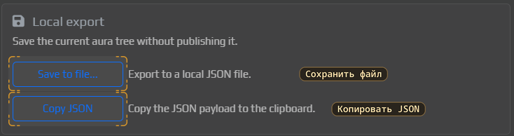
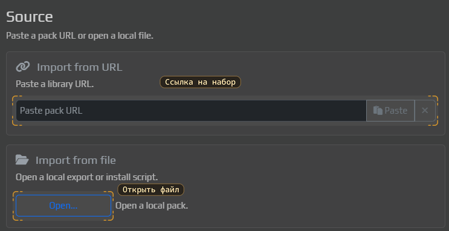
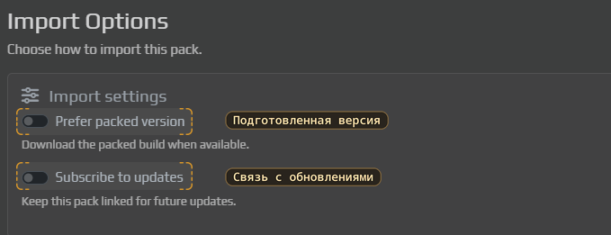

# Сохранить свой набор аур и открыть его копию

Экспорт сохраняет выбранную ауру, дерево или папку с содержимым в JSON. Например, перед правками можно сделать копию набора, импортировать её рядом и сравнить с исходной. Публиковать что-либо на сайте для этого не нужно.

Для первой пробы возьмите свою небольшую папку `Проба переноса` с одной отключённой аурой. Чужой Pack с закрытым содержимым не подойдёт: его права могут запрещать экспорт.

1. Выберите папку в дереве и откройте **Share/Export** кнопкой экспорта или **Ctrl+S**. На странице **Content** проверьте, что в набор попали нужная папка и её содержимое.
2. Если видите **Missing linked objects detected**, проверьте зависимости. **Add linked objects** добавляет найденные связанные объекты, которых ещё нет в наборе. После этого снова просмотрите **Content**.
3. Откройте **Destination → Local export → Save to file…** и сохраните JSON в свою папку. Готовый файл можно найти кнопкой **Open in Explorer**. Закройте окно экспорта.

   
4. Нажмите **Import**, затем **Source → Import from file → Open…** и выберите сохранённый файл. Просмотрите **Preview**: состав и пути должны совпадать с вашей папкой.
5. Исходные объекты уже существуют, поэтому откройте **Import Options** и выберите **Copy**. Исходные элементы останутся, а новые получат свои идентификаторы. **Replace** здесь не выбирайте.
6. Найдите импортированную копию в дереве. Переименуйте её ауру и убедитесь, что имя исходной ауры не изменилось. Не включайте обе, пока не проверите настройки и внешние зависимости.

Обычный импорт кладёт элементы по путям из файла. Папка, выделенная перед открытием окна, местом назначения не становится. Где окажутся элементы, смотрите в **Preview**.

## Что переносится

| Вариант | Содержимое и назначение |
| --- | --- |
| Выбранная аура или дерево | Настройки выбранного элемента. |
| Папка | Папка со всеми вложенными папками, аурами и деревьями. |
| Save to file… / Copy JSON | Локальный JSON выбранного набора. Copy JSON кладёт его в буфер обмена. |
| Publish | Загружает набор на сайт и даёт ссылку на публикацию. |
| Переносимый Pack | Отдельный комплект с программой и конфигурацией для запуска. См. [Паки](/ru/features/packs). |

Встроенные ресурсы экспортируются вместе с данными. А вот путь к внешнему файлу, имя окна, установленный драйвер или доступ к стороннему сервису на другом ПК сами не заработают. При создании копии связи внутри набора могут переназначаться. Произвольные строки в вашем коде и ссылки на объекты, оставшиеся снаружи, программа сама не исправляет.

Экспорт не убирает секреты из полей настроек. Перед передачей проверьте токены, пароли, адреса и содержимое ресурсов.

## Импортировать по ссылке и выбрать способ обновления

1. В **Source** вставьте ссылку на публикацию. Посмотрите её имя, описание и владельца.
2. Нажмите **Download**. Содержимое загрузится и откроется **Preview**. На страницах **Overview** и **Pack Options** можно до импорта прочитать описание и настройки автора.
3. В **Import Options** выберите режим, затем нажмите **Import** или нужную кнопку разрешения конфликтов. Импортируется весь загруженный набор, а не элемент, отмеченный в превью.

| Import Options | Когда выбирать |
| --- | --- |
| Prefer packed version | Чтобы получить вариант содержимого, подготовленный автором, если он есть. При политике Packed Only выбор может быть включён принудительно. |
| Subscribe to updates | Чтобы связать локальную папку с публикацией и получать обновления. Текущая версия применяется сразу. Для обычного JSON без публикации не используется. |
| Clone locally | Доступен вместе с подпиской. Создаёт отдельные локальные ID, но сохраняет связь с источником. Подходит для нескольких копий одного Pack. |
| Без подписки | Разовый импорт. Следующая версия автора сама эту копию не заменит. |

| Конфликт | Что произойдёт |
| --- | --- |
| Replace | Существующие элементы с конфликтом заменяются импортированными. Отдельные настройки при этом не сливаются. |
| Copy | Старые элементы остаются, новые добавляются как отдельные копии с другими ID и согласованными путями. |
| Ignore Conflicts | Новые элементы с конфликтом пропускаются, остальные импортируются. |

При обычном импорте, если общий вариант не выбран, могут появляться отдельные вопросы **Ignore / Replace / Copy** и варианты **… All**. При подписке папка синхронизируется с источником — это не разовая независимая копия. Локальный клон не предназначен для того, чтобы публиковать его заново как оригинал.

Форма также принимает подготовленный установочный файл и JSON из буфера обмена.

Перед публикацией задайте через [права папки](/ru/features/permission-model), что получатель сможет смотреть и менять. Например, **Configurable** разрешает настраивать открытые свойства, а действия и триггеры оставляет только для чтения.

Опубликовать новый набор или обновить свой

1. Откройте экспорт. Для новой публикации оставьте URL в **Destination** пустым. В **Overview** задайте имя и описание, проверьте **Content** и **Pack Options**.
2. Нажмите **Publish**. После загрузки появится ссылка.
3. Чтобы выпустить новую ревизию, вставьте адрес существующей публикации в **Destination**, проверьте загруженные сведения и нажмите **Update**.

Окно экспорта проверяет владельца по аккаунту, под которым вы вошли, и может не дать обновить чужую публикацию.

Ссылка и присутствие в публичной библиотеке — разные вещи. Если URL никто не знает, это ещё не защита: ограничения содержимого и права публикации задаются отдельно.

