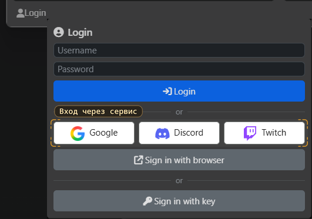

# Войти в свой аккаунт EyeAuras через другой сервис

В EyeAuras можно войти через Google, Twitch или Discord. Пароль сервиса вы вводите на его сайте. EyeAuras этот пароль не получает — только свой сеанс.

Какие сервисы доступны, зависит от настроек сайта.

## Сначала сохранить связь с существующим аккаунтом

Если в EyeAuras уже есть ваши лицензии и история, сначала привяжите сервис к этому аккаунту. Иначе первый вход через непривязанный сервис может создать другой аккаунт.

1. Войдите на [сайт EyeAuras](https://eyeauras.net/my) как обычно и откройте `Profile`.
2. В разделе способов входа выберите сервис и привяжите его. В браузере подтвердите именно свою учётную запись этого сервиса.
3. Вернитесь в профиль и проверьте, что сервис отмечен как связанный с вашим аккаунтом.
4. В приложении откройте `Login` и нажмите кнопку этого сервиса. Завершите вход на сайте и подтвердите запрос приложения.
5. Вернитесь в EyeAuras. Приложение должно показать ваш аккаунт с прежними лицензиями. Если аккаунт не тот, не переносите лицензии наугад — сначала проверьте связь в профиле.

Кнопки Google, Discord и Twitch находятся под обычным входом по имени и паролю.

Если вы новый пользователь и сохранять нечего, первый вход через сервис может создать аккаунт EyeAuras без отдельной регистрации.

Автоматическая привязка по почте возможна только когда она включена в настройках сайта, адрес подтверждён и ему подходит ровно один аккаунт. Если подходящих аккаунтов несколько, они не объединяются. Если адрес уже занят, а безопасно привязать сервис нельзя, войдите в существующий аккаунт и свяжите сервис в `Profile`.

| Способ | Что используется |
|---|---|
| Кнопка Google, Twitch, Discord или другого доступного сервиса | Вход через выбранный сервис и его связь с аккаунтом EyeAuras. |
| `Sign in with browser` | Открытый сеанс сайта EyeAuras, если он есть, и подтверждение запроса приложения. |
| Имя и пароль EyeAuras | Данные самого аккаунта EyeAuras. Пароль внешнего сервиса сюда не подходит. |
| `Sign in with key` | [Вход по лицензионному ключу](/ru/features/keylogin), отдельный способ. |

Сохранённые данные входа приложение защищает средствами Windows.

Если окно `Login` закрылось, когда открылся браузер, откройте его снова: запрос можно продолжить или отменить. Если запрос истёк или вы перезапустили приложение, начните вход заново.

## Выйти или сменить аккаунт

`Logout` завершает сеанс **приложения**. Сеансы сайта EyeAuras и внешнего сервиса в браузере остаются отдельными. Чтобы сменить пользователя, переключите аккаунт на сайте, а если нужно — и в самом сервисе. Затем снова начните вход из приложения.

Сервис можно отвязать в профиле отдельным действием с подтверждением, когда это разрешено для текущего сеанса. Сначала убедитесь, что у вас остаётся другой способ входа.

Создать или восстановить пароль EyeAuras

Если знаете текущий пароль, измените его в `Profile`: укажите текущий и новый пароль. После смены придётся войти снова.

Если пароля нет или вы его забыли:

1. В `Profile` откройте `Password`. Если пароль уже есть — `Forgot this password?`.
2. Подтвердите учётную запись через один из **уже связанных и сейчас доступных** сервисов: `Confirm your linked … account`.
3. После возврата отдельно нажмите `Create password` либо `Reset password`. Само подтверждение сервиса пароль не создаёт. `Cancel` отменяет подготовку.
4. Сохраните показанные `Username` и пароль, затем отметьте `I've saved it`. Пароль показывается только один раз, в этом ответе. При этом он не одноразовый — им можно входить и дальше. Вместо имени пользователя не подставляйте адрес почты сервиса наугад.

Сброс заменяет прежний пароль EyeAuras, и после него нужно войти заново. Связи с внешними сервисами сохраняются. Если подтверждение истекло, вернитесь в профиль и начните заново. Если связанного доступного сервиса нет, пользуйтесь прежними способами входа. Имя пользователя через этот раздел не меняется.

