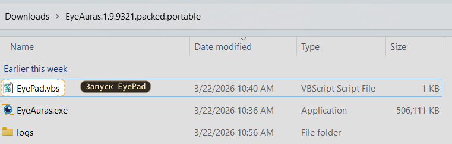
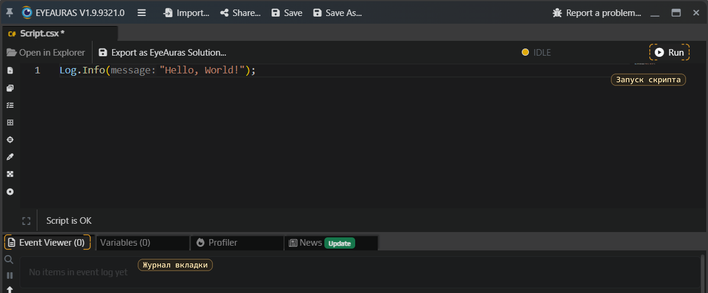

# Открыть отдельный скрипт в EyePad

EyePad запускает ваш C#-файл без ауры в основном дереве. Это режим того же `EyeAuras.exe`: код выполняет скриптовый движок EyeAuras, а во вкладке есть редактор, журнал и кнопки запуска.

Нужна установленная или портативная EyeAuras с поддержкой EyePad и свой файл `Script.csx`. Начните с [минимального примера](/ru/scripting/examples/basic/hello-world). Чужой код сначала прочитайте: у вкладок разные рабочие деревья, но от самого кода это систему не защищает.

1. В папке программы запустите `EyePad.vbs`, если он есть в вашей поставке. Либо выполните из этой папки:

```text
EyeAuras.exe --pad
```



2. Через меню `File` → `Open...` выберите свой `Script.csx`.
3. Нажмите `Run`. Сообщение из скрипта появится в журнале выбранной вкладки. Скрипт с одной записью в журнал завершится сам. Если скрипт работает долго, есть `Stop` и `Restart`.
4. Сохраните изменения через `Save`. Для нового файла выберите `Save As...` и укажите свой путь.



## Какой файл открыть

| Формат | Что получает EyePad |
| --- | --- |
| `.csx`, `.cs` | Отдельный C#-скрипт. Код верхнего уровня получает контекст EyeAuras. Обычный библиотечный класс сам точкой входа не становится. |
| `.sln` | Решение с проектом скрипта и синхронизацией с диска. В EyePad файлы решения доступны только для чтения — меняйте их в IDE. |
| `.dll` | Подготовленную сборку скрипта. В произвольной DLL подходящей точки входа может не быть. |
| `.json` | Конфигурацию ауры или скрипта EyeAuras, а не любой JSON-документ. |

Чтобы сразу открыть файл при запуске, передайте путь после `--pad`. Пути ниже замените своими:

```text
EyeAuras.exe --pad "config\auras\HW\Script.json"
```

```text
EyeAuras.exe --pad "D:\Projects\MyTool\MyTool.sln"
```

```text
EyeAuras.exe --pad "D:\Projects\MyTool\Script.csx"
```

Сам аргумент режима:

```text
--pad
```

## Продолжить работу в IDE или с паком

Если проект состоит из нескольких файлов, откройте экспортированное `.sln`. EyePad загрузит проект и начнёт `Live Import`. Сохранили код в IDE — дождитесь обновления и запустите снова. Как экспортировать проект и какие у синхронизации ограничения — в [интеграции с IDE](/ru/scripting/ide-integration).


Через `Import...` можно загрузить готовый пак во временную рабочую область и поменять доступные скрипты и настройки. Результат нужно явно экспортировать или опубликовать: сам импорт ничего не публикует. Что можно редактировать, зависит от [прав пакета](/ru/features/permission-model).


У каждой вкладки своё виртуальное дерево аур и своё состояние. Импортированный или новый пак нужно сохранить явно.

<details>
<summary>Что доступно для больших проектов</summary>

EyePad работает на C# и Roslyn и поддерживает [NuGet](/ru/scripting/nuget), [встроенные ресурсы](/ru/scripting/embedded-resources), [Blazor Windows](/ru/scripting/blazor-windows/1-intro) и [ImGui](/ru/scripting/imgui/getting-started).

Триггеры, действия, макросы и деревья поведения удобнее настраивать в основном интерфейсе EyeAuras. Если хотите запускать своё приложение поверх скриптового движка, смотрите [mini-app](/ru/features/mini-app).

</details>
