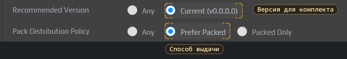

# Собрать своё мини-приложение на базе EyeAuras

Мини-приложение — это ваш скрипт с окном, упакованный вместе с EyeAuras и нужной конфигурацией. Пользователь запускает его и сразу видит вашу панель, а не собирает ауру вручную. Так можно сделать утилиту, панель, кликер или что-то ещё. Это не отдельный язык, и зависимости у такой поставки могут остаться.

Нужны свой работающий проект, права на его распространение и доступные ему компоненты. Для начала возьмите одно окно из [руководства Blazor](/ru/scripting/blazor-windows/getting-started), без внешних действий. Главный Script.csx должен ждать, пока окно закроют, например через ShowDialog(cancellationToken), а затем освобождать его в явном блоке using. Если скрипт откроет окно и сразу закончится, такой запуск не сработает.

## От своего окна до запускаемого комплекта

1. Создайте папку **HW** и в ней ауру **Script** с главным **C# Script**. Настройте окно по руководству выше и проверьте обычным **Run**, что оно открывается и закрывается. Интерфейс EyeAuras пока не скрывайте — он пригодится для диагностики.
2. Откройте для папки **Share/Export**, проверьте **Content** и зависимости. В **Pack Options** задайте **Application name**, например `MyPanel`, и нужную **Recommended Version**. Упаковывайте именно свой законченный набор.

   
3. В **Command line** укажите режим EyePad и целевой файл набора. Пример для структуры HW/Script:

```text
--pad --ui normal "config/auras/HW/Script.json"
```

4. Сверьте путь с реальным файлом конфигурации. В путь входят имена ваших папок и аур, поэтому путь из чужого примера вам не подойдёт. **Publish** создаёт публикацию, **Update** обновляет уже существующую. Как готовить и упаковывать набор локально — в [паках](/ru/features/packs). Публикация — отдельный шаг: данные уходят на сервер.
5. Скачайте комплект своей публикации через **Download pack**, распакуйте в отдельный каталог и запустите его исполняемый файл. Сравните с исходным запуском: должна открыться ваша панель, и ей должны быть доступны нужные ресурсы. Появилась ссылка — ещё не значит, что сборка успешно завершилась.
6. Когда обычный запуск работает, можно заменить `--ui normal` на `--ui splashOnly` и добавить `--readiness script`. В этом режиме основное окно скрыто, а когда целевой запуск заканчивается, EyePad завершает приложение. Закрытие вашей панели должно завершать скрипт, который её ждёт.

Самый короткий способ открыть EyePad без целевого файла:

```text
EyeAuras.exe --pad
```

В переносимой поставке может быть вспомогательный EyePad.vbs. Параметр --pad работает и без него.

На старом снимке — скрипт с отдельным окном. Пространства имён и способ создания окна берите из текущего руководства, а не из кода на картинке.


## Какие параметры влияют на запуск

| Параметр | Что задаёт |
| --- | --- |
| --pad | Оболочку EyePad, которая открывает и запускает целевой файл. |
| --ui normal | Обычный интерфейс. Удобен для первой проверки комплекта. |
| --ui splashOnly | Заставку без основного окна. Ваш интерфейс при этом должен открыть сам скрипт. |
| --readiness app | Готовность после загрузки оболочки. |
| --readiness script | Готовность на этапе подготовки запуска скрипта. Ваши окна, модели и внешние соединения к этому моменту могут быть ещё не готовы. |
| --read-only | Запрет сохранять изменения штатной конфигурации. Ваш код при этом всё ещё может писать файлы и обращаться к сервисам. |
| --publish-single-file | Просьбу к серверному сборщику подготовить поставку одним файлом. Не каждый проект удастся уместить в один файл. |
| --acceptLicense | Автоматическое принятие стандартного соглашения при запуске. Лицензию, ключ или доступ к платному паку это не выдаёт. |
| Последний аргумент с путём | Что открыть и выполнить. Для ауры это её фактический файл конфигурации. |

Полный пример для подготовленного набора:

```text
--pad --read-only --publish-single-file --ui splashOnly --readiness script --acceptLicense "config/auras/HW/Script.json"
```

Настройки опубликованной папки меняются в **Synchronization → Pack Options**. На старом снимке раздел назывался Pack Config. После изменения сохраните параметры и подготовьте новую ревизию. Уже скачанный комплект сам не изменится.


## Выбрать устройство проекта

| Вариант | Когда подходит |
| --- | --- |
| Один .csx или .cs | Небольшая утилита или прототип. Отдельный [ImGui](/ru/scripting/imgui/getting-started) нужно подключать самому вместе с его ресурсами. |
| Несколько файлов, Razor и NuGet | Панель со своей логикой: [Blazor Windows](/ru/scripting/blazor-windows/1-intro) и [встроенные ресурсы](/ru/scripting/embedded-resources). |
| .sln и IDE | Разработка через экспорт и [Live Import](/ru/scripting/ide-integration). Не каждый вспомогательный проект решения попадает в запускаемый скрипт. |
| Фоновая работа или оверлей | Отдельное окно необязательно. Но главный запуск должен жить, пока идёт работа, и владеть её ресурсами. |

Обычный пак передаёт набор, с которым пользователь работает в EyeAuras. В мини-приложении главное — ваша логика и ваш UI. В него могут входить ауры, макросы, деревья, захват изображения, работа с памятью и другие подключённые возможности. Модуль, которого нет, упаковка сама не добавит.

Код, DLL, изображения, шрифты, видео и модели должны попасть в поставку подходящим способом. Ссылка на внешний файл не заменяет [Embedded Resources](/ru/scripting/embedded-resources). Права, [защита скриптов](/ru/features/script-protection), [саблицензии](/ru/features/sublicenses) и обновления настраиваются отдельно. Скрытый интерфейс не отменяет авторизацию и сетевые зависимости.

[Пример мини-приложения](https://eyeauras.net/share/S20251105201607zPUUkZryl4CY) показывает, как выглядит такая поставка. Картинка ниже — из этого примера.


Что читать дальше: [EyePad](/ru/features/eyepad), [основы скриптов](/ru/scripting/getting-started) и [отчёты мини-приложений](/ru/features/problem-reports).
