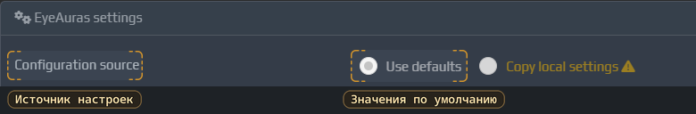
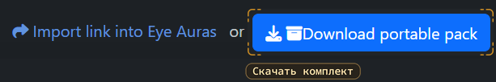
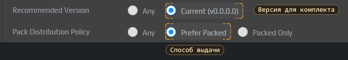

# Подготовить свой набор для отдельного запуска

**Pack** — это готовая папка аур вместе с EyeAuras и нужной конфигурацией. Получатель распаковывает архив и запускает его отдельно от установленного EyeAuras. Так можно передать, например, настроенный экран состояния со всеми аурами, и человеку не придётся импортировать их по одной.

Нужны свой проверенный набор, аккаунт для публикации от своего имени и доступ к сайту EyeAuras. Перед упаковкой отключите лишние автоматические действия и уберите личные секреты. Если нужна просто копия аур без программы, хватит [JSON-экспорта](/ru/features/export-import).

## Создать публикацию и получить переносимый комплект

1. Выберите корневую папку набора. Откройте её публикацию через **Publish/Synchronize** в контекстном меню или через окно экспорта. Для нового набора оставьте адрес назначения пустым, проверьте **Content** и задайте имя в **Overview**.
2. В **Pack Options** начните с **Configuration source = Use defaults**, **Recommended Version = Current**, **Pack Distribution Policy = Any**. Если набор можно отдавать с исходниками, оставьте **Script Compilation Mode = Script Only**, а защиту — **None**. Не скрывайте главное окно заранее, пока у набора нет своего интерфейса.

   
3. Нажмите **Publish**. В старом окне эта кнопка называлась **Publish folder**. После публикации у папки появятся сведения об источнике и ревизии.
4. Откройте ссылку публикации и выберите **Download portable pack**. Дождитесь подготовки и скачайте архив.
5. Распакуйте архив в отдельную папку, не поверх рабочей установки. Запустите исполняемый файл из архива и проверьте, что загрузился именно ваш набор. Внешние окна, файлы, драйверы и сервисы, которые ему нужны, должны быть и на этом ПК.

По сведениям синхронизации видно, какая публикация связана с папкой. Ссылка рядом с названием ведёт на веб-страницу набора.

## Что входит в комплект

| Часть | Граница переноса |
| --- | --- |
| Программа | Подготовленная версия EyeAuras с файлами для отдельного запуска. Системные требования приложения при этом остаются. |
| Конфигурация | Настройки, которые автор выбрал для комплекта. Use defaults берёт исходные значения с заданными переопределениями. Copy local settings переносит больше локальных настроек. |
| Содержимое папки | Ауры, макросы, деревья и скриптовые проекты набора с подготовленными ресурсами. Внешние зависимости проверьте отдельно. |
| Данные работы | Своя папка данных комплекта. История вашей установленной копии получателю не передаётся. |

Обычная **Standalone**-установка и распакованный Pack не зависят друг от друга. Pack не нужно регистрировать в списке установленных программ.

## Выбрать политику распространения

| Pack Distribution Policy | Что предлагается получателю |
| --- | --- |
| Any | Импорт содержимого и переносимый комплект. |
| Prefer Packed | Предпочтителен подготовленный вариант. Исходники при этом не запрещены: другой поддерживаемый способ может остаться доступен. |
| Packed Only | Обычному получателю нужен подготовленный вариант. Это политика выдачи: сама она скрипты не компилирует и их текст не удаляет. |

В текущем импорте **Prefer packed version** запрашивает подготовленное содержимое публикации. Это не то же самое, что скачать ZIP с программой: содержимое может импортироваться в уже запущенный EyeAuras. Какие варианты доступны, решают проверка владельца и политика сервера.

| Script Compilation Mode | Что включается в подготовленное содержимое |
| --- | --- |
| Script Only | Исходные скрипты. Компилируются у получателя. |
| Script w/ Binaries | Исходники и заранее собранные файлы. |
| Binaries Only | Готовые сборки вместо исходного текста скриптов. Восстановить логику по ним всё равно можно. |

**Script Protection Mode** выбирается отдельно и доступен при **Binaries Only**: **None**, **Performance-first**, **Security-first**. Его ограничения и подготовка описаны в [защите C#-скриптов](/ru/features/script-protection). Откуда взялась эта возможность — в [старом анонсе бинарной упаковки](/ru/changelogs/7994).

Если получатель должен менять только выбранные значения, задайте [права папки](/ru/features/permission-model) до распространения. Если доступ должен быть по ключу, используйте [сублицензии](/ru/features/sublicenses): через них работают текущая аренда продукта и обработка потери доступа.

Дополнительные параметры и локальная упаковка

| Настройка | Когда нужна |
| --- | --- |
| Output Directory | Каталог, куда попадёт результат локальной упаковки. Выберите для него отдельное место. |
| Application name / Icon | Имя приложения и значок. |
| Recommended Version: Any / Current | Любая допустимая версия или рекомендация текущей версии автора. |
| Configuration source | С Use defaults переносится меньше личных настроек. После Copy local settings проверьте результат. Данные входа EyeAuras очищаются специально, а поля ваших скриптов сами не очищаются. |
| Packing Mode | Embed everything кладёт готовое содержимое в комплект. Install on startup добавляет установочный материал для первого запуска. |
| Security Measures / Check for Updates / Pause Everything if Active | Переопределяют поведение комплекта: Not set, Enable или Disable. |

В приложении у папки есть ещё пункт **Pack…**. Для этого локального пути нужен доступ Alpha и включённое файловое хранение конфигурации. Выберите **Output Directory**, просмотрите **Preview**, нажмите **Pack**. После **Packed Successfully** кнопка **here** открывает папку результата, а **run** запускает комплект.

Для своего интерфейса можно подготовить [Blazor-окно](/ru/scripting/blazor-windows/getting-started) или [мини-приложение](/ru/features/mini-app). Сначала добейтесь, чтобы оно запускалось, и только потом скрывайте основное окно.

