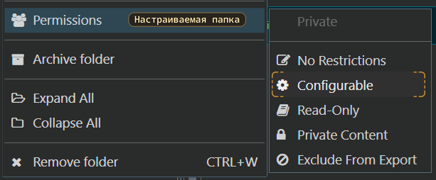
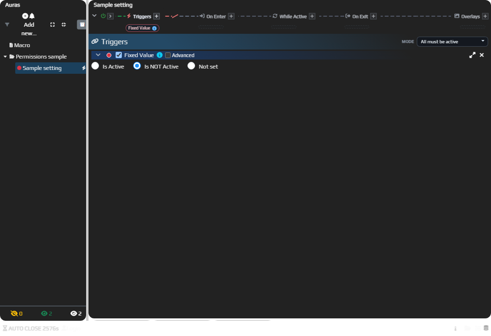
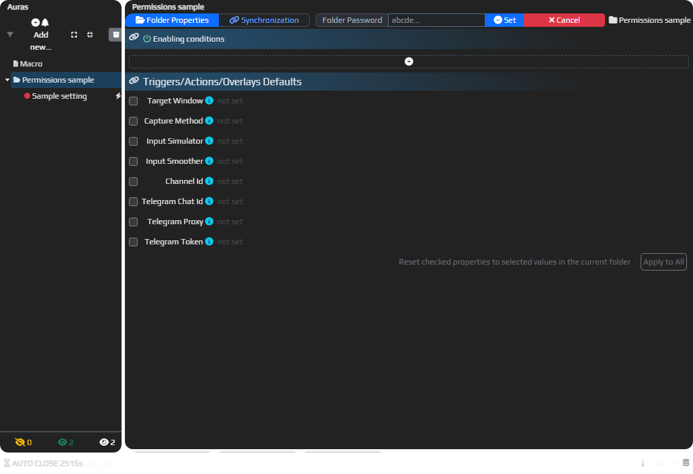
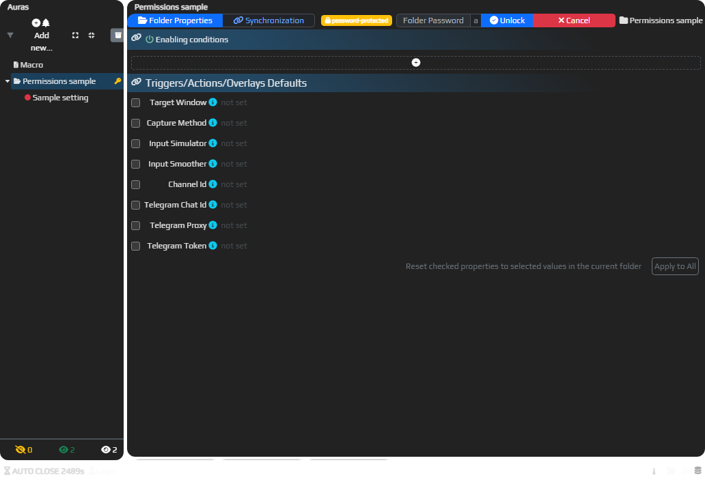
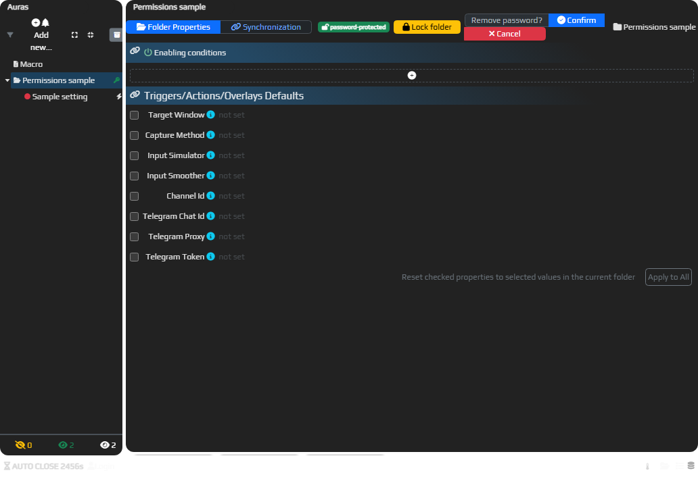

# Разрешить настройку набора, сохранив его структуру

Права папки определяют, что получатель может делать с вашим набором. Например, можно разрешить менять значения существующих элементов, но запретить добавлять и удалять части папки. Для этого подходит режим **Configurable**.

Нужны своя папка, вход в EyeAuras и право менять её ограничения. Проверять ограничение под владельцем бесполезно: у него всегда полный доступ.

1. Выберите свою папку и откройте контекстное меню **Permissions → Configurable**.
2. Посмотрите на заголовок **Folder Properties**: там должны появиться уровень и **owned by you (…)**. Когда ограничения назначаются впервые, владельцем становится текущий пользователь.
3. Подготовьте значения, которые пользователь сможет менять, например имя целевого окна в существующем триггере. Получатель настраивает уже созданные элементы, а не строит структуру заново.
4. Чтобы увидеть набор глазами получателя, откройте тестовую копию под другой учётной записью, без прав владельца. Настройки существующих элементов доступны в пределах выбранного режима, а добавление и удаление структуры ограничены.
5. Чтобы снять ограничение, выберите **Permissions → No Restrictions**. Смена режима также сбрасывает пароль этой папки.

В текущем меню приватный режим называется **Private Content**, а обычный — **No Restrictions**.

У своей папки сведения о владельце зелёные. У чужой они выглядят иначе:

## Выбрать уровень

| Пункт Permissions | Что доступно обычному получателю |
| --- | --- |
| No Restrictions | Обычное редактирование, добавление и удаление. В модели это Default. |
| Configurable | Можно менять настройки существующих элементов, но не их состав и структуру. |
| Read-Only | Просмотр без редактирования. Выполнять уже настроенную логику это не запрещает. |
| Private Content | Получатель не может смотреть, менять, копировать и обычным способом экспортировать содержимое. В модели это Private. |
| Exclude From Export | Помечает локальное содержимое как LocalOnly. В снимки синхронизации такие элементы не попадают. Не рассчитывайте, что метка уберёт секреты при любом способе сериализации. |

Ограничения наследуются от родителя. Поэтому у вложенной папки смотрите на итоговый уровень всей цепочки, а не только на её собственный. Владелец и тот, кто разблокировал папку паролем, получают в приложении полный доступ.

## Временно открыть закрытую папку по паролю

Пароль нужен, когда надо пустить человека в закрытую папку, не отдавая свой аккаунт. Это пароль папки, а не пароль входа EyeAuras и не ключ лицензии.

1. У своей папки с **Private Content** нажмите **add password…** в заголовке, введите пароль и нажмите **Set**. Кнопка есть и в обычном режиме без ограничений. Пароль сам закрывает папку для получателя, пока тот её не разблокирует.
2. Получатель нажимает **unlock…**, вводит **Folder Password** и нажимает **Unlock**. После этого у него полный доступ в этой локальной работе. Владелец папки не меняется.
3. После работы нажмите **Lock folder**. Чтобы снять пароль, выберите **remove password… → Confirm**. Для этого нужен соответствующий доступ.

Права локальной папки не решают, кто может менять публикацию на сайте. У публикации свой владелец и серверные роли **Viewer / Editor / Manager**. Видеть исходники, редактировать папку, обновлять публикацию и запускать продукт по [сублицензии](/ru/features/sublicenses) — это четыре разных разрешения. Закрытый интерфейс не гарантирует, что код нельзя извлечь. Для распространения посмотрите [упаковку](/ru/features/packs) и [защиту скриптов](/ru/features/script-protection).
