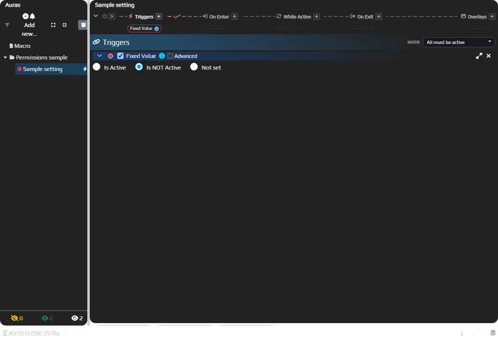
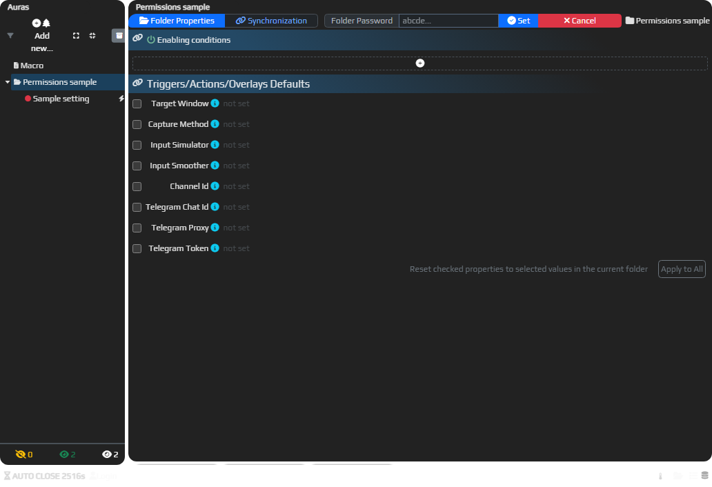
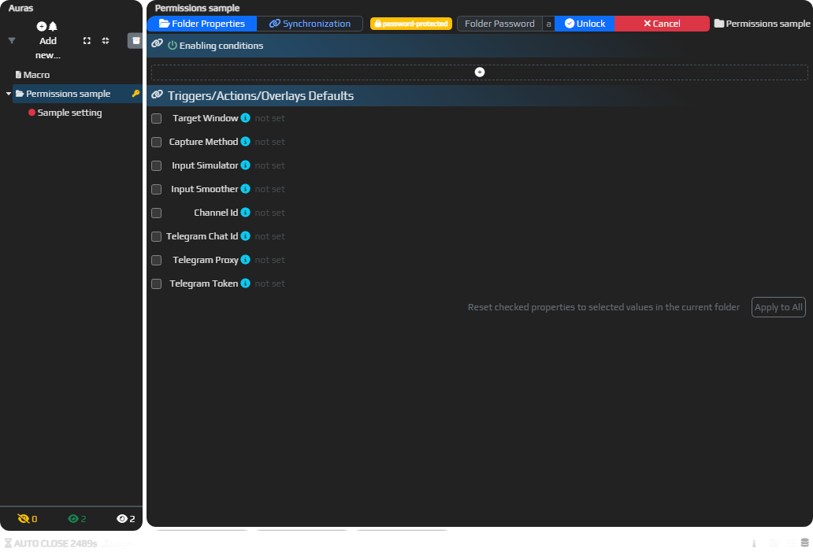
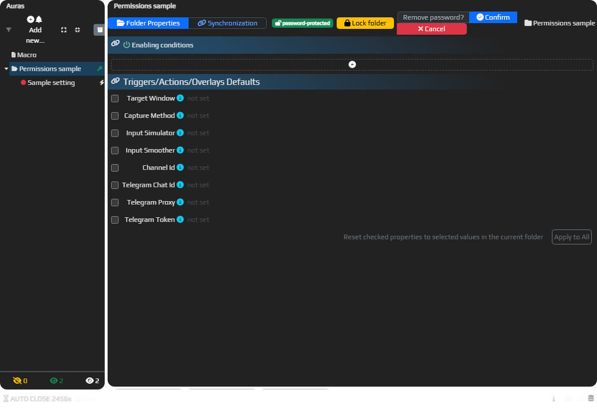

# Разрешить настройку набора, сохранив его структуру

Права папки помогают отделить настройки получателя от внутреннего устройства набора. Например, автор может разрешить менять значения существующих элементов, но запретить добавление и удаление частей готовой папки. Для этого подходит **Configurable**.

Нужны своя папка, вход в EyeAuras и право менять её ограничения. Не проверяйте ограничение только глазами владельца: для него сохраняется полный доступ.

1. Выберите свою папку и откройте контекстное меню **Permissions → Configurable**.
2. Проверьте заголовок **Folder Properties**: должны появиться уровень и **owned by you (…)**. При первом назначении ограничений владельцем становится текущий пользователь.
3. Подготовьте доступные пользователю значения, например имя целевого окна в существующем триггере. Получатель должен настраивать уже созданные элементы, а не достраивать структуру заново.
4. Для проверки получателя откройте свою тестовую копию под заранее подготовленной учётной записью без прав владельца. Настройки существующих элементов доступны в пределах выбранного режима, а добавление и удаление структуры ограничены. Если проверяете под владельцем, отсутствие блокировки ожидаемо.
5. Чтобы снять собственное ограничение, выберите **Permissions → No Restrictions**. Учтите, что смена режима также сбрасывает пароль этой папки.

На старом снимке показано меню уровней. В текущем меню приватный режим называется **Private Content**, а обычный — **No Restrictions**.

Зелёные сведения владельца и сведения о чужой папке означают разные условия проверки:

## Выбрать уровень

| Пункт Permissions | Что доступно обычному получателю |
| --- | --- |
| No Restrictions | Обычное редактирование, добавление и удаление. В модели это Default. |
| Configurable | Изменение настроек существующих элементов без свободного изменения их состава и структуры. Не равен режиму «можно делать с набором всё». |
| Read-Only | Просмотр без редактирования. Это не запрет выполнения уже настроенной логики. |
| Private Content | Содержимое закрыто для просмотра, изменения, копирования и обычного экспорта получателем. В модели это Private. |
| Exclude From Export | Помечает локальное содержимое как LocalOnly; снимки синхронизации исключают такие элементы. Не используйте метку как универсальную очистку секретов во всех возможных способах сериализации. |

Первый снимок ниже показывает текущий локальный пример без ограничений. Следующие три сохраняют прежние виды получателя: настройку готовых элементов, просмотр и закрытое содержимое.

В этом изолированном примере вход в аккаунт не выполнен и владелец не назначен. Без ограничений и пароля папки доступны существующие настройки **Fixed Value** и кнопки добавления. Значение изменено через UI и возвращено в **Is NOT Active** перед снимком. Это исходное состояние для проверки редактирования, а не проверка ограничений получателя.

Ограничения наследуются от родителя: вложенная папка не должна рассматриваться отдельно от эффективного уровня всей цепочки. Владелец и разблокировка по паролю дают полный доступ в приложении. Права закрытого родителя могут влиять на видимость и редактирование вложенных элементов.

## Временно открыть закрытую папку по паролю

Пароль полезен, когда нужно дать доступ к закрытой папке без передачи своего аккаунта. Это пароль папки, а не пароль входа EyeAuras и не ключ лицензии.

1. У своей папки с **Private Content** откройте **add password…** в заголовке, введите свой пароль и нажмите **Set**. Кнопка также доступна при обычном режиме без ограничений; наличие пароля само закрывает папку для получателя до разблокировки.
2. Получатель нажимает **unlock…**, вводит **Folder Password** и нажимает **Unlock**. Успешная разблокировка даёт полный доступ в этой локальной работе; владельца она не меняет.
3. После работы нажмите **Lock folder**. Для снятия пароля используйте **remove password… → Confirm**, если у вас есть соответствующий доступ.

Текущие панели ниже относятся к тому же локальному примеру без входа в аккаунт и без назначенного владельца. В заголовке папки без ограничений доступно **add password… → Folder Password / Set**. Поле пустое; показан ввод пароля, а не назначение ограничений владельцем.

Затем через настоящий UI задан вымышленный учебный пароль папки. Сессия по-прежнему не являлась владельцем, а эффективный доступ стал Private. Кнопка **unlock…** открывает показанную ниже пустую панель **Folder Password / Unlock**. Это разблокировка пользователем без прав владельца, а не показ аккаунта другого владельца.

После настоящей разблокировки через UI та же сессия без прав владельца получила полный локальный доступ. На снимке одновременно видны **Lock folder** и **Remove password? → Confirm**. Показаны доступные элементы управления и неподтверждённый запрос удаления; завершённое удаление не демонстрируется.

Права локальной папки не определяют, кто вправе изменять публикацию на сайте. У публикации отдельно есть владелец и серверные роли **Viewer / Editor / Manager**. Право видеть исходники, редактировать папку, обновлять публикацию и запускать продукт по [сублицензии](/ru/features/sublicenses) — разные разрешения. Закрытый интерфейс также не является обещанием невозможности извлечь код; для распространения рассмотрите [упаковку](/ru/features/packs) и [защиту скриптов](/ru/features/script-protection).
