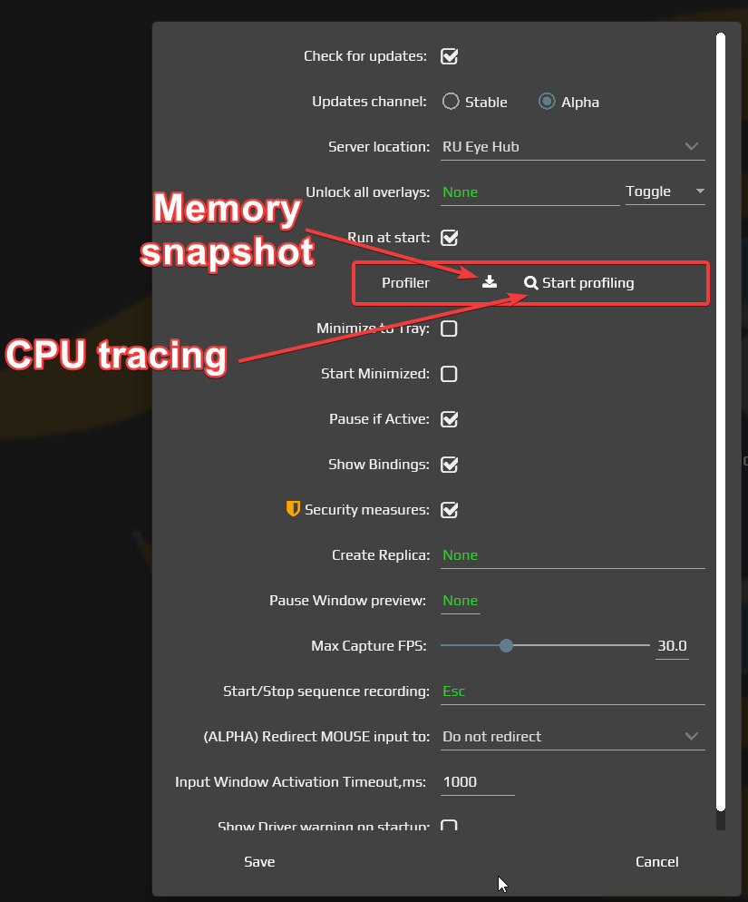

# Профилирование производительности и памяти

Чтобы выяснить, чем занят EyeAuras во время задержек, запишите короткий профиль собственной нагрузки. Он сохраняется локально и помогает разбирать работу процесса. Если проблема — постоянный рост памяти, нужен другой результат: снимок объектов памяти, а не запись времени.

| Инструмент | Когда выбирать |
| --- | --- |
| Settings → Profiler | Запись работы процесса через JetBrains dotTrace: задержки, высокий CPU, неизвестное узкое место |
| Memory snapshot | Снимок памяти через JetBrains dotMemory, когда рост уже заметен. Доступность кнопки зависит от редактора настроек |
| Нижняя панель Profiler | MiniProfiler: время заранее размеченных операций, а не автоматический анализ всех методов. Панель добавляется при наличии alpha-доступа |
| FPS в предпросмотре CV | Быстрая проверка времени захвата, эффектов и анализа конкретного триггера |

Инструменты dotTrace/dotMemory могут загружать необходимые компоненты при первом запуске, увеличивать нагрузку и создавать большие файлы. Снимок памяти содержит данные процесса; перед передачей кому-либо проверьте состав материалов.

## Записать собственный поиск по изображению

Для опыта возьмите свою ауру с уже настроенным [захватом окна](/ru/triggers/images/imagecapturetriggers) и поиском, без действий ввода. Оставьте ту же область, частоту и эффекты, при которых возникает задержка.

1. Откройте `Settings`, строку `Profiler`, и нажмите `Start profiling`. Дождитесь состояния `Collecting`. Само нажатие ещё не подтверждает начало: сначала могут готовиться компоненты профилировщика.
2. Оставьте свой поиск работать в обычном режиме и запомните время заметной задержки. Для первого опыта достаточно короткого воспроизводимого интервала; если проблема появляется постепенно, запись может занимать 10–30 минут.
3. Нажмите `Stop profiling`. EyeAuras сохраняет собранные данные в архив, затем отсоединяет профилировщик. Дождитесь завершения и состояния `Idle`; `Running` означает, что он ещё подключён.
4. Найдите созданный `Performance-PID…` архив в каталоге данных текущего экземпляра EyeAuras, подпапке `traces`. Путь также записывается в журнал при сохранении.
5. При подготовке обращения откройте `Report a problem` и проверьте список файлов. Создание архива и открытие этого окна ещё не отправляют его; передача через `Send` — отдельное действие в [отчёте о проблеме](/ru/features/problem-reports).

Результат — локальный архив профиля с записанным интервалом. Он показывает работу процесса, а не готовый диагноз и не отдельный GPU-профиль. Если на коротком интервале задержка не повторилась, такой архив не доказывает её отсутствие.

| Элемент | Что наблюдать |
| --- | --- |
| Start profiling | Начинает сбор после подготовки и подключения dotTrace |
| Collecting | Данные собираются; продолжайте обычную воспроизводимую нагрузку |
| Stop profiling | Сохраняет данные, создаёт архив и отсоединяет профилировщик |
| Running | Профилировщик подключён, но это не равнозначно продолжающемуся сбору |
| Idle | Запись остановлена; проверьте файл, прежде чем считать результат сохранённым |

## Если растёт память

В старом WPF-редакторе была кнопка снимка с подсказкой `Take memory snapshot` рядом с `Start profiling`. Она вызывает создание `.dmw` в `traces` с именем `Memory-PID…`. Текущий Blazor-редактор `Settings → Profiler` показывает только запуск и остановку записи производительности: не ищите в нём несуществующий переключатель памяти.

Если ваша версия предоставляет кнопку снимка:

1. Дождитесь заметного роста при той же собственной нагрузке.
2. Нажмите кнопку один раз и дождитесь окончания. Во время снятия приложение может надолго замедлиться.
3. Проверьте `.dmw` в `traces`, затем его наличие среди подготовленных файлов отчёта.

Снятие `.dmw` не закрывает приложение и не освобождает найденные объекты автоматически.

Старый снимок интерфейса памяти

Изображение показывает прежний WPF-элемент снимка памяти, а не текущую раскладку настроек.

Если готовый архив слишком велик для отправки, способ передачи можно согласовать через [контакты поддержки](/ru/contacts), затем отдельно предоставить выбранный файл. Подготовка файла не требует его публикации в облаке. Старые указания на Discord `Xab3r#3780` и Telegram `ixab3r` не заменяют актуальную страницу контактов.

## Время отдельных операций

При доступной нижней панели `Profiler` откройте её и выберите `Tree` или `Text`.

| Режим | Что показывает |
| --- | --- |
| Tree | Дерево Startup. Значения в ms — длительность шага; процент считается от корня, а не как загрузка CPU. Дочернее время входит в родительское |
| Text | Сохранённый на момент обновления текст всех зарегистрированных профилей. Кнопка с круговой стрелкой обновляет его |
| Запись шагов | Шаги создаёт сам код приложения или скрипта; открытие панели не начинает измерять произвольные методы |
| Сброс | Рабочей кнопки очистки истории в текущем компоненте нет. Повторное обновление не создаёт новый интервал и не обнуляет прежние шаги |

Эта панель не является автоматически обновляемым счётчиком всех вызовов, а одинаковые имена шагов не превращаются в среднее по запускам. Для собственного ограниченного измерения CV используйте [пример профилирования](/ru/scripting/examples/advanced/profiling-cv); для быстрой оценки начните с подсказки FPS в предпросмотре.

Файлы в `traces` временные: служба очистки может удалить старые записи. Сохраните нужную копию отдельно до долгого ожидания ответа поддержки.
