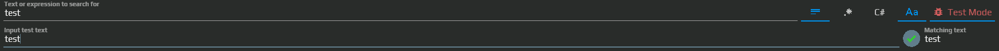
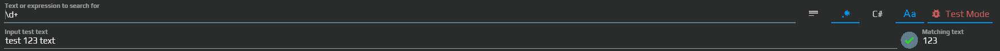
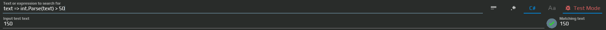

# Выражения сопоставления текста

Чтобы аура реагировала на сообщение «Обработка завершена», выберите, что считать совпадением: всю строку, фрагмент по правилу или результат проверки на C#. Оценщик получает **строку** от триггера и возвращает результат проверки; получение сообщения или распознавание текста настраивается в самом триггере.

Этот элемент встречается в [Text Search](/ru/triggers/images/text-search), [Network Message](/ru/triggers/network-message), [Telegram Message](/ru/triggers/telegram-message) и других редакторах. Сначала удобно проверить правило на своём тексте без ожидания нового входного сообщения.

## Проверить точное сообщение

1. Откройте текстовое условие уже добавленного триггера, например Telegram Message. Выберите режим **Text** — кнопку обычного текста рядом с Regex и C#.
2. В **Text or expression to search for** введите `Обработка завершена`. Кавычки и Markdown-разметка не нужны: они стали бы частью сравниваемого текста.
3. Включите **Ignore Case**, если `ОБРАБОТКА ЗАВЕРШЕНА` тоже должно подходить.
4. Включите **Test Mode** и в **Input test text** введите `Обработка завершена`. Должно появиться успешное совпадение с этим текстом.
5. Замените тестовый ввод на `Обработка завершена: 3 файла`. В режиме Text совпадение должно исчезнуть: сравнивается вся строка, а не её начало.
6. Верните подходящий тестовый текст, проверьте результат и **выключите Test Mode**. Пока он включён, оценщик проверяет тестовый ввод вместо строки от триггера.

Теперь условие готово проверять реальные сообщения. Само выражение не отправляет ответ и не запускает действие: реакция зависит от состояния ауры и её настроек.

## Выбрать режим

| Режим | Когда использовать |
|---|---|
| Text | Вся строка должна совпасть с введённым текстом. Пробелы и остальное содержимое тоже имеют значение |
| Regex | Нужно найти фрагмент или описать шаблон: число, слово, начало и конец строки |
| C# (Lambda в прежних описаниях) | Нужна проверка строки выражением, возвращающим bool, например длина или числовой диапазон |
| Ignore Case | Управляет учётом регистра в Text и Regex. На код C# не распространяется |
| Test Mode | Подставляет Input test text вместо реального входа. После настройки отключите его |

### Text: совпадает вся строка

`Привет, мир` совпадёт только с этой строкой; `12345` — с такой числовой **строкой**, введённой без дополнительных кавычек. Для `ПРИВЕТ` включённый Ignore Case допускает `привет` и `Привет`. Длинное предложение сравнивается так же точно, как короткое слово.

На старом снимке выражение `test` равно тестовому вводу `test`. В текущем редакторе смысл переключателей тот же, хотя оформление может отличаться.

### Regex: найти фрагмент по шаблону

Введите `\d+` без внешних косых черт. В тестовом тексте `test 123 text` совпадением будет `123`: regex не требует совпадения всей строки. Если нужна вся строка, задайте это в выражении, например `^Обработка завершена$`.

| Выражение | Что найдёт |
|---|---|
| `\d+` | Одну или несколько цифр, например 123 внутри строки |
| `\b\w+\b` | Слово из символов категории \w; сюда входят не только буквы, но и цифры и подчёркивание. Кириллица поддерживается |
| `\b[a-zA-Z]{2}\b` | Слово ровно из двух латинских букв, например ab |
| `\b\d{3}\b` | Группу ровно из трёх цифр на границах слова, например 123 |
| `\bH\w*\b` | Слово с латинской H в начале, например Hello; кириллическая Н — другая буква |
| `\b\w*e\b` | Слово с латинской e в конце, например code |

Используется regex .NET с **Singleline**: точка `.` может захватывать перевод строки. Ignore Case добавляет сравнение без учёта регистра. Проверяется первое найденное совпадение. В поле результата показывается первая захватывающая группа, если она есть, иначе — всё совпадение.

Внешние [редакторы regex](https://regex101.com/) полезны для знакомства с синтаксисом, но их движок и флаги могут отличаться. Окончательно проверяйте выражение здесь, в Test Mode.

C#: Lambda-проверки и ограничения

Это поле принимает выражение со строковым аргументом и логическим результатом, а не полный файл Script.csx. Возможности контекста верхнеуровневого скрипта — `Log`, `AuraTree`, `Variables` и другие — здесь не становятся доступными автоматически.

На старом снимке C# проверяет, больше ли целое число 50. Ввод `150` проходит проверку. Ошибку преобразования числа нужно отличать от обычного несовпадения.

| Выражение | Что проверяет |
|---|---|
| `text => string.IsNullOrEmpty(text)` | Пустую строку или null |
| `text => text.Contains("Привет")` | Наличие подстроки Привет. Этот вызов учитывает регистр независимо от Ignore Case |
| `text => text.Length < 5` | Длину меньше пяти символов; предполагает, что text не null |
| `text => double.Parse(text) >= 1 && double.Parse(text) <= 100` | Число от 1 до 100 включительно; предполагает допустимую числовую строку |

Последний пример **не** возвращает false для любого нечислового ввода: `double.Parse` может завершиться ошибкой и учитывает текущую культуру, включая десятичный разделитель. Проверьте ожидаемый формат входа. Для успешной проверки числового диапазона можно ввести `50`, затем `150` и сравнить результат. Если источник присылает произвольные сообщения, сначала выберите правило, которое соответствует этому формату, а не полагайтесь на Parse как на универсальный фильтр.

Результат выражения должен быть bool. Ошибки синтаксиса и вычисления отображаются как ошибки оценщика; их нельзя трактовать как штатный ответ «условие не выполнено».

Все режимы получают текст, в том числе числа, представленные строкой. Unicode поддерживается, но латинские и похожие кириллические символы остаются разными. После проверки нескольких ожидаемых значений выключите Test Mode и убедитесь, что условие меняется уже от реального источника.
