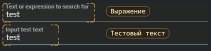
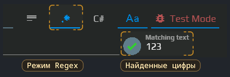
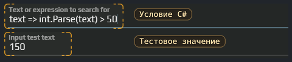

# Выражения сопоставления текста

Выражение сопоставления текста решает, подходит ли текст, который пришёл от триггера. Например, аура должна реагировать на сообщение «Обработка завершена». Вы выбираете, что считать совпадением: всю строку, фрагмент по шаблону или результат проверки на C#. Откуда берётся текст — из сообщения или из распознавания — настраивается в самом триггере.

Это поле есть в [Text Search](/ru/triggers/images/text-search), [Network Message](/ru/triggers/network-message), [Telegram Message](/ru/triggers/telegram-message) и других редакторах. Правило удобно сначала проверить на своём тексте, не дожидаясь нового сообщения.

## Проверить точное сообщение

1. Откройте текстовое условие уже добавленного триггера, например Telegram Message. Выберите режим **Text** — кнопку обычного текста рядом с Regex и C#.
2. В **Text or expression to search for** введите `Обработка завершена`. Кавычки и Markdown-разметку не ставьте: они станут частью сравниваемого текста.
3. Включите **Ignore Case**, если `ОБРАБОТКА ЗАВЕРШЕНА` тоже должно подходить.
4. Включите **Test Mode** и в **Input test text** введите `Обработка завершена`. Должно появиться совпадение с этим текстом.
5. Замените тестовый текст на `Обработка завершена: 3 файла`. Совпадение должно исчезнуть: режим Text сравнивает всю строку, а не её начало.
6. Верните подходящий тестовый текст, проверьте результат и **выключите Test Mode**. Пока он включён, проверяется тестовый текст, а не строка от триггера.

## Выбрать режим

| Режим | Когда использовать |
|---|---|
| Text | Вся строка должна совпасть с введённым текстом. Пробелы и всё остальное тоже учитываются |
| Regex | Нужно найти фрагмент или описать шаблон: число, слово, начало и конец строки |
| C# (Lambda в прежних описаниях) | Нужно проверить строку выражением, которое возвращает bool: например, длину или числовой диапазон |
| Ignore Case | Включает и выключает учёт регистра в Text и Regex. На код C# не действует |
| Test Mode | Подставляет Input test text вместо реального текста. После настройки выключите его |

### Text: совпадает вся строка

`Привет, мир` совпадёт только с точно такой строкой. `12345` — с такой же **строкой** из цифр, дополнительные кавычки не нужны. Если выражение `ПРИВЕТ` и включён Ignore Case, подойдут `привет` и `Привет`.

### Regex: найти фрагмент по шаблону

Введите `\d+` без косых черт по краям. В тестовом тексте `test 123 text` совпадёт `123`: regex не требует, чтобы совпала вся строка. Если нужна вся строка, укажите это в выражении, например `^Обработка завершена$`.

[Показать выражение и тестовую строку](/assets/legacy/eyeauras_jb1lvsh9pz.png).

| Выражение | Что найдёт |
|---|---|
| `\d+` | Одну или несколько цифр, например 123 внутри строки |
| `\b\w+\b` | Слово из символов категории \w: это буквы, цифры и подчёркивание. Кириллица поддерживается |
| `\b[a-zA-Z]{2}\b` | Слово ровно из двух латинских букв, например ab |
| `\b\d{3}\b` | Группу ровно из трёх цифр на границах слова, например 123 |
| `\bH\w*\b` | Слово с латинской H в начале, например Hello. Кириллическая Н — другая буква |
| `\b\w*e\b` | Слово с латинской e в конце, например code |

Используется regex .NET с **Singleline**: точка `.` может захватывать перевод строки. Ignore Case включает сравнение без учёта регистра. Проверяется первое найденное совпадение. В поле результата видна первая захватывающая группа, а если её нет — всё совпадение.

Внешние [редакторы regex](https://regex101.com/) помогают освоить синтаксис, но их движок и флаги могут отличаться. Окончательно проверяйте выражение здесь, в Test Mode.

C#: Lambda-проверки и ограничения

В это поле пишут выражение, которое принимает строку и возвращает логический результат, а не целый файл Script.csx. `Log`, `AuraTree`, `Variables` и другие возможности верхнеуровневого скрипта здесь сами не появляются.

| Выражение | Что проверяет |
|---|---|
| `text => string.IsNullOrEmpty(text)` | Пустую строку или null |
| `text => text.Contains("Привет")` | Есть ли подстрока Привет. Этот вызов учитывает регистр независимо от Ignore Case |
| `text => text.Length < 5` | Длину меньше пяти символов. Рассчитано на то, что text не null |
| `text => double.Parse(text) >= 1 && double.Parse(text) <= 100` | Число от 1 до 100 включительно. Рассчитано на допустимую числовую строку |

Последний пример **не** возвращает false для любого нечислового текста: `double.Parse` может завершиться ошибкой. Ещё он зависит от текущей культуры, в том числе от десятичного разделителя. Проверьте, в каком формате приходит текст. Чтобы проверить числовой диапазон, введите `50`, затем `150` и сравните результат.

Ошибки синтаксиса и вычисления показываются как ошибки оценщика.

