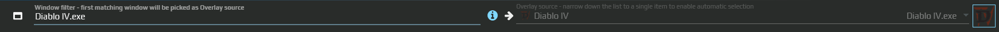

# Выражения сопоставления окон

Если открыто несколько окон одной программы, выберите именно то, с которым должна работать аура. Например, захват отчёта не должен внезапно переключиться на другое окно просмотрщика. Выражение в поле выбора окна уточняет поиск; рядом редактор показывает фактически выбранное окно.

Такой выбор встречается в триггерах, действиях и оверлеях: источник захвата, окно для проверки активности и адресат ввода могут настраиваться отдельно. Уточнение одного поля не перенастраивает остальные.

## Выбрать окно отчёта

1. Откройте нужный отчёт и второе окно той же программы. В редакторе триггера захвата раскройте **Capture settings → Target Window**.
2. Нажмите кнопку с подсказкой **Click to select Window** и выберите окно отчёта. Справа проверьте выбранное окно; наведите указатель, чтобы увидеть подробности.
3. Если нужен выбор по названию после повторного открытия документа, введите характерную часть заголовка, например `Отчёт за октябрь`. Это обычный текст без кавычек: он ищется как подстрока в нескольких полях окна.
4. Для полного совпадения возьмите **весь фактический заголовок** в двойные или одинарные кавычки. Например, если заголовок ровно `Отчёт за октябрь — Просмотрщик`, введите `"Отчёт за октябрь — Просмотрщик"`. Суффикс программы тоже входит в заголовок.
5. Переключитесь на второе окно. Поле выбранного окна и предпросмотр захвата должны по-прежнему указывать на отчёт. Закройте и снова откройте отчёт: проверьте, что выражение нашло его заново.

При изменении имени документа точный заголовок перестанет совпадать. Дескриптор, полученный при выборе конкретного окна, тоже может измениться после его пересоздания. Выбирайте правило под то, что остаётся постоянным в вашем сценарии.

На старом снимке слева видно выражение, справа — выбранное окно. В текущем редакторе выбор окна и процесса доступен через кнопки с прицелом; расположение отличается от старого выпадающего списка.

## Как читается простое выражение

Выражение сравнивается с **путём процесса, именем процесса, заголовком окна и аргументами запуска**. Достаточно совпадения подходящего поля. Поэтому текст не является строгим фильтром только заголовка или только процесса.

| Запись в поле | Как работает |
|---|---|
| `notepad` | Подстрока в пути, заголовке или аргументах; имя процесса сравнивается целиком |
| `"My document"` или `'My document'` | Полное совпадение поля |
| `/^My document/` | Регулярное выражение для пути, заголовка или аргументов |
| `0x5A` или `&H5A` | Нативный дескриптор окна; числа здесь приведены только как пример синтаксиса |
| `notepad #2` | Второе совпадение после сортировки результатов |
| `#1` | Первое окно из подходящего списка |

Обычный текст и точное совпадение **не учитывают регистр**: используется `OrdinalIgnoreCase`. Регулярные выражения выполняются с `RegexOptions.IgnoreCase`. Кавычки требуют полного совпадения, но не включают учёт регистра и не ограничивают поиск одним полем.

Regex вводится как `/pattern/`, без внешних кавычек. Запись `"/pattern/"` распознаётся как точный текст и не включает regex. Это отличается от [текстового оценщика Regex](/ru/features/text-match-expressions), где внешние косые черты не нужны.

Индекс ставится **после** выражения, за закрывающей кавычкой: `"My document" #2`, а не `"My document #2"`. Он считается с единицы после сортировки по времени создания процесса, Z-order, длине и тексту заголовка и PID. Состав и порядок списка могут измениться: `#2` не является постоянным идентификатором документа.

## Несколько условий

| Запись | Смысл |
|---|---|
| `notepad && /report/` | Последовательное сужение: сначала окна по notepad, затем среди них — по /report/ |
| `notepad \|\| calc` | Первая непустая альтернатива: если есть совпадения notepad, calc не добавляется; если их нет, проверяется calc |

Альтернативы **не объединяют** оба набора окон. Разбор операторов последовательный: не рассчитывайте на скобки и обычный приоритет логических выражений C#. Сначала проверьте простую строку, затем добавляйте условия и смотрите, какое окно выбрано в конкретном редакторе.

Фильтры selector и граница со скриптовым API

Список кандидатов зависит от провайдера окон и фильтров selector — механизма выбора окна. Свойства вроде `[type=toplevel]` разбираются этим механизмом, а не обычным поиском текста.

| Запись или свойство | Ограничение |
|---|---|
| `[type=toplevel]` | Выбирает основные окна; поддерживаются также type=child и type=any. Результат ограничен используемым списком окон |
| `[ownedBy=external]` / `[ownedBy=any]` | Исключает собственные окна EyeAuras или снимает это ограничение. Без указания используется external; тип по умолчанию — toplevel |
| `[visible]` / `[focus]` в строке | Сами по себе не включают фильтрацию по видимости или фокусу |
| OnlyVisible | Свойство selector, которым задаётся фильтрация видимых окон. Не заменяется приписыванием `[visible]` |
| ProcessName | Для строгого ограничения процесса нужен явный фильтр ProcessName в соответствующем контексте; широкий текст не является переводом AutoHotkey `ahk_exe` |

Кнопка **Click to select Process** в текущем редакторе записывает имя выбранного процесса как выражение. К нему продолжают применяться обычные правила сопоставления нескольких полей; не считайте эту кнопку отдельным строгим фильтром процесса.

В скриптовом API `IWindowMatcher.FindMatches` обрабатывает составные строки с `&&` и `||`. `IsMatch` одного окна принимает простое выражение; `WindowMatchParams` также не предназначен для сложной строки. Это граница API, а не требование писать скрипт для обычного выбора окна. Контексты окон, независимых списков и foreground разобраны [отдельно](/ru/scripting/api/windows-subsystems/window-handles).

Для проверки активности используйте выбранное окно в [Window Is Active](/ru/triggers/window-is-active). Для поиска пикселей после выбора окна отдельно настройте [область захвата](/ru/triggers/images/imagecapturetriggers): совпавший заголовок ещё не гарантирует правильный кадр.
