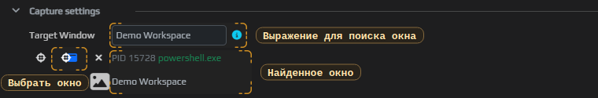

# Выражения сопоставления окон

Выражение в поле выбора окна говорит EyeAuras, с каким окном работать. Оно нужно, когда у программы открыто несколько окон: например, чтобы захват отчёта не переключился вдруг на другое окно просмотрщика. Найденное окно редактор показывает под выражением.

Такое поле есть в триггерах, действиях и оверлеях. Источник захвата, окно для проверки активности и адресат ввода могут настраиваться отдельно: если уточнить одно поле, остальные не изменятся.

## Выбрать окно отчёта

1. Откройте нужный отчёт и второе окно той же программы. В редакторе триггера захвата раскройте **Capture settings → Target Window**.
2. Нажмите кнопку с подсказкой **Click to select Window** и выберите окно отчёта. Проверьте выбранное окно под выражением. Наведите на него указатель, чтобы увидеть подробности.
3. Чтобы окно находилось по названию и после повторного открытия документа, введите характерную часть заголовка, например `Отчёт за октябрь`. Это обычный текст без кавычек: он ищется как подстрока в нескольких полях окна.
4. Для полного совпадения возьмите **весь фактический заголовок** в двойные или одинарные кавычки. Если заголовок ровно `Отчёт за октябрь — Просмотрщик`, введите `"Отчёт за октябрь — Просмотрщик"`. Суффикс программы тоже часть заголовка.
5. Переключитесь на второе окно. Поле выбранного окна и предпросмотр захвата должны по-прежнему показывать отчёт. Закройте и снова откройте отчёт и проверьте, что выражение нашло его заново.

Если документ переименовать, точный заголовок перестанет совпадать. Дескриптор, полученный при выборе конкретного окна, тоже может измениться, когда окно создаётся заново. Стройте правило на том, что в вашей задаче не меняется.

Если одно окно нужно нескольким проверкам, задайте выражение в [свойствах по умолчанию](/ru/features/default-properties) папки и привяжите к нему их Target Window. Тогда при смене окна не придётся править каждую копию выражения.

Выбрав окно, сверьте заголовок и процесс под выражением с нужным окном.

## Как читается простое выражение

Выражение сравнивается с **путём процесса, именем процесса, заголовком окна и аргументами запуска**. Хватит совпадения в одном подходящем поле. Поэтому это не строгий фильтр только по заголовку или только по процессу.

| Запись в поле | Как работает |
|---|---|
| `notepad` | Подстрока в пути, заголовке или аргументах. Имя процесса сравнивается целиком |
| `"My document"` или `'My document'` | Полное совпадение поля |
| `/^My document/` | Регулярное выражение для пути, заголовка или аргументов |
| `0x5A` или `&H5A` | Нативный дескриптор окна. Числа здесь — только пример синтаксиса |
| `notepad #2` | Второе совпадение после сортировки результатов |
| `#1` | Первое окно из подходящего списка |

Обычный текст и точное совпадение **не учитывают регистр**: используется `OrdinalIgnoreCase`. Регулярные выражения работают с `RegexOptions.IgnoreCase`. Кавычки требуют полного совпадения, но учёт регистра не включают и поиск одним полем не ограничивают.

Regex пишется как `/pattern/`, без кавычек снаружи. Запись `"/pattern/"` — это точный текст, а не regex. В [текстовом оценщике Regex](/ru/features/text-match-expressions) наоборот: косые черты по краям не нужны.

Индекс ставится **после** выражения, за закрывающей кавычкой: `"My document" #2`, а не `"My document #2"`. Счёт идёт с единицы после сортировки по времени создания процесса, Z-order, длине и тексту заголовка и PID. Список и его порядок могут измениться, так что `#2` — не постоянный идентификатор документа.

## Несколько условий

| Запись | Смысл |
|---|---|
| `notepad && /report/` | Сужает по шагам: сначала окна по notepad, потом среди них — по /report/ |
| `notepad \|\| calc` | Первая непустая альтернатива: если по notepad что-то нашлось, calc не добавляется. Если нет — проверяется calc |

Альтернативы **не объединяют** оба набора окон. Операторы разбираются по порядку: не рассчитывайте на скобки и обычный приоритет логических выражений C#. Сначала проверьте простую строку, потом добавляйте условия и смотрите, какое окно выбрано в конкретном редакторе.

Фильтры selector и граница со скриптовым API

Список кандидатов зависит от провайдера окон и фильтров selector — механизма выбора окна. Свойства вроде `[type=toplevel]` разбирает он, а не обычный поиск текста.

| Запись или свойство | Ограничение |
|---|---|
| `[type=toplevel]` | Выбирает основные окна. Есть также type=child и type=any. Результат ограничен используемым списком окон |
| `[ownedBy=external]` / `[ownedBy=any]` | Исключает собственные окна EyeAuras или снимает это ограничение. По умолчанию — external, а тип — toplevel |
| `[visible]` / `[focus]` в строке | Сами по себе фильтрацию по видимости или фокусу не включают |
| OnlyVisible | Свойство selector, которое включает фильтр видимых окон. Приписать `[visible]` вместо него нельзя |
| ProcessName | Чтобы строго ограничить процесс, нужен явный фильтр ProcessName в соответствующем контексте. Широкий текст — не перевод `ahk_exe` из AutoHotkey |

Кнопка **Click to select Process** в текущем редакторе записывает имя выбранного процесса как выражение. Оно работает по обычным правилам и сравнивается с несколькими полями. Не считайте эту кнопку отдельным строгим фильтром процесса.

В скриптовом API `IWindowMatcher.FindMatches` понимает составные строки с `&&` и `||`. `IsMatch` для одного окна принимает простое выражение, и `WindowMatchParams` тоже не рассчитан на сложную строку. Это граница API: для обычного выбора окна скрипт писать не нужно. Контексты окон, независимых списков и foreground разобраны [отдельно](/ru/scripting/api/windows-subsystems/window-handles).

Чтобы проверять активность, используйте выбранное окно в [Window Is Active](/ru/triggers/window-is-active). Для поиска пикселей после выбора окна отдельно настройте [область захвата](/ru/triggers/images/imagecapturetriggers): совпавший заголовок ещё не гарантирует правильный кадр.
