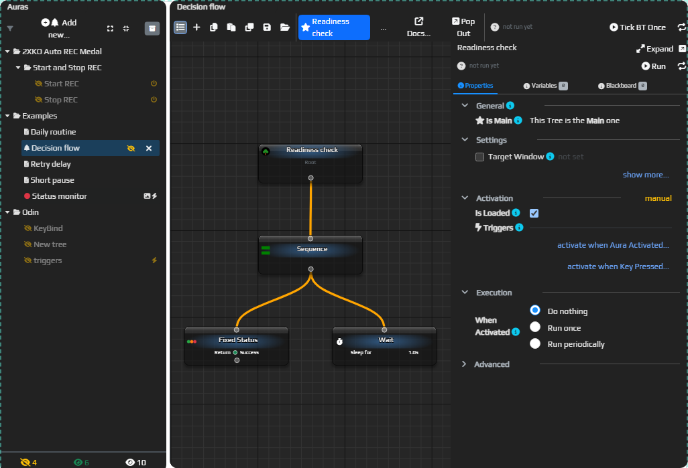
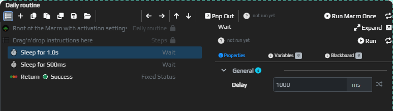
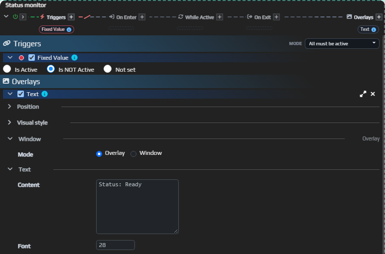
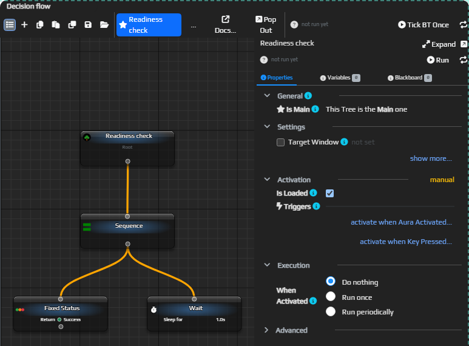
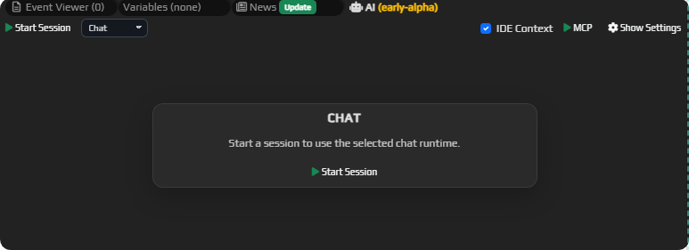

# Превратите задачу в автоматизацию

Следите за условиями, выполняйте шаги по порядку и стройте логику с ветвлением в одном рабочем пространстве. [Скачайте EyeAuras](https://eyeauras.net/#downloads) и начните с небольшой задачи, которую хотите автоматизировать.

*Демонстрационный набор объединяет импортированные паки и локальные примеры. Выбрано дерево Decision flow.*

## Три инструмента

### Макрос — шаги по порядку

Соберите последовательность с ожиданиями, условиями и повторами. Начните с макроса, если задачу можно описать как «сначала это, затем то». [Руководство по макросам](/ru/macros/getting-started).

*Локальный пример Daily routine содержит ожидания на 1 секунду и 500 миллисекунд, затем Fixed Status.*

### Аура — следить и реагировать

Триггер участвует в вычислении состояния ауры. Настройте реакции **On Enter**, **While Active** и **On Exit**, а для вывода информации добавьте оверлей. Попробуйте [Fixed Value](/ru/triggers/fixed-value) как первое условие.

*В Status monitor у Fixed Value выбрано Is NOT Active, а в оверлее Text задана надпись «Status: Ready».*

### Дерево поведения — проверки и ветвления

Связывайте узлы, чтобы описать условия, выбор и повторяющуюся работу. Узлы возвращают **Success**, **Failure** или **Running**, а тики продвигают выполнение. [Соберите первое дерево](/ru/behavior-trees/gettings-started).

*Локальный пример Decision flow связывает Sequence с Fixed Status и Wait. В Activation выбран ручной режим, в When Activated — Do nothing.*

## AI в рабочем пространстве

Обсуждайте задачу в AI-панели с контекстом EyeAuras. Выберите режим и настройте доступный профиль провайдера; подробности — в [руководстве по AI Assistant](/ru/features/ai-assistant).

*Панель до запуска сеанса. Для ответов модели нужен доступный профиль провайдера.*

## Первый макрос

Выберите **Macro** в дереве слева и соберите небольшую последовательность без действий клавиатуры и мыши:

1. Выберите верхнюю строку с настройками корня в редакторе. Оставьте **Activation → Is Loaded** включённым и задайте **Execution → When Activated → Do nothing** для ручного запуска.
2. Через **Add new Node** добавьте два **Wait** макроса и один **Fixed Status** соседями внутри **Drag'n'drop instructions here**, в таком порядке.
3. У Wait задайте **General → Delay**: **1000 ms** и **500 ms**, случайный разброс выключите. У **Fixed Status** выберите **General → Status → Success**.
4. Нажмите **Run Macro Once**. После обеих пауз у последнего узла и блока должен появиться **Success**.

Условия, циклы и вызовы разобраны в [полном руководстве по макросам](/ru/macros/getting-started).

## Что дальше

- Познакомьтесь с [триггерами на Fixed Value](/ru/triggers/fixed-value), [действиями на Play Sound](/ru/actions/play-sound) и [оверлеями на Text](/ru/overlays/text).
- Выберите готовый [рецепт](/ru/recipes). [C#-скрипты](/ru/scripting/getting-started) добавят свою логику и интерфейсы, когда готовых шагов недостаточно.
- Откройте [FAQ](/ru/faq) с частыми вопросами или [разбор проблем](/ru/known-problems), если настройка ведёт себя иначе.

Для конкретного источника или реакции [выберите инструмент под задачу](/ru/getting-started/choose-a-tool).
