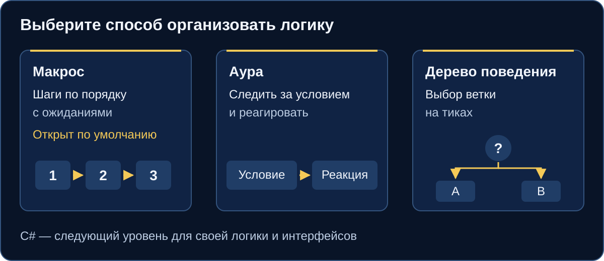
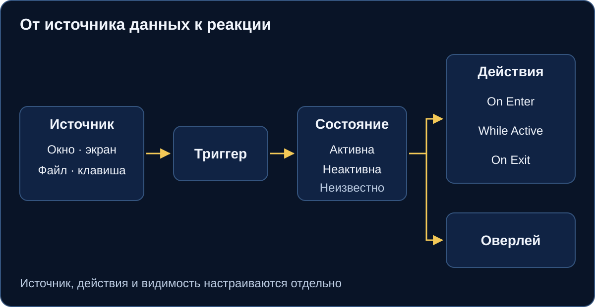

# Начните с EyeAuras

EyeAuras помогает автоматизировать задачи в приложениях: выполнять последовательности, следить за условиями и строить логику с ветвлением. [Скачайте EyeAuras](https://eyeauras.net/#downloads) и начните с **Macro**, который открывается в пустом наборе.

## Три инструмента

Выберите **макрос** для шагов по порядку с ожиданиями, **ауру** — чтобы следить за условием и реагировать, **дерево поведения** — для ветвления и работы на тиках. По умолчанию открыт редактор макроса. [C#-скрипты](/ru/scripting/getting-started) позволяют добавить свою логику и интерфейсы, когда готовых шагов недостаточно.

## Первый макрос

Соберите в уже открытом **Macro** небольшую последовательность без действий клавиатуры и мыши:

1. Выберите верхнюю строку с настройками корня в редакторе. Оставьте **Activation → Is Loaded** включённым и задайте **Execution → When Activated → Do nothing** для ручного запуска.
2. Через **Add new Node** добавьте два **Wait** макроса и один **Fixed Status** соседями внутри **Drag'n'drop instructions here**, в таком порядке.
3. У Wait задайте **General → Delay**: **1000 ms** и **500 ms**, случайный разброс выключите. У **Fixed Status** выберите **General → Status → Success**.
4. Нажмите **Run Macro Once**. После обеих пауз у последнего узла и блока должен появиться **Success**.

Условия, циклы и вызовы разобраны в [полном руководстве по макросам](/ru/macros/getting-started).

## Аура реагирует на условие

Триггер читает источник данных и участвует в вычислении состояния ауры. Реакции **On Enter**, **While Active** и **On Exit** настраиваются отдельно; оверлей может показать подсказку. Начните с [Fixed Value](/ru/triggers/fixed-value): вручную меняйте условие и наблюдайте реакцию.

## Дерево поведения выбирает ветку

Дерево удобно, когда результат проверки определяет следующую ветку. Узлы возвращают **Success**, **Failure** или **Running**, а тики продвигают работу. Это результаты выполнения, они отличаются от состояния ауры. Пройдите [первое дерево поведения](/ru/behavior-trees/gettings-started).

## Что дальше

- Познакомьтесь с [триггерами на Fixed Value](/ru/triggers/fixed-value), [действиями на Play Sound](/ru/actions/play-sound) и [оверлеями на Text](/ru/overlays/text).
- Выберите готовый [рецепт](/ru/recipes) или переходите к [C#-скриптам](/ru/scripting/getting-started).
- Откройте [FAQ](/ru/faq) с частыми вопросами или [разбор проблем](/ru/known-problems), если настройка ведёт себя иначе.

Для конкретного источника или реакции [выберите инструмент под задачу](/ru/getting-started/choose-a-tool).
