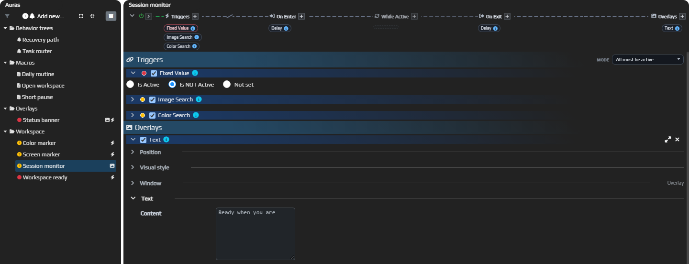
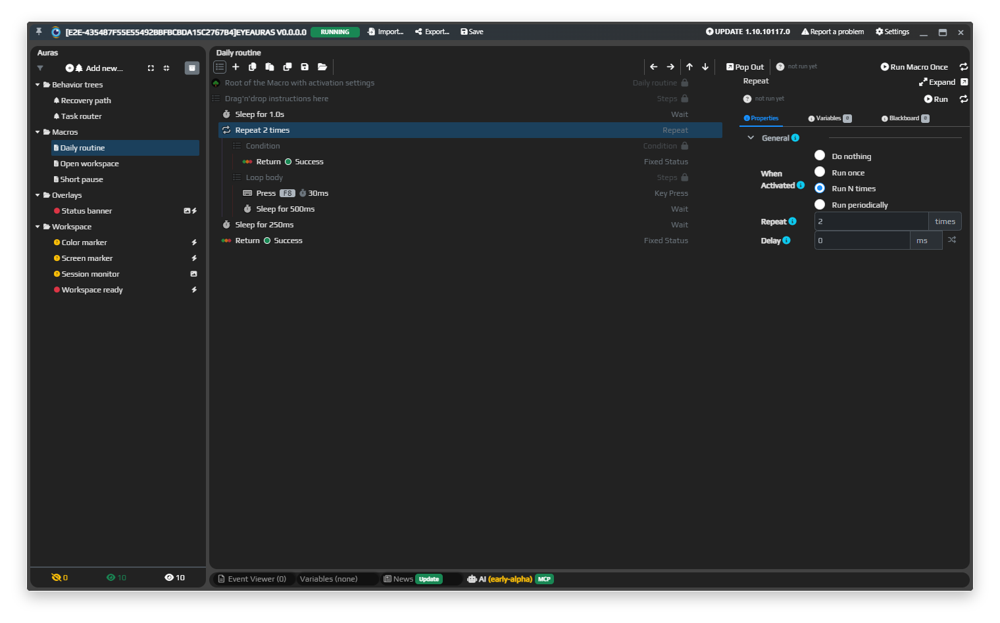
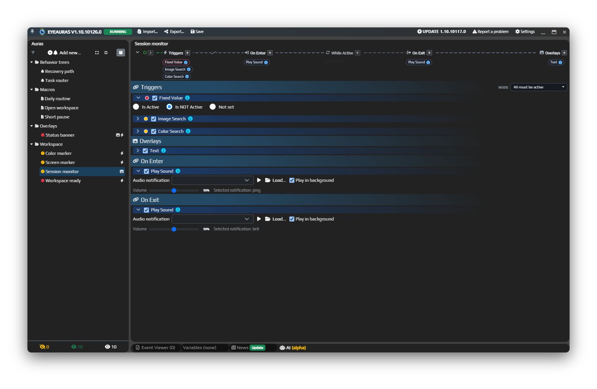
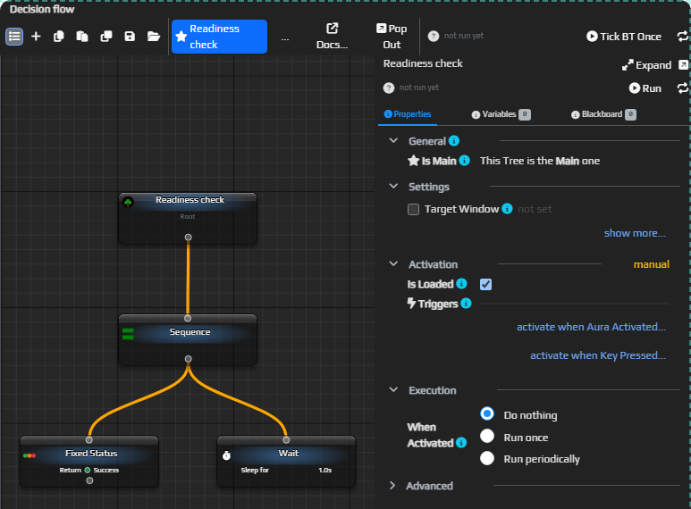
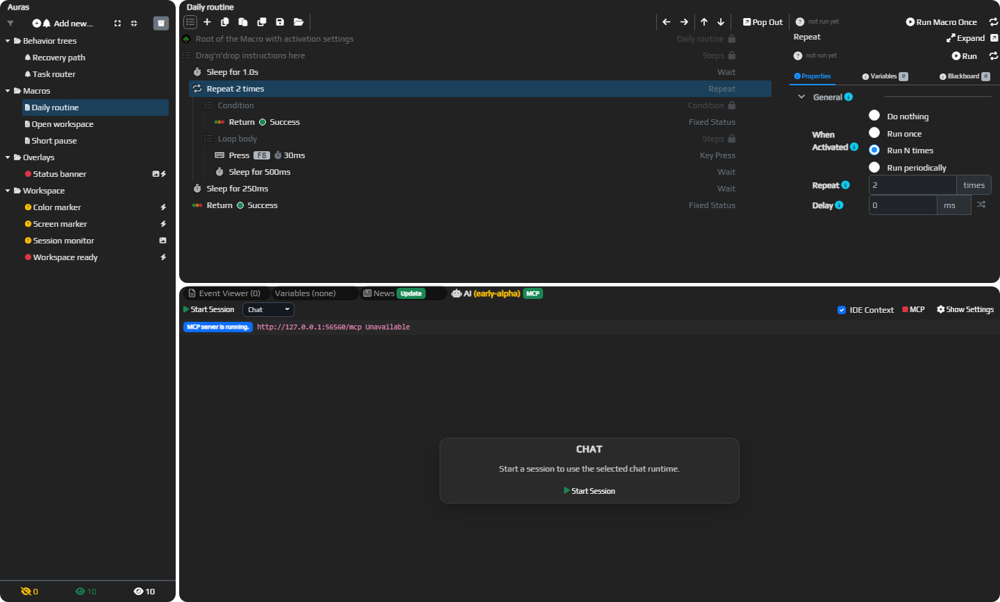

# Что такое EyeAuras

EyeAuras — это кликер с компьютерным зрением. Он смотрит на экран и сам нажимает клавиши, двигает мышь, включает звук или пишет вам в Telegram.

[Скачайте EyeAuras](https://eyeauras.net/#downloads) и начните с одной простой задачи.

## Три инструмента

Почти любую задачу можно собрать одним из трёх способов.

### Макрос — шаги по порядку

«Нажми, подожди, проверь, повтори». Если задачу можно так описать — берите макрос. [Как собрать макрос](/ru/macros/getting-started).

### Аура — следить и реагировать

Аура всё время проверяет условие: найдена ли картинка, активно ли окно, зажата ли клавиша. Условие сработало — аура выполняет действия: нажимает кнопку, играет звук, показывает оверлей.

Условия называются триггерами. Самый простой из них — [Fixed Value](/ru/triggers/fixed-value), с него удобно начать.

### Дерево поведения — сложная логика

Это «мозг» бота. Дерево само решает, что делать дальше: проверить условие, выбрать ветку, попробовать ещё раз. Берите его, когда в макросе стало тесно. [Как собрать первое дерево](/ru/behavior-trees/gettings-started).

Не уверены, что выбрать? Есть [короткая подсказка](/ru/getting-started/choose-a-tool).

## AI-помощник

В EyeAuras встроен чат с AI. Он видит открытый макрос или скрипт, поэтому можно спросить, что тут не так и как сделать лучше. [Как настроить AI Assistant](/ru/features/ai-assistant).

## Первый макрос за пару минут

Этот макрос ничего не нажимает — он просто ждёт и завершается. Так можно спокойно посмотреть, как всё устроено.

1. Выберите **Macro** в дереве слева.
2. Нажмите на верхнюю строку макроса и выберите **Execution → When Activated → Do nothing**. Теперь он запускается только вручную.
3. Через **Add new Node** добавьте в блок **Drag'n'drop instructions here** два **Wait** и один **Fixed Status** — именно в таком порядке.
4. Первому Wait задайте **Delay** 1000 ms, второму — 500 ms. У **Fixed Status** выберите **Status → Success**.
5. Нажмите **Run Macro Once**. Через полторы секунды у последнего узла появится **Success** — макрос отработал.

Условия, циклы и всё остальное — в [руководстве по макросам](/ru/macros/getting-started).

## Что дальше

- [Рецепты](/ru/recipes) — готовые решения под конкретные задачи.
- Из чего состоит аура: триггер [Fixed Value](/ru/triggers/fixed-value), действие [Play Sound](/ru/actions/play-sound), оверлей [Text](/ru/overlays/text).
- [C#-скрипты](/ru/scripting/getting-started) — когда готовых блоков не хватает.
- [FAQ](/ru/faq) и [известные проблемы](/ru/known-problems) — если что-то пошло не так.
