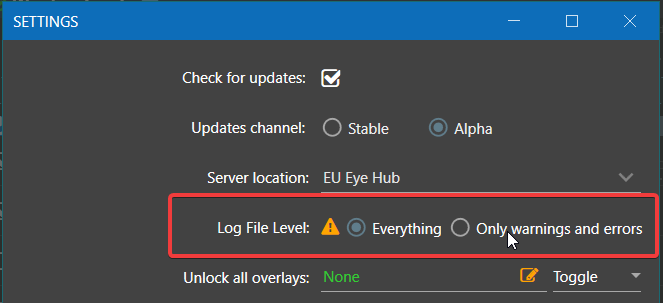

# Уменьшить подробность журналов

Если нужны только предупреждения и ошибки, измените Log File Level в настройках. Это уменьшает поток диагностических сообщений, но не делает программу автоматически быстрее. Уже записанные файлы останутся; подробности пропущенных событий потом восстановить нельзя.

## Выбрать режим в приложении

1. Откройте **Settings** и найдите **Log File Level** в основных настройках EyeAuras.
2. Выберите **Warnings/Errors**. Для полного ограничения обычного журналирования есть **Disabled**, но для разбора ошибок лучше оставить предупреждения.
3. Нажмите **Save**. Изменение применяется к работающему приложению без перезапуска.
4. Снова откройте настройки и проверьте выбранное значение. После следующих событий в обычных журналах должно стать меньше подробных записей. Перед воспроизведением проблемы для поддержки верните **Default** и снова сохраните.

| Log File Level | Что выбираете |
| --- | --- |
| Everything | Самая подробная работа штатного механизма журналирования, включая Trace, где это допускает настройка конкретного журнала. |
| Default | Обычная конфигурация журналов приложения; в базовом файле корневой уровень DEBUG, отдельные журналы могут быть настроены строже. |
| Warnings/Errors | Общий порог Warn для обычных журналов. Debug и Info отсекаются. |
| Disabled | Отключение обычных сообщений через общий порог. Это не обещание остановить любой вывод сторонней библиотеки или запись пользовательского файла. |

На старом снимке настройка оформлена иначе; в текущем редакторе выбирайте режим по названиям в таблице.



## Что означают уровни

| Уровень | Для чего обычно используется |
| --- | --- |
| TRACE | Очень подробные диагностические события. |
| DEBUG | Ход работы компонентов, полезный для поиска причины ошибки. |
| INFO | Основные события выполнения. |
| WARN | Неожиданная ситуация, после которой программа может продолжить работу. |
| ERROR | Ошибка операции или компонента; запись сама по себе не означает, что весь процесс завершился. |

Это настройка журналирования, а не фильтр окна [Event Viewer](/ru/features/event-viewer). Фильтр просмотра скрывает строки на экране; он не возвращает сообщения, которые ранее не записывались. Журналы штатного профиля release находятся в `%appdata%\EyeAuras\release\logs`; у другого профиля или переносимой установки путь отличается.

<details>
<summary>Изменить log4net.config для конкретной установки</summary>

Этот способ нужен для настройки самого файла журналирования. Для обычного уменьшения подробности достаточно интерфейса выше.

1. Найдите каталог **работающего экземпляра**, а не просто папку с самым большим номером версии. У установленной версии это может быть `%localappdata%\EyeAuras\app-<версия>`; у переносимой — её собственная папка. Сохраните копию `log4net.config` перед изменением.
2. Откройте `log4net.config` текстовым редактором и найдите уровень внутри секции `root`:

```xml
<root>
    <level value="DEBUG" />
```

3. Замените только это значение на `WARN` и сохраните файл, не удаляя остальную секцию и настройки вывода. Приложение следит за изменениями файла, поэтому перезапуск обычно не нужен.
4. Учтите, что именованные журналы могут иметь собственные уровни, а общий порог из Settings также влияет на штатные сообщения. Изменение одного root не гарантирует единый уровень всем источникам.

Обновление или замена установки может заменить этот файл. Настройка через **Settings → Save** хранится в конфигурации приложения и удобнее для постоянного выбора режима. Прежний пример `app-1.2.4177` обозначал каталог конкретной старой версии, а не обязательное имя сегодняшней установки.

</details>
