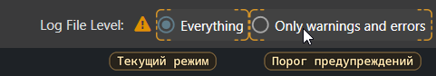

# Уменьшить подробность журналов

Если вам нужны только предупреждения и ошибки, поменяйте Log File Level в настройках. EyeAuras станет писать меньше диагностики, но быстрее от этого не обязательно заработает. Уже записанные файлы останутся. Подробности событий, которые не записались, потом не восстановить.

## Выбрать режим в приложении

1. Откройте **Settings** и найдите **Log File Level** в основных настройках EyeAuras.
2. Выберите **Warnings/Errors**. Можно выбрать и **Disabled**, чтобы отключить обычные журналы совсем, но для разбора ошибок предупреждения лучше оставить.
3. Нажмите **Save**. Настройка применяется сразу, без перезапуска.
4. Откройте настройки снова и проверьте значение. Подробных записей в обычных журналах дальше должно стать меньше. Перед тем как воспроизводить проблему для поддержки, верните **Default** и снова сохраните.

| Log File Level | Что выбираете |
| --- | --- |
| Everything | Самый подробный режим, включая Trace там, где это разрешает настройка конкретного журнала. |
| Default | Обычная конфигурация журналов. В базовом файле корневой уровень DEBUG, отдельные журналы могут быть настроены строже. |
| Warnings/Errors | Общий порог Warn для обычных журналов. Debug и Info не пишутся. |
| Disabled | Обычные сообщения отключены общим порогом. Сторонняя библиотека или пользовательский файл всё равно могут что-то писать. |

На снимке старый редактор, в нём выбрано Everything. Вам нужен Warnings/Errors — на снимке он называется Only warnings and errors.



## Что означают уровни

| Уровень | Для чего обычно используется |
| --- | --- |
| TRACE | Очень подробные диагностические события. |
| DEBUG | Ход работы компонентов. Помогает искать причину ошибки. |
| INFO | Основные события выполнения. |
| WARN | Что-то пошло не по плану, но программа может работать дальше. |
| ERROR | Ошибка операции или компонента. Весь процесс при этом мог и не завершиться. |

Эта настройка решает, что пишется в журнал. Фильтр в окне [Event Viewer](/ru/features/event-viewer) — другое: он только скрывает строки на экране и не вернёт сообщения, которые не записывались. Журналы обычного профиля release лежат в `%appdata%\EyeAuras\release\logs`. У другого профиля или переносимой установки путь другой.

Если нужна помощь со сбоем, который повторяется, верните **Default** и воспроизведите его. Затем по [инструкции отчёта о проблеме](/ru/report-a-problem) выберите логи этого запуска и сохраните архив. Если поменять уровень позже, подробностей в уже готовом отчёте не прибавится.

<details>
<summary>Изменить log4net.config для конкретной установки</summary>

Этот способ — для правки самого файла настроек журналов. Чтобы просто уменьшить подробность, хватит настройки выше.

1. Найдите каталог **работающего экземпляра**, а не папку с самым большим номером версии. У установленной версии это может быть `%localappdata%\EyeAuras\app-<версия>`, у переносимой — её собственная папка. Перед правкой сохраните копию `log4net.config`.
2. Откройте `log4net.config` в текстовом редакторе и найдите уровень внутри секции `root`:

```xml
<root>
    <level value="DEBUG" />
```

3. Замените только это значение на `WARN` и сохраните файл. Остальную секцию и настройки вывода не трогайте. Приложение следит за файлом, поэтому перезапуск обычно не нужен.
4. У именованных журналов могут быть свои уровни, а общий порог из Settings тоже влияет на обычные сообщения. Поэтому один root не задаёт единый уровень для всех источников.

Обновление или переустановка могут заменить этот файл. Настройка через **Settings → Save** хранится в конфигурации приложения, и для постоянного режима она удобнее. Прежний пример `app-1.2.4177` — это каталог одной старой версии. У вас имя будет другим.

</details>
