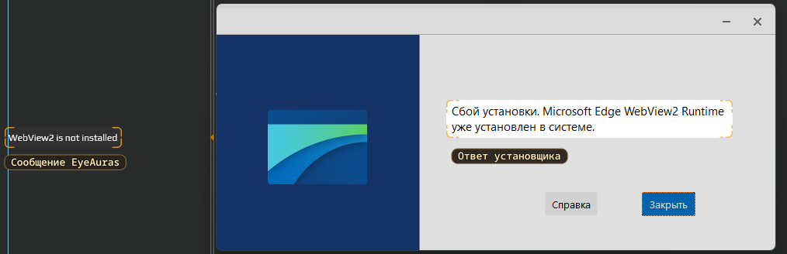

# Разобрать проблему запуска, подключения или старой ауры

EyeAuras не открывает интерфейс, показывает Not connected или не загружает элементы набора? Сначала поймите, на каком этапе всё остановилось.

| Что вы видите | С чего начать |
| --- | --- |
| WebView2 is not installed | С проверки WebView2 ниже. |
| Not connected, вход не завершается | С проверки соединения с Eye Hub. |
| Соединение есть, но Proxy Not Available | С проверки входа, состава поставки и доступности модуля. |
| Приложение закрывается без окна ошибки | [Как подготовить данные после сбоя](/ru/report-a-problem). |

## WebView2 есть в Windows, но EyeAuras его не видит

Интерфейс EyeAuras работает на WebView2. Программа ищет Microsoft WebView2 Runtime. Установленный Edge ещё не значит, что эта среда доступна процессу.

1. Закройте EyeAuras и откройте официальную [страницу WebView2 Runtime](https://developer.microsoft.com/en-us/microsoft-edge/webview2/consumer). Прямая ссылка на установщик, которым пользуется сам EyeAuras: [WebView2 Runtime installer](https://go.microsoft.com/fwlink/p/?LinkId=2124703).
2. Установите или восстановите среду по инструкции Microsoft. В случае из апреля 2026 года обычный запуск установщика отвечал «уже установлен», а запуск от имени администратора помог.
3. Снова запустите EyeAuras. Должен открыться интерфейс, а не сообщение об отсутствующей среде.
4. Не помогло — перезагрузите Windows и сохраните точные сообщения EyeAuras и установщика для [обращения](/ru/report-a-problem).

## Not connected и не получается войти

Not connected означает, что нет связи с Eye Hub. Это не то же самое, что отсутствующая лицензия или один недоступный модуль. Без связи могут одновременно не работать вход, сетевые функции и загрузка части возможностей. Если список редакторов пустой, проверьте ещё и модули, а не только Интернет.

1. Запишите версию EyeAuras и точный статус соединения. Если вышла версия новее, сравните её [заметки о выпуске](/ru/changelogs/9339) со своей версией, прежде чем применять к ней старое решение.
2. Откройте **Settings → Network**. Включите **Auto-select server location** и нажмите **Save**. Теперь приложение само сменит региональный адрес, если проверки соединения не проходят.
3. Хотите проверить один конкретный маршрут — отключите автоматический выбор, выберите **Preferred server location** и сохраните. В списке есть Default Eye Hub, EU Eye Hub и RU Eye Hub. Меняйте по одной настройке за раз.
4. Попробуйте другую сеть, которой вам можно пользоваться. Помните про системный прокси, VPN, сетевой фильтр и корпоративные правила: смена маршрута может и помочь, и помешать. Отключать защиту или считать её блокировку ошибочной для этой проверки не нужно.

| Настройка | Что меняет |
| --- | --- |
| Auto-select server location | Разрешает приложению менять адрес сервера, когда проверки связи не проходят. |
| Preferred server location | Вы сами выбираете адрес из списка. Поле недоступно, пока включён автоматический выбор. |

Автоматический выбор появился в [1.9.9339](/ru/changelogs/9339), отдельный RU-хаб — в [1.9.9164](/ru/changelogs/9164).

Если связь с Eye Hub есть, но AI-сеанс не запускается, проверьте **Endpoint**, **Model Id** и **API Type** выбранного профиля по [руководству AI Assistant](/ru/features/ai-assistant).

При такой проблеме в списке виден только C# Script или неполный набор элементов.

## Соединение есть, но старые элементы недоступны

Proxy Not Available или Not Available означает, что EyeAuras не смог превратить сохранённое описание элемента в рабочий компонент. Причина может быть в составе поставки, в загрузке модуля или в правах, которые ему нужны.

1. Проверьте соединение отдельно от входа. В случае со старыми аурами после перехода на 1.9.9339 помогали обычный **Login** и повторное открытие или перезапуск. Покупать подписку для этого было не обязательно.
2. Если вы уже вошли, сравните версию EyeAuras с требованиями автора набора: нужный компонент должен входить в поставку и загрузиться. Обычный вход не даёт доступа к любому платному модулю.
3. Если автор выпустил исправленный набор, сначала [сохраните свою копию](/ru/features/export-import), затем просмотрите новую версию до замены.
4. Компонент всё ещё недоступен — запишите его полное имя, название набора, версию и состояние соединения. Приложите логи этого запуска через [отчёт](/ru/report-a-problem).
