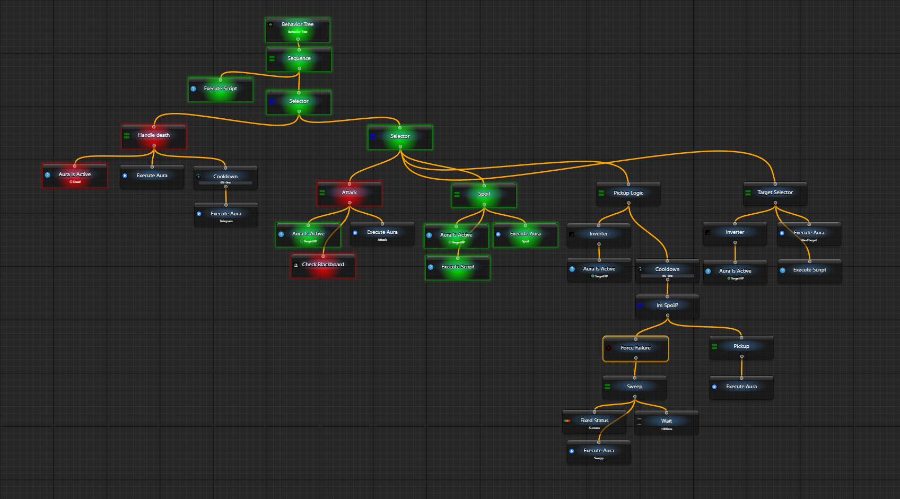

# Первый макрос — выполнить шаги по порядку

Чтобы собрать последовательность с паузами, условиями и циклами без написания программы целиком, создайте макрос. Его блок выполняет шаги по очереди и ждёт окончания каждого. Начнём с двух пауз и видимого результата узла — без ввода в другое окно.

## Две паузы за один запуск

1. В дереве аур откройте меню создания и выберите `New Macro`. Откройте новый элемент: внутри `My Macro` уже есть блок `Drag'n'drop instructions here` для шагов. Новый макрос отображается вложенным списком.
2. Выберите верхнюю строку с настройками корня. В `Activation` оставьте `Is Loaded` включённым, а в `Execution → When Activated` выберите `Do nothing`. Условия активации пока не добавляйте.
3. Через `Add new Node` последовательно добавьте два `Wait` и один `Fixed Status`. Они должны стать соседями внутри исходного блока в указанном ниже порядке. В списке узлов выбирайте Wait именно макроса.
4. У первого Wait задайте `General → Delay = 1000 ms`, у второго — `500 ms`, случайный разброс выключите. У Fixed Status выберите `General → Status → Success`.

```text
My Macro
└─ Block
   ├─ Wait: 1000 ms
   ├─ Wait: 500 ms
   └─ Fixed Status: Success
```

5. Нажмите верхнюю `Run Macro Once`. Макрос дождётся обеих пауз и выполнит последний шаг. После примерно полутора секунд работы, плюс затраты интерфейса, итог будет Success. Второй ручной тик для завершения этих Wait не нужен.
6. Поменяйте у Fixed Status параметр на `Failure` и добавьте **после него** ещё один Fixed Status со значением Success. Запустите снова. Последний шаг тоже выполнится, но итог всего Block будет Failure: обычный неуспех соседа не обрывает список.

Это существенное отличие от [Sequence дерева поведения](/ru/behavior-trees/nodes/sequence). Для условного маршрута выбирайте IfThenElse, для досрочного выхода — [Break](/ru/behavior-trees/nodes/Break) или [Return](/ru/behavior-trees/nodes/Return), а не надейтесь на остановку после любого Failure.

| Элемент | Как выполняется |
| --- | --- |
| Block | Проходит включённых детей по порядку. Обычный Failure учитывается в общем итоге, но следующие соседи выполняются |
| Wait макроса | Ожидает Delay внутри текущего запуска. Это не Wait дерева поведения, который отдаёт Running для следующего внешнего тика |
| IfThenElse макроса | Проверяет Condition и выполняет только If matched, then либо Otherwise; возвращает результат выбранной ветки |
| Repeat макроса | Проверяет Condition перед каждой допускаемой итерацией, затем выполняет Loop body |
| Break | Выходит из соответствующего цикла или блока; дальнейший маршрут зависит от места установки |
| Return | Завершает текущий вызываемый макрос с выбранным Success или Failure |

`Running` означает незавершённую работу, а Success/Failure — результаты узлов, не Active/Inactive ауры. Ошибка и отмена не обязаны становиться обычным Failure. `Stop` запрашивает отмену выданного ручного запуска; макрос не получает способность принудительно остановить произвольный код или откатить уже сделанные действия.

## Когда подключать автоматический запуск

После ручной проверки создайте свою ауру с проверенным триггером, например [Hotkey Is Active](/ru/triggers/hotkey-is-active), и свяжите её с макросом через `Activation → activate when Aura Activated... → Enabling Condition → Links`. [Условия включения](/ru/features/enabling-conditions) определяют допуск; сами команды остаются в макросе.


| When Activated | Что происходит |
| --- | --- |
| Do nothing | Только ручной запуск; выполнение условия само по себе макрос не запускает |
| Run once | Один запуск при переходе состояния активации из false в true |
| Run periodically | Повторные запуски, пока активация разрешена; Tick every задаёт паузу после законченного прохода, а не точный период независимо от его длительности |


У макроса без условий и триггеров состояние активации manual; загруженный макрос всё равно можно запустить вручную. Загрузка, активность и режим исполнения различаются, как описано у [Root](/ru/behavior-trees/nodes/root).

<details>
<summary>От клавиатурной цепочки до вложенной логики</summary>

Вместо Fixed Status можно добавить [Key Press](/ru/behavior-trees/nodes/KeyPress), [Mouse Move](/ru/behavior-trees/nodes/MouseMoveAbs) или [Send Text](/ru/behavior-trees/nodes/SendText). Сначала задайте своё окно и Input Simulator через значения по умолчанию и проверьте отображаемого адресата. Удержание клавиши требует отдельного Release; выход из блока его не заменяет.

На старом примере клавиатурной цепочки видны обычная клавиша, Wait и отдельные нажатие/отпускание Ctrl:


Вложенный пример использует Repeat, Condition и IfThenElse. Ауры Rebuff и Can do anything здесь уже должны предоставлять готовые условия; встроенного знания состояния игры у макроса нет.


Можно вызывать другой макрос через Run Macro, готовые действия ауры через [Run Aura](/ru/behavior-trees/nodes/execute-aura) и писать отдельные шаги на [C# Script](/ru/scripting/getting-started). Окно и переменные вызываемой работы не становятся общими автоматически только из-за вызова.


</details>

<details>
<summary>Чем макрос отличается от других способов</summary>

| Способ | Когда удобен |
| --- | --- |
| [Ауры](/ru/home) | Отдельные проверки по пикселям, окнам или событиям и реакции On Enter / While Active / On Exit |
| [C# Script](/ru/scripting/getting-started) | Свой алгоритм, данные и программный интерфейс; нужен соответствующий контекст исполнения |
| [Дерево поведения](/ru/behavior-trees/gettings-started) | Выбор веток по Success/Failure и продолжение Running между тиками |
| Макрос | Последовательные шаги с ожиданием, блоками, условиями и циклами в одном месте |

Пример ауры показывает источник изображения и отдельные настройки реакции:


C# и связанные технологии позволяют дополнять готовые узлы своим кодом; это не означает, что обычный класс или компонент Blazor получает все возможности верхнеуровневого скрипта автоматически.

  

Историческая большая схема дерева показывает, зачем могут понадобиться отдельные ветки и приоритеты. Это пример организации логики, не готовая интеграция с внутренними данными приложения:



</details>
