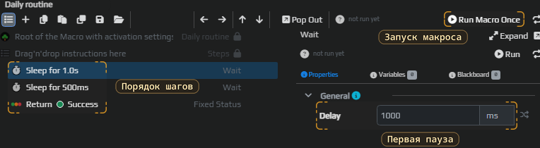
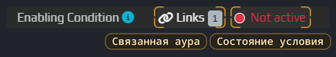
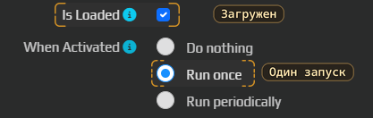
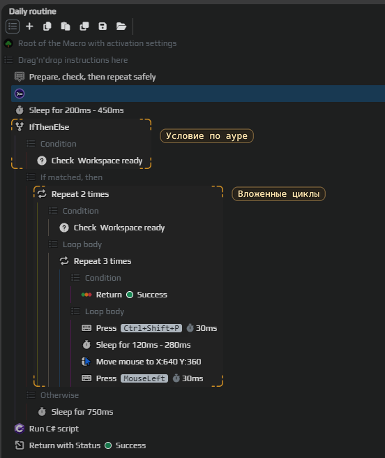
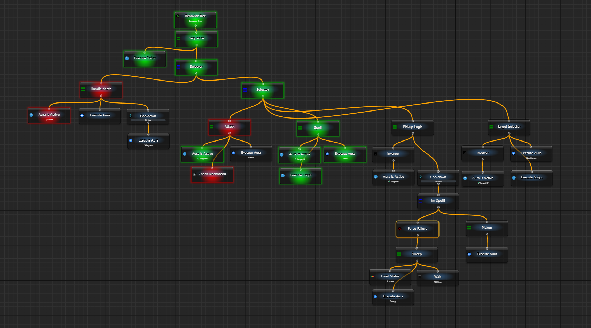

# Первый макрос — выполнить шаги по порядку

Макрос — это список шагов с паузами, условиями и циклами. Он выполняет шаги по очереди и ждёт, пока каждый закончится. Начнём с двух пауз и результата, который видно в редакторе.

## Две паузы за один запуск

1. В дереве аур откройте меню создания и выберите `New Macro`. Откройте новый элемент. Внутри `My Macro` уже есть блок `Drag'n'drop instructions here` — в него кладут шаги.
2. Нажмите на верхнюю строку с настройками корня. В `Activation` оставьте `Is Loaded` включённым, а в `Execution → When Activated` выберите `Do nothing`. Условия активации пока не добавляйте.
3. Через `Add new Node` добавьте по очереди два `Wait` и один `Fixed Status`. Они должны стоять рядом внутри исходного блока в том порядке, что показан ниже. В списке узлов берите Wait именно макроса.
4. Первому Wait задайте `General → Delay = 1000 ms`, второму — `500 ms`. Случайный разброс выключите. У Fixed Status выберите `General → Status → Success`.

```text
My Macro
└─ Block
   ├─ Wait: 1000 ms
   ├─ Wait: 500 ms
   └─ Fixed Status: Success
```



5. Нажмите `Run Macro Once` вверху. Макрос переждёт обе паузы и выполнит последний шаг. Примерно через полторы секунды (плюс немного на интерфейс) итог будет Success.
6. Поменяйте у Fixed Status значение на `Failure` и добавьте **после него** ещё один Fixed Status со значением Success. Запустите снова. Последний шаг тоже выполнится, но итог всего Block будет Failure. Обычный Failure одного шага не обрывает список.

Этим макрос отличается от [Sequence в дереве поведения](/ru/behavior-trees/nodes/sequence). Нужна развилка — берите IfThenElse. Нужно выйти раньше — берите [Break](/ru/behavior-trees/nodes/Break) или [Return](/ru/behavior-trees/nodes/Return).

| Элемент | Как выполняется |
| --- | --- |
| Block | Проходит включённые шаги по порядку. Обычный Failure попадает в общий итог, но следующие шаги всё равно выполняются |
| Wait макроса | Ждёт Delay внутри текущего запуска. Это не Wait дерева поведения, который возвращает Running до следующего внешнего тика |
| IfThenElse макроса | Проверяет Condition и выполняет только одну ветку: If matched, then или Otherwise. Возвращает результат этой ветки |
| Repeat макроса | Перед каждой итерацией проверяет Condition, затем выполняет Loop body |
| Break | Выходит из своего цикла или блока. Что будет дальше, зависит от того, где он стоит |
| Return | Завершает текущий вызываемый макрос с выбранным Success или Failure |

`Running` значит, что работа ещё не закончена. Success и Failure — это результаты узлов, а не Active/Inactive ауры. Ошибка и отмена не обязательно становятся обычным Failure. `Stop` просит отменить ручной запуск. Остановить произвольный код силой или откатить уже сделанные действия макрос не может.

## Когда подключать автоматический запуск

Сначала проверьте макрос вручную. Потом создайте ауру с проверенным триггером, например [Hotkey Is Active](/ru/triggers/hotkey-is-active), и свяжите её с макросом через `Activation → activate when Aura Activated... → Enabling Condition → Links`. [Условия включения](/ru/features/enabling-conditions) решают, можно ли макросу работать. Сами команды остаются в макросе.



| When Activated | Что происходит |
| --- | --- |
| Do nothing | Только ручной запуск. Сработавшее условие макрос не запускает |
| Run once | Один запуск, когда активация переходит из false в true |
| Run periodically | Запускается снова и снова, пока активация разрешена. Tick every — это пауза после законченного прохода, а не точный период: длительность самого прохода в неё не входит |



У макроса без условий и триггеров состояние активации — manual. Загруженный макрос всё равно можно запустить вручную. Загрузка, активность и режим исполнения — разные вещи, они описаны в статье про [Root](/ru/behavior-trees/nodes/root).

<details>
<summary>От клавиатурной цепочки до вложенной логики</summary>

Вместо Fixed Status можно поставить [Key Press](/ru/behavior-trees/nodes/KeyPress), [Mouse Move](/ru/behavior-trees/nodes/MouseMoveAbs) или [Send Text](/ru/behavior-trees/nodes/SendText). Сначала задайте своё окно и Input Simulator через значения по умолчанию и проверьте, какое окно показано как получатель. Зажатую клавишу нужно отпускать отдельным Release: выход из блока её не отпустит.


В макросе Daily routine узел IfThenElse проверяет ауру Workspace ready. В ветке If matched, then стоит цикл Repeat 2 times, а в его Loop body — Repeat 3 times. Сначала настройте ауру, которая даёт условие.



Из макроса можно вызвать другой макрос через Run Macro, действия ауры — через [Run Aura](/ru/behavior-trees/nodes/execute-aura), а отдельные шаги написать на [C# Script](/ru/scripting/getting-started). Окно и переменные при вызове сами общими не становятся.


</details>

<details>
<summary>Чем макрос отличается от других способов</summary>

| Способ | Когда удобен |
| --- | --- |
| [Ауры](/ru/home) | Отдельные проверки по пикселям, окнам или событиям и реакции On Enter / While Active / On Exit |
| [C# Script](/ru/scripting/getting-started) | Свой алгоритм, данные и программный интерфейс. Нужен подходящий контекст исполнения |
| [Дерево поведения](/ru/behavior-trees/gettings-started) | Выбор веток по Success/Failure и работа, которая продолжается в Running между тиками |
| Макрос | Шаги по порядку с ожиданием, блоками, условиями и циклами в одном месте |


На C# можно дописать то, чего нет в готовых узлах. Но обычный класс или компонент Blazor не получает сам все возможности верхнеуровневого скрипта.

  

Старая большая схема дерева показывает, зачем бывают нужны отдельные ветки и приоритеты:



</details>
