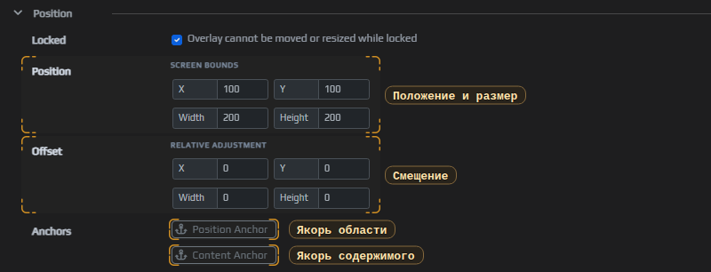

# Общие параметры — разместить оверлей и настроить его видимость

Общие параметры есть у любого оверлея. Ими вы ставите оверлей в нужное место, задаёте размер и прозрачность, запрещаете его двигать и разрешаете кликам проходить сквозь него в приложение. Так подсказка остаётся заметной и не мешает работать мышью.

Что именно показывать, решает сам оверлей: [Text](/ru/overlays/text) выводит ваш текст, [Image](/ru/overlays/image) — загруженную картинку, [Replica](/ru/overlays/replica) — копию окна. Виден оверлей или нет, обычно зависит от состояния ауры.

## Разместите подсказку и пропустите клики

1. В ауре с [Fixed Value](/ru/triggers/fixed-value) в состоянии Is Active добавьте Text. В **Content** напишите «Проверьте микрофон».
2. В **Window → Mode** оставьте **Overlay**. В **Position** выключите **Locked**, перетащите подсказку куда удобно и поменяйте размер, потянув за край. X, Y, Width и Height можно ввести и числами.
3. В **Visual style** поставьте **Opacity — 100%** и подберите Background так, чтобы текст читался. Значение `1` — это 100%.
4. Включите **Locked**, затем **Click-through**. Перейдите в другое приложение и кликните по его элементу под подсказкой. Клик должен пройти в приложение.
5. Проверьте скрытие: переключите Fixed Value в Is NOT Active, выберите в дереве другую ауру и вернитесь в рабочее приложение.

Подсказка скроется. Сделайте ауру снова активной — она появится на прежнем месте. Разблокированный оверлей виден и при неактивной ауре. Оверлей выбранной ауры тоже виден, пока активно окно редактора EyeAuras, чтобы его можно было настроить. Поэтому видимость проверяйте, выйдя из редактора.

## Положение и оформление

| Настройка | Что делает |
| --- | --- |
| Locked | Запрещает двигать оверлей и менять его размер мышью. В прежнем интерфейсе — IsLocked. |
| Position / Screen bounds | Координаты X, Y и размер Width, Height оверлея. |
| Offset | Поправки к положению и размеру. При стандартных якорях позиция `(100, 100)` и смещение `(10, 20)` дают `(110, 120)`. |
| Anchors | Точки отсчёта для положения и содержимого. Для начала оставьте стандартные. Подробности — в [блоке координат](/ru/features/coordinate-system). |
| Opacity | Прозрачность всего оверлея. `0` — невидим, `1` — полностью непрозрачен. |
| Background | Цвет фона, может быть прозрачным. В прежнем интерфейсе — Background Color. |
| Border / Border Thickness | Цвет и толщина рамки. |
| Click-through | Пропускает клики сквозь заблокированный оверлей. Пока активно окно EyeAuras, оверлей может временно снова ловить мышь, чтобы его можно было редактировать. |
| Aspect Ratio | Сохраняет соотношение сторон, если у содержимого известны пропорции. Недоступна, когда положение привязано к источнику. |

Показать содержимое как обычное окно

Если нужны заголовок и отдельное окно на панели задач, в разделе Window выберите Mode — Window. Содержимое и связь с аурой останутся.

| Настройка | Что делает |
| --- | --- |
| Mode — Overlay | Окно без обычного заголовка поверх других окон. |
| Mode — Window | Обычное окно с заголовком и кнопкой на панели задач. |
| Title | Текст заголовка в режиме Window. |
| Stacking — Always on top | Держит обычное окно поверх остальных. |
| Movement — Movable even if locked | Разрешает двигать заблокированное окно. Click-through при этом всё равно пропускает мышь сквозь него. |
| Minimum Size / Maximum Size | Ограничивают размер. Pick current берёт текущий размер, Reset снимает выбранное ограничение. |
| Window Icon | Load from file... загружает значок окна, Clear убирает его. |

Чтобы снова передвинуть оверлей, снимите Locked в его редакторе. Блокировка, прозрачность и условие активности — разные настройки: полностью прозрачный оверлей может оставаться активным.
