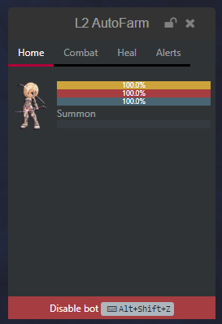
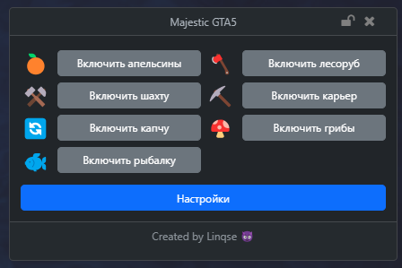
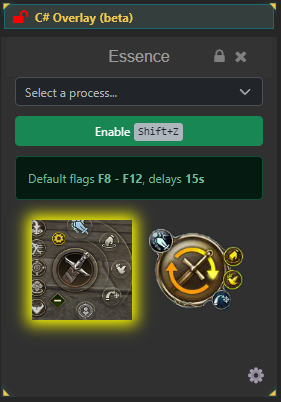
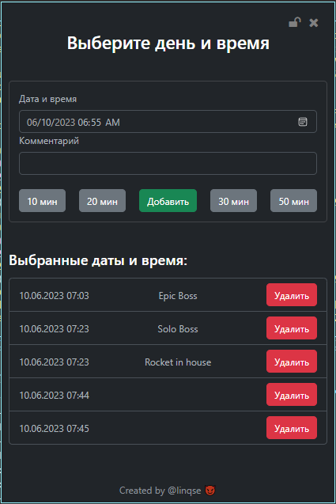

# Показать свою панель через C# Overlay

Чтобы вывести поверх окна собственные кнопки и значения, добавьте C# Overlay. Его содержимое — Razor-компонент Blazor, размещённый в WebView2. В старых материалах этот механизм называется Custom UI или WebUI. Это не ASP.NET Razor Pages и не изменение общего интерфейса EyeAuras.

Для первого опыта сделаем счётчик нажатий в своей ауре. Нужен обычный EyeAuras с доступным C# Overlay; внешние сервисы и дополнительные пакеты для этого примера не нужны.

## Создать счётчик

1. Создайте ауру **Панель**, добавьте **Fixed Value → Is Active** и затем оверлей **C# Overlay**. Так видимость не зависит от поиска или игрового события.
2. В редакторе оверлея откройте созданную пару **UserOverlay.razor** и **UserOverlay.cs**. Замените оба файла приведённым содержимым. Пространство имён PanelExample должно совпадать. Других пользовательских компонентов для этого опыта не добавляйте: оверлей выбирает первый экспортированный тип компонента из сборки.
3. Оставьте созданный **Script.csx** с короткой входной инструкцией. Здесь не нужно создавать отдельное IBlazorWindow или ждать его через ShowDialog: окном и показом владеет сам оверлей.
4. Дождитесь перекомпиляции. В видимой панели нажмите **Добавить**: число увеличится. Поменяйте Fixed Value на **Is NOT Active** — при обычной видимости по активности панель скроется; снова включите условие.

**UserOverlay.razor**

```razor
@namespace PanelExample
@inherits PoeShared.Blazor.BlazorReactiveComponent

<div class="p-3">
    <p>Нажатий: @count</p>
    <button class="btn btn-primary" @onclick="IncrementCount">Добавить</button>
</div>
```

**UserOverlay.cs**

```csharp
using PoeShared.Blazor;

namespace PanelExample;

public partial class UserOverlay : BlazorReactiveComponent
{
    private int count;

    private void IncrementCount()
    {
        count++;
        Refresh(nameof(IncrementCount));
    }
}
```

Число принадлежит экземпляру компонента, а не переменной конфигурации. Новая компиляция или пересоздание компонента начинает его заново; простое скрытие оверлея не следует считать сохранением или сбросом данных.

## Содержимое, состояние и окно

| Часть | Её роль |
| --- | --- |
| Script.csx | Верхнеуровневый вход скриптового проекта. Его Log и GetService не становятся глобальными именами внутри обычного класса или Razor. |
| Razor и C#-класс компонента | Разметка, поля и обработчики. Зависимости передаются параметрами или через зарегистрированные службы контейнера. |
| C# Overlay | Компиляция проекта, размещение компонента, окно, видимость и общие параметры оверлея. Код проекта сохраняется с его свойствами. |
| Refresh(reason) | Запрос обновления компонента BlazorReactiveComponent после изменения состояния. В примере вызван из обработчика. |
| Привязка свойства ауры | Отдельный механизм [Bindings](/ru/features/bindings). Обычное поле count не становится таким свойством автоматически. |
| Linked auras | Контекст ссылок проекта, если он нужен вашему коду; не автоматическое получение любых игровых данных. |

Положение, размер, прозрачность, режим Window/Overlay, блокировка и пропуск мыши задаются [общими параметрами](/ru/overlays/common-options). Если панель не принимает щелчки, проверьте блокировку и Click-through. Пользовательский код живёт в том же приложении; компиляция не создаёт изолированную среду безопасности.

Созданные компонентом подписки, таймеры и JavaScript-регистрации должны освобождаться вместе с ним. Для своих событий используйте владельца и Anchors; не оставляйте бессрочную подписку после замены компонента. В отличие от оверлея, отдельное [Blazor-окно](/ru/scripting/blazor-windows/getting-started) создаёт и удерживает сам скрипт; [мини-приложение](/ru/features/mini-app) дополнительно определяет запуск и распространение всего набора.

## Редактировать и переносить проект

| Команда редактора | Для чего нужна |
| --- | --- |
| File Tree | Открыть файлы проекта. Текущий редактор кода отличается от прежнего AvalonEdit. |
| Pop-out editor in separate window | Вынести редактор в отдельное окно; это не новое окно результата оверлея. |
| Export… / Open in IDE… | Выгрузить решение или открыть его во внешней IDE. Используйте ссылки и пакеты созданного проекта, а не вручную угаданную версию SDK. |
| Import… | Применить проект обратно. Дополнительные зависимости должны быть доступны этому проекту. |
| Live… | Следить за решением и применять изменения; остановка наблюдения описана в [интеграции с IDE](/ru/scripting/ide-integration). |
| Dev Tools | Открыть инструменты WebView2 для содержимого оверлея. Клавиша F12 зависит от разрешённых browser hotkeys и фокуса; кнопка не требует угадывать эту настройку. |
| Clone as Action | Создать On Enter C# Script из оверлея и отключить исходный оверлей. Это отдельный переход к сценарию со своим окном, не обычная перекомпиляция. |

CSS меняет оформление вашего компонента, а не всей оболочки. Для JavaScript используйте [модуль и его cleanup](/ru/scripting/blazor-windows/js-loadscript), для файлов — [встроенные ресурсы](/ru/scripting/embedded-resources). Встроенные Bootstrap-классы подходят для первого счётчика; подключённый CDN остаётся внешней зависимостью. Нативные диалоги из обработчиков Blazor открывайте через штатные UI-обёртки, не через Task.Run.

<details>
<summary>Прежние пользовательские интерфейсы</summary>

Эти проекты показывают, как авторы сочетали собственную панель с логикой набора. Их игровые данные и поведение задаёт конкретный проект, а не сам тип C# Overlay.

[Lineage 2 Scryde autofarm](https://eyeauras.net/share/S202403150219539BfeOJ0eRl1q): панель состояния и управления деревом.



[GTA 5 RP Majestic helper](https://eyeauras.net/share/S20240121210358gpJJuNtIZRSQ): кнопки отдельных задач.



[Lineage 2 Essence auto flags](https://eyeauras.net/share/S20240325120506y5CPVmuwLvC3): выбор адресата и параметры сценария.



[Time Alert](https://eyeauras.net/share/S20230424095833g0ccyvLqWNNo): собственный список дат и комментариев.



</details>
