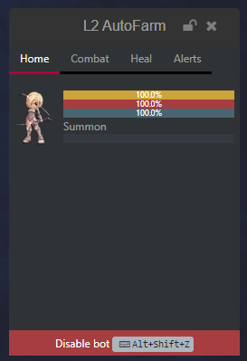
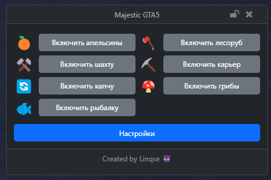
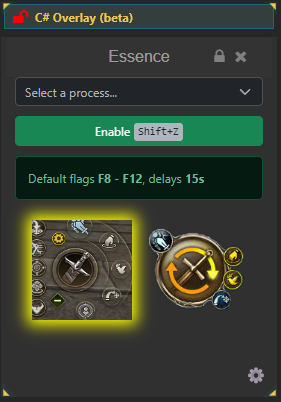
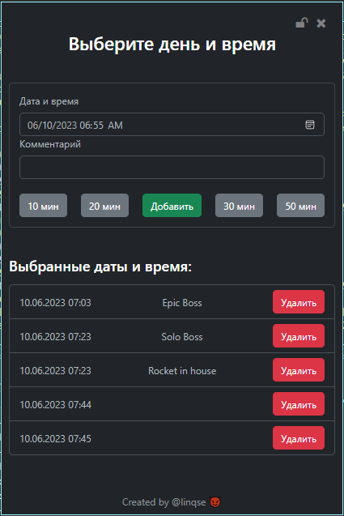

# Показать свою панель через C# Overlay

C# Overlay показывает поверх окна ваши собственные кнопки и значения. Внутри это Razor-компонент Blazor, который работает в WebView2. В старых материалах его называют Custom UI или WebUI. Это не ASP.NET Razor Pages, и общий интерфейс EyeAuras он не меняет.

Для начала сделаем счётчик нажатий в своей ауре. Нужен обычный EyeAuras, в котором доступен C# Overlay. Внешние сервисы и дополнительные пакеты не понадобятся.

## Создать счётчик

1. Создайте ауру **Панель**, добавьте **Fixed Value → Is Active**, затем оверлей **C# Overlay**. Так панель видна всегда и не зависит от поиска или события в игре.
2. В редакторе оверлея откройте созданную пару **UserOverlay.razor** и **UserOverlay.cs**. Замените оба файла кодом ниже. Пространство имён PanelExample должно совпадать в обоих. Других своих компонентов пока не добавляйте: оверлей берёт первый экспортированный тип компонента из сборки.
3. Созданный **Script.csx** с короткой входной инструкцией оставьте как есть. Создавать отдельное IBlazorWindow или ждать его через ShowDialog не нужно: окном и показом управляет сам оверлей.
4. Дождитесь перекомпиляции. На панели нажмите **Добавить** — число вырастет. Переключите Fixed Value на **Is NOT Active** — панель скроется (если видимость обычная, по активности). Затем включите условие обратно.

**UserOverlay.razor**

```razor
@namespace PanelExample
@inherits PoeShared.Blazor.BlazorReactiveComponent

<div class="p-3">
    <p>Нажатий: @count</p>
    <button class="btn btn-primary" @onclick="IncrementCount">Добавить</button>
</div>
```

**UserOverlay.cs**

```csharp
using PoeShared.Blazor;

namespace PanelExample;

public partial class UserOverlay : BlazorReactiveComponent
{
    private int count;

    private void IncrementCount()
    {
        count++;
        Refresh(nameof(IncrementCount));
    }
}
```

Число хранится в экземпляре компонента, а не в переменной конфигурации. После новой компиляции или пересоздания компонента счёт начнётся заново. Простое скрытие оверлея не стоит считать ни сохранением, ни сбросом данных.

Если панель должна показывать изменения не только от своих кнопок, посмотрите [пример реактивного переключателя](/ru/scripting/blazor-windows/reactive-toggle). Он следит за триггером своей ауры через внедрённый сервис дерева. Подпиской владеет компонент, а значение берётся из триггера, а не из локального счётчика.

## Содержимое, состояние и окно

| Часть | Её роль |
| --- | --- |
| Script.csx | Верхнеуровневый вход скриптового проекта. Его Log и GetService не видны как глобальные имена в обычном классе или Razor. |
| Razor и C#-класс компонента | Разметка, поля и обработчики. Зависимости передаются параметрами или через зарегистрированные службы контейнера. |
| C# Overlay | Компилирует проект, размещает компонент, отвечает за окно, видимость и общие параметры оверлея. Код проекта сохраняется вместе с его свойствами. |
| Refresh(reason) | Просит компонент BlazorReactiveComponent обновиться после изменения состояния. В примере вызывается из обработчика. |
| Привязка свойства ауры | Отдельный механизм [Bindings](/ru/features/bindings). Обычное поле count таким свойством само не становится. |
| Linked auras | Контекст ссылок проекта, если он нужен вашему коду. Игровые данные через него сами не появляются. |

Положение, размер, прозрачность, режим Window/Overlay, блокировка и пропуск мыши настраиваются в [общих параметрах](/ru/overlays/common-options). Если панель не реагирует на щелчки, проверьте блокировку и Click-through. Ваш код работает в том же приложении: компиляция не создаёт изолированную безопасную среду.

Подписки, таймеры и JavaScript-регистрации, которые создал компонент, должны освобождаться вместе с ним. Для своих событий используйте владельца и Anchors. Не оставляйте вечную подписку после замены компонента. Отдельное [Blazor-окно](/ru/scripting/blazor-windows/getting-started), в отличие от оверлея, создаёт и держит сам скрипт. [Мини-приложение](/ru/features/mini-app) вдобавок определяет запуск и распространение всего набора.

## Редактировать и переносить проект

| Команда редактора | Для чего нужна |
| --- | --- |
| File Tree | Открывает файлы проекта. Нынешний редактор кода — уже не прежний AvalonEdit. |
| Pop-out editor in separate window | Выносит редактор в отдельное окно. Это не новое окно с результатом оверлея. |
| Export… / Open in IDE… | Выгружает решение или открывает его во внешней IDE. Берите ссылки и пакеты созданного проекта, а не версию SDK наугад. |
| Import… | Применяет проект обратно. Дополнительные зависимости должны быть доступны этому проекту. |
| Live… | Следит за решением и применяет изменения. Как остановить наблюдение, написано в [интеграции с IDE](/ru/scripting/ide-integration). |
| Dev Tools | Открывает инструменты WebView2 для содержимого оверлея. F12 зависит от разрешённых browser hotkeys и фокуса, а кнопка работает всегда. |
| Clone as Action | Создаёт On Enter C# Script из оверлея и отключает исходный оверлей. Получается отдельный сценарий со своим окном, это не обычная перекомпиляция. |

CSS меняет вид только вашего компонента, а не всей оболочки. Для JavaScript используйте [модуль и его cleanup](/ru/scripting/blazor-windows/js-loadscript), для файлов — [встроенные ресурсы](/ru/scripting/embedded-resources). Для первого счётчика хватит встроенных Bootstrap-классов. Подключённый CDN остаётся внешней зависимостью. Нативные диалоги из обработчиков Blazor открывайте через штатные UI-обёртки, а не через Task.Run.

<details>
<summary>Прежние пользовательские интерфейсы</summary>

В этих проектах авторы совместили свою панель с логикой набора. Игровые данные и поведение в них задаёт сам проект, а не C# Overlay.

[Lineage 2 Scryde autofarm](https://eyeauras.net/share/S202403150219539BfeOJ0eRl1q): панель состояния и управления деревом.



[GTA 5 RP Majestic helper](https://eyeauras.net/share/S20240121210358gpJJuNtIZRSQ): кнопки отдельных задач.



[Lineage 2 Essence auto flags](https://eyeauras.net/share/S20240325120506y5CPVmuwLvC3): выбор адресата и параметры сценария.



[Time Alert](https://eyeauras.net/share/S20230424095833g0ccyvLqWNNo): собственный список дат и комментариев.



</details>
