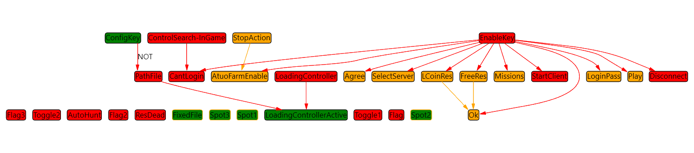

# Увидеть, от какой ауры зависит условие

Dependencies Viewer — оверлей, который рисует граф: ауры и связи между ними. Связь появляется, когда условие одной ауры ссылается на другую.

## Проверить одну связь без действий

1. Создайте ауру **Источник** с **Fixed Value → Is NOT Active**. Действия не добавляйте.
2. Создайте ауру **Зависимая** с одним триггером **Aura Is Active**. В его **Links** выберите Источник и проверку активности — как в [описании триггера](/ru/triggers/aura-is-active).
3. Создайте третью ауру **Граф** с **Fixed Value → Is Active** и оверлеем **Dependencies Viewer**. Она нужна только для показа, поэтому всегда активна.
4. В редакторе оверлея раскройте **Graph → Auras → Links** и выберите Зависимую. **Show dependencies** и **Show connections** оставьте включёнными. На графе появятся Зависимая, её Источник и связь между ними.
5. У Источника выберите **Is Active**, затем снова **Is NOT Active**. Посмотрите на результат Aura Is Active в редакторе Зависимой — он меняется вслед за Источником.

Графа не видно? Проверьте, что аура Граф активна, и [условия видимости оверлея](/ru/overlays/common-options). Нет связи? Ссылка должна быть создана в триггере Зависимой. Выбрать ауру в списке отображаемых недостаточно.

## Выбрать содержимое графа

| Настройка | Что меняет |
| --- | --- |
| Auras → Links | Ауры или папки, с которых начинается граф. Выберите папку, чтобы разобрать свою группу. |
| Show dependencies | Добавляет зависимости выбранных аур. Если выключить, останутся только выбранные узлы. |
| Show connections | Показывает линии связей. Если их скрыть, сами связи в конфигурации останутся. |
| Show background | Фон области графа. |

Этот граф не показывает, активна ли аура и заняты ли её группы On Enter, While Active и On Exit. Смотрите это в редакторе и в [Event Viewer](/ru/features/event-viewer).

Параметры раскладки

| Поле | Сохранённое значение |
| --- | --- |
| Auto-arrange after updates | Выбор автоматического размещения. |
| Arrange Direction | Направление, по умолчанию Down. |
| Arrange Algorithm | Алгоритм, по умолчанию Layered. |

Эти поля сохраняются в конфигурации, но на размещение узлов сейчас не влияют.

Dependencies Viewer показывает ссылки вычислителей связанных аур. Откуда берётся значение конкретного свойства, смотрите в [Binding Editor](/ru/features/bindings).

Как читать группы действий и что чему соответствует в старом интерфейсе — на [странице со старым адресом](/ru/overlays/dependenciesviewer).
