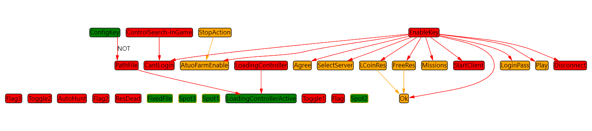

# Увидеть, от какой ауры зависит условие

Если одна аура должна следовать за другой, Dependencies Viewer помогает увидеть обе и связь между ними на графе. Источник рёбер — ссылки условий на другие ауры. Сам граф не выполняет условия и не заменяет редактор привязок свойств.

## Проверить одну связь без действий

1. Создайте ауру **Источник** с **Fixed Value → Is NOT Active**. Действия не добавляйте.
2. Создайте ауру **Зависимая** с одним триггером **Aura Is Active**. В его **Links** выберите Источник и проверку активности по [руководству триггера](/ru/triggers/aura-is-active).
3. Создайте третью ауру **Граф** с **Fixed Value → Is Active** и оверлеем **Dependencies Viewer**. Она нужна только для показа, поэтому её собственное условие постоянно активно.
4. В редакторе оверлея раскройте **Graph → Auras → Links** и выберите Зависимую. Оставьте **Show dependencies** и **Show connections** включёнными. На графе должны появиться Зависимая и её Источник со связью.
5. У Источника выберите **Is Active**, затем снова **Is NOT Active**. Проверьте результат Aura Is Active в редакторе Зависимой: он следует за Источником. Сам граф используйте для проверки состава узлов и связи; он не выполняет реакций и не служит индикатором завершения действия.

Если граф скрыт, сначала проверьте активность ауры Граф и [условия видимости оверлея](/ru/overlays/common-options). Отсутствующее ребро проверяйте отдельно: ссылка должна быть создана в триггере Зависимой, а не только в списке отображаемых аур.

## Выбрать содержимое графа

| Настройка | Что меняет |
| --- | --- |
| Auras → Links | Начальные ауры или папки для отображения. Выбор папки позволяет разобрать свою группу. |
| Show dependencies | Добавляет зависимости выбранных аур. Без него можно оставить только исходный набор узлов. |
| Show connections | Показывает линии связей; скрытие линий не удаляет сами связи конфигурации. |
| Show background | Фон области графа. |

В этом варианте графа отображение активности аур и занятости On Enter, While Active, On Exit не подключено. Проверяйте их в редакторе и [Event Viewer](/ru/features/event-viewer), а не по цвету старого снимка. Статус Active отличается от факта, что группа действий занята.

Параметры раскладки

| Поле | Сохранённое значение |
| --- | --- |
| Auto-arrange after updates | Выбор автоматического размещения. |
| Arrange Direction | Направление, по умолчанию Down. |
| Arrange Algorithm | Алгоритм, по умолчанию Layered. |

Эти поля сохраняются в конфигурации, но текущий компонент графа не применяет их к размещению. Их изменение не следует использовать как проверку работающей раскладки.

Dependencies Viewer показывает ссылки вычислителей связанных аур, а не полный граф C#-вызовов или всех Bindings. Для проверки источника конкретного свойства откройте [Binding Editor](/ru/features/bindings). Перемещение узлов графа не создаёт новую зависимость и не меняет порядок выполнения действий.

Этот механизм применим к любому своему набору, а не только к игровой конфигурации. На [странице прежнего URL](/ru/overlays/dependenciesviewer) разобрано чтение групп действий и соответствие старой оболочке.
