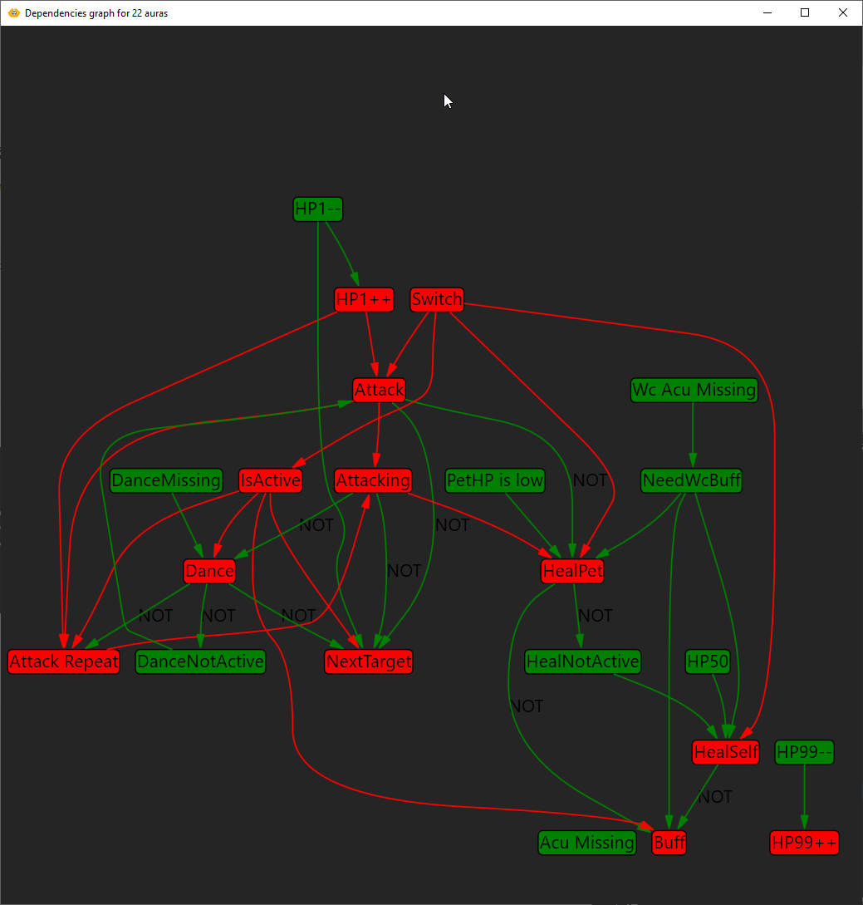
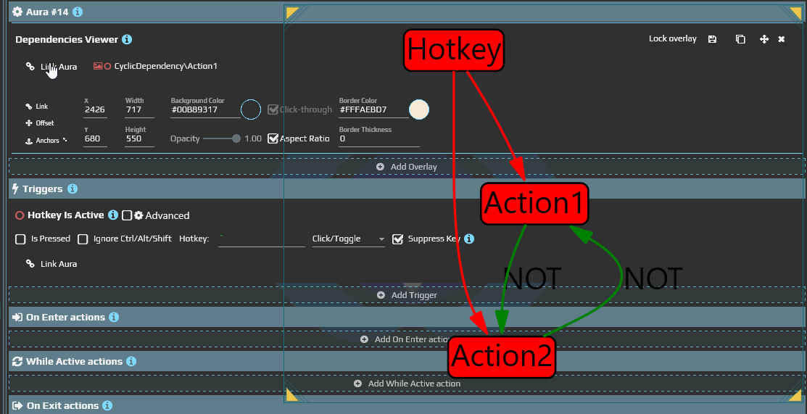

# Сопоставить прежний граф зависимостей с текущей настройкой

Если вы разбираете старую конфигурацию по снимку графа, сначала отделите структуру связей от отметок выполнения. Этот адрес относится к тому же Dependencies Viewer, что и [руководство оверлея](/ru/overlays/dependencies-viewer). Отдельный новый тип узла из-за другого написания URL создавать не нужно.

## Проверить свою связь и ожидание

1. Соберите Источник, Зависимую и оверлей Граф по [короткому примеру](/ru/overlays/dependencies-viewer). На графе проверьте, что видны обе ауры и их связь.
2. В Зависимую добавьте **Delay** на **1000 ms** в **On Enter** и **On Exit**, а в **While Active** — Delay на **2000 ms**. Другие действия не нужны.
3. Откройте **Event Viewer** Зависимой и её редактор. У Источника переключите **Is NOT Active → Is Active**, затем обратно. Сопоставьте состояние Aura Is Active с началом и завершением групп в журнале.
4. Вернитесь к графу: он отвечает на вопрос, откуда пришло условие. Порядок и завершение ожиданий проверяйте по журналу; нынешний вывод графа не отображает отметки активности и занятости групп со старых изображений.

Результат — понятная цепочка «Источник → условие Зависимой → её действия». Delay оставляет время заметить работу, но не останавливает все остальные ауры.

| Признак из прежнего графа | Как проверить его сейчас |
| --- | --- |
| Аура активна или неактивна | Состояние ауры и её триггеров в редакторе. Unknown — отдельный результат, не синоним Not Active. |
| Аура приостановлена или недоступна | Состояние включения/загрузки и сообщения редактора; отсутствие узла или его цвет сами по себе не устанавливают причину. |
| On Enter | Начало и завершение группы перехода в активное состояние в журнале. |
| While Active | Работа повторяемой группы активной ауры. |
| On Exit | Работа группы выхода из активного состояния. |
| Соединение | Ссылка условия на другую ауру; это не провод между произвольными свойствами. |

На старом снимке большого графа использовались цветовые отметки. Он помогает читать прежнюю конфигурацию, но его оформление не задаёт возможности нынешнего вывода:

## Найти соответствующий редактор

В прежнем интерфейсе описывались два входа: **Show dependencies** в контекстном меню и оверлей **Dependencies Viewer**. Для текущего пути используйте зарегистрированный оверлей и **Graph → Auras → Links**. Наличие старого пункта меню не требуется этому сценарию.

| Что нужно изменить | Где это делать |
| --- | --- |
| Начальные узлы и показ зависимостей | Graph у оверлея, Show dependencies и Show connections. |
| Условие зависимости | Links соответствующего Aura Is Active или другого поддержанного условия. |
| Привязку значения свойства | [Binding Editor](/ru/features/bindings), а не линия на графе. |
| Положение, блокировку или видимость окна | [Общие параметры оверлеев](/ru/overlays/common-options). Интерактивность зависит от режима окна и пропуска мыши; оверлей нельзя считать всегда неинтерактивным. |

Граф не предсказывает будущие действия и не хранит историю каждого короткого перехода. Для порядка событий нужен [журнал ауры](/ru/features/event-viewer).
