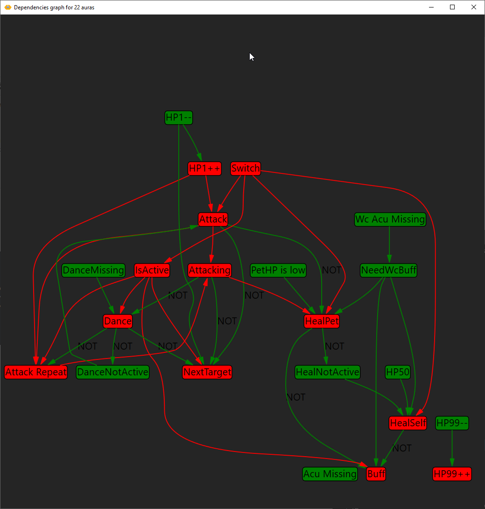
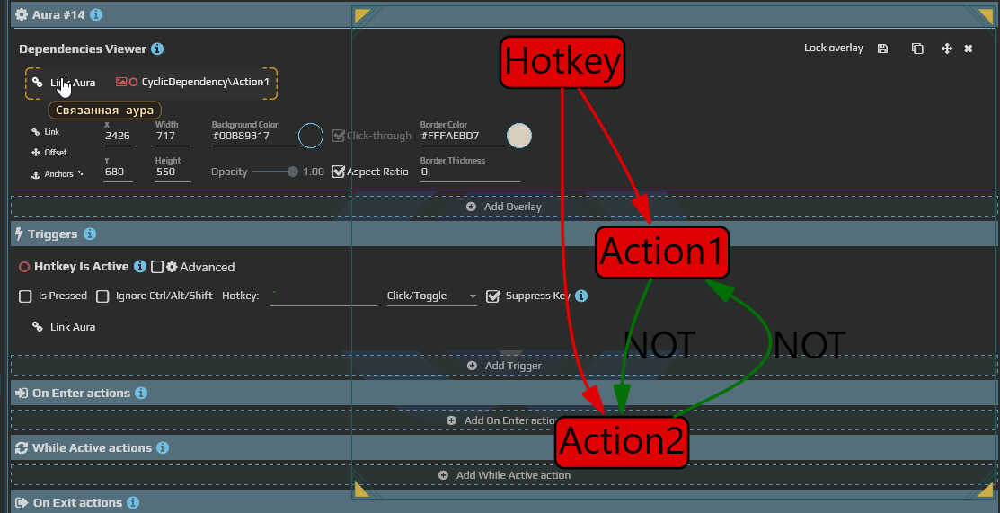

# Сопоставить прежний граф зависимостей с текущей настройкой

Эта страница помогает разобрать старую конфигурацию по снимку графа. Главное — не путать сами связи с отметками выполнения. Адрес ведёт к тому же Dependencies Viewer, что и [страница оверлея](/ru/overlays/dependencies-viewer). Из-за другого написания URL отдельный тип узла создавать не нужно.

## Проверить свою связь и ожидание

1. Соберите Источник, Зависимую и оверлей Граф по [короткому примеру](/ru/overlays/dependencies-viewer). Проверьте, что на графе видны обе ауры и связь между ними.
2. В Зависимую добавьте **Delay** на **1000 ms** в **On Enter** и **On Exit**, а в **While Active** — Delay на **2000 ms**. Другие действия не нужны.
3. Откройте **Event Viewer** Зависимой и её редактор. У Источника переключите **Is NOT Active → Is Active**, затем обратно. Сравните состояние Aura Is Active с началом и концом групп в журнале.
4. Вернитесь к графу. Он показывает, откуда пришло условие. Порядок и завершение ожиданий смотрите в журнале: отметок активности и занятости групп, как на старых снимках, на нынешнем графе нет.

Получится понятная цепочка «Источник → условие Зависимой → её действия». Delay даёт время заметить работу, но остальные ауры не останавливает.

| Признак из прежнего графа | Как проверить его сейчас |
| --- | --- |
| Аура активна или неактивна | Состояние ауры и её триггеров в редакторе. Unknown — отдельный результат, а не то же самое, что Not Active. |
| Аура приостановлена или недоступна | Состояние включения и загрузки, сообщения редактора. По отсутствию узла или его цвету причину не определить. |
| On Enter | Начало и конец группы в журнале. Она выполняется при переходе в активное состояние. |
| While Active | Работа группы, которая повторяется, пока аура активна. |
| On Exit | Работа группы, которая выполняется при выходе из активного состояния. |
| Соединение | Ссылка условия на другую ауру. Это не провод между произвольными свойствами. |

На старом снимке большого графа есть цветовые отметки. Снимок помогает читать прежнюю конфигурацию, но не показывает, что умеет нынешний граф:

## Найти соответствующий редактор

В прежнем интерфейсе было два входа: **Show dependencies** в контекстном меню и оверлей **Dependencies Viewer**. Сейчас используйте оверлей и **Graph → Auras → Links**. Старый пункт меню для этого не нужен.

| Что нужно изменить | Где это делать |
| --- | --- |
| Начальные узлы и показ зависимостей | Graph у оверлея, Show dependencies и Show connections. |
| Условие зависимости | Links у Aura Is Active или другого поддерживаемого условия. |
| Привязку значения свойства | [Binding Editor](/ru/features/bindings), а не линия на графе. |
| Положение, блокировку или видимость окна | [Общие параметры оверлеев](/ru/overlays/common-options). Можно ли взаимодействовать с оверлеем, зависит от режима окна и пропуска мыши. Он не всегда неинтерактивен. |

Граф не предсказывает будущие действия и не хранит историю каждого короткого перехода. Порядок событий смотрите в [журнале ауры](/ru/features/event-viewer).
