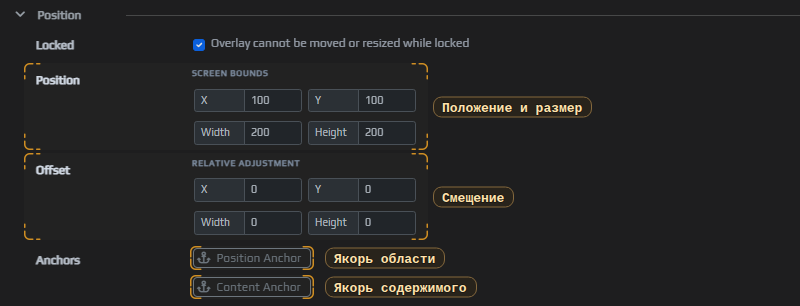

# Image — держать перед глазами схему или картинку

Image показывает картинку из файла поверх приложений: схему подключения, раскладку клавиш, любую шпаргалку. Можно сделать так, чтобы она была видна, только пока вы держите клавишу.

Подойдёт PNG или JPEG. Анимированные GIF тоже работают, но оверлей просто проигрывает файл. Таймер или прогресс по данным другого приложения он не считает.

## Показывайте схему, пока удерживается F8

1. Создайте ауру с одним [Hotkey Is Active](/ru/triggers/hotkey-is-active). Задайте свободную клавишу F8 и режим **Hold**.
2. В **Overlays** добавьте **Image**. В его разделе Image нажмите **Load image from file...** и выберите файл. Картинка появится в Preview.
3. В **Visual style** включите **Aspect Ratio**, чтобы схема не растягивалась при изменении размера.
4. Снимите **Locked**, перетащите оверлей в удобное место и потяните за край, чтобы изменить размер. Если на схеме мелкие подписи, начните с крупного размера. Снова включите Locked и, если нужно, Click-through.

   

   На снимке оверлей размером 200 × 200 и включён Locked. Чтобы поменять размер, сначала снимите этот флажок.
5. Перейдите в рабочее приложение, зажмите F8, затем отпустите.

Пока клавиша зажата, схема видна. Отпустили — пропала. Если аура выбрана в редакторе или снят Locked, схема может быть видна и без клавиши: это режим настройки.

## Настройки изображения

| Настройка | Что делает |
| --- | --- |
| Load image from file... | Загружает файл. В диалоге доступны JPEG, PNG, BMP, GIF и TGA. |
| Preview | Показывает выбранную картинку в редакторе. |
| Clear | Убирает картинку из оверлея. |
| Aspect Ratio | Сохраняет пропорции при изменении размера. Недоступен, если положение привязано к источнику. |
| Position / Locked | Положение и блокировка оверлея. Подробнее — в [общих параметрах](/ru/overlays/common-options). |

Картинка сохраняется в конфигурации оверлея. Если поменять файл на диске, оверлей сам не обновится — загрузите картинку заново.

Чтобы схема была видна всегда, вместо горячей клавиши возьмите [Fixed Value](/ru/triggers/fixed-value) со значением Is Active. Если нужен живой участок другого окна, например полоса прогресса, берите [Replica](/ru/overlays/replica).
