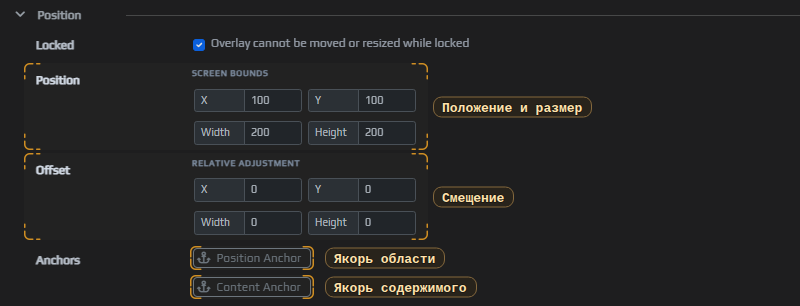

# Replica — вынести нужный участок окна на видное место

Replica показывает живую копию окна или его части поверх других приложений. Например, программа долго что-то обрабатывает, а полоса прогресса занимает уголок большого окна — вынесите её туда, где удобно смотреть. Оверлей копирует только пиксели исходного окна. Процентов или оставшегося времени он не знает.

Для первой проверки не закрывайте и не сворачивайте исходную программу. Выберите участок, который точно меняется: строку состояния или полосу прогресса.

## Покажите копию области с прогрессом

1. Создайте ауру с [Fixed Value](/ru/triggers/fixed-value) в состоянии **Is Active** и добавьте в **Overlays** оверлей **Replica**.
2. В разделе **Replica → Target Window** выберите окно исходной программы. Проверьте, какое окно показано как цель. Если не то, уточните [выражение сопоставления](/ru/features/window-matching-expressions).
3. В **Source region** нажмите **Select region** и обведите прямоугольником нужный индикатор в исходном окне. **Source offset** оставьте нулевым, **Source anchors** — стандартными, **Linked auras** — пустым.
4. В общих параметрах оверлея снимите **Locked**, перетащите копию в удобное место и задайте размер. Чтобы сохранить пропорции, включите Aspect Ratio. Затем снова включите Locked.
5. Перейдите в рабочее приложение и подождите, пока индикатор в источнике изменится.

Та же область изменится и в оверлее. Source region задаёт, **что копировать**, а общий Position — **где и какого размера показывать копию**. Если элементы в исходном окне сдвинулись, выделите область заново.

## Источник и область

| Настройка | Что делает |
| --- | --- |
| Target Window | Окно, из которого берётся копия. Это не то окно, поверх которого она должна лежать. |
| Source region / Select region | Участок исходного окна. Хранится в пикселях относительно клиентской области окна. |
| Reset | Сбрасывает область, смещения, якоря и ссылки источника. Если область пустая, копируется всё окно. |
| Source offset | Поправки X, Y, Width, Height к области копирования. |
| Source anchors | Точки отсчёта области и её содержимого. Подробнее — в [блоке координат](/ru/features/coordinate-system). |
| Linked auras | Берёт исходное окно и область из другой ауры, например из результата Image Search. В прежнем редакторе — Link Aura. |

Чтобы связать Replica с [Image Search](/ru/triggers/images/image-search), сначала добейтесь, чтобы поиск находил правильный прямоугольник. Потом добавьте эту ауру в Linked auras — Replica будет следовать за найденной областью и её окном. Если источников несколько, берётся первый доступный источник с областью. На порядок активации по времени не рассчитывайте. Начните с одной ссылки, так настройка будет однозначной.

## Видимость и ограничения

В примере Fixed Value держит ауру активной, поэтому заблокированная Replica видна всегда. Чтобы показывать её по клавише, замените его на [Hotkey Is Active](/ru/triggers/hotkey-is-active). Про Locked, Click-through и режим обычного окна написано в [общих параметрах](/ru/overlays/common-options).

Replica — это изображение, а не вторая рабочая копия приложения. Щелчок по копии в исходное окно не попадает. С Click-through он уходит в окно **под оверлеем**.

Закрытое окно скопировать нельзя. Свёрнутое или защищённое от захвата окно может не обновляться — разверните его и проверьте. Копии нет? Проверьте Target Window, размеры Source region и сообщение внутри оверлея, например No window matched. Если окно пересоздали, прежний временный дескриптор может больше не подходить.
