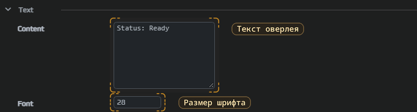

# Text — показать короткую памятку по клавише

Text показывает надпись поверх приложений. Например, памятку «Перед записью проверьте микрофон», которую вы включаете и убираете клавишей. Сам текст вводится в Content, а за показ отвечает триггер Hotkey Is Active.

## Включайте памятку клавишей F7

1. Создайте ауру и добавьте только [Hotkey Is Active](/ru/triggers/hotkey-is-active). Задайте свободную клавишу F7 и режим **Toggle Trigger state on Click**.
2. В **Overlays** добавьте **Text**. Раскройте раздел Text и в **Content** напишите «Перед записью проверьте микрофон». В прежнем редакторе это поле называется Text.
3. В **Font** задайте `24` и выключите **Size to fit**. Выберите белый **Font Color**, в **Outline** — толщину `2` и чёрный цвет.

   

   На снимке пример Status monitor: текст `Status: Ready` и шрифт 28. У себя введите в Content памятку и поставьте 24 в поле Font.
4. Снимите **Locked**, поставьте памятку на место и растяните прямоугольник пошире, например `500 × 80`. Затем включите Locked и, если хотите, Click-through.
5. Перейдите в рабочее приложение и нажмите F7. Второе нажатие уберёт памятку.

Первое нажатие делает ауру активной и показывает текст, второе — неактивной и скрывает. Пока аура выбрана в редакторе, оверлей может оставаться видимым для настройки, поэтому проверяйте в другом приложении.

Чтобы проверить показ без клавиши, замените Hotkey Is Active на [Fixed Value](/ru/triggers/fixed-value). Если нужное условие уже есть в другой ауре, возьмите её состояние через [Aura Is Active](/ru/triggers/aura-is-active). Сам текст всё равно задаётся в **Content**.

## Настройки текста

| Настройка | Что делает |
| --- | --- |
| Content | Текст памятки. Введите его вручную или получайте через [привязку](/ru/features/bindings) к другому свойству или переменной. |
| Font | Размер шрифта, когда Size to fit выключен. В прежнем редакторе — FontSize. |
| Size to fit | Подбирает размер шрифта под область отображения. В прежнем редакторе — Fit to Size. Длинному тексту всё равно нужно достаточно места. |
| Font Color | Цвет букв. |
| Outline | Толщина и цвет обводки букв. В прежнем редакторе это отдельные поля Outline Thickness и Outline Color. |
| Alignment | Выравнивание внутри прямоугольника оверлея. В прежнем редакторе — Text Anchor. |

Alignment ставит текст по центру, к верхнему, нижнему, левому или правому краю либо в один из четырёх углов. В старом интерфейсе эти варианты называются Center, Top, Bottom, Left, Right, TopLeft, TopRight, BottomLeft и BottomRight. Это положение текста **внутри** оверлея. Сам оверлей двигается через Position.

Размер, фон, рамка, прозрачность и блокировка описаны в [общих параметрах](/ru/overlays/common-options). Чтобы сообщение появлялось по событию, замените горячую клавишу подходящим триггером, например [поиском надписи](/ru/triggers/images/text-search). Источник события и текст сообщения настраиваются отдельно.
