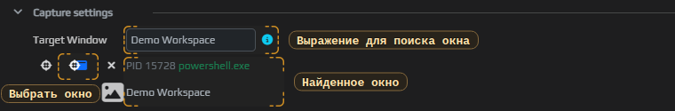

# Привязать клавишу уведомления к одному приложению

F6 подаёт короткий сигнал, только когда ваше окно Блокнота на переднем плане. Одна аура следит за окном и разрешает или запрещает обработку горячей клавиши во второй.

Откройте одно окно Блокнота с временным текстовым документом. Нужен рабочий звуковой выход. F6 не должна запускать что-то мешающее в окнах, где вы проверяете. Если запускает — возьмите другую свободную клавишу. **Suppress Key** везде оставьте выключенным: приложение по-прежнему может получить исходную клавишу.

## Создать исходное условие

1. Нажмите правой кнопкой на пустом месте дерева, выберите **New Aura**, назовите ауру **Заметки активны**.
2. В **Triggers** нажмите **+** и добавьте **Window Is Active**. В **Target Window** введите `notepad`. Проверьте по сведениям о выбранном окне, что это ваш документ. Списки действий и оверлеев оставьте пустыми.

   

3. Перейдите из Блокнота в другое приложение и обратно. **Заметки активны** должна быть **Active**, только когда подходящее окно на переднем плане. Ауру оставьте загруженной и включённой.

## Ограничить клавишу и добавить сигнал

1. Создайте в корне ещё одну **New Aura** с именем **Уведомление заметок**. В **Triggers** добавьте **Hotkey Is Active**. Назначьте **F6**, выберите **Hold**, **Suppress Key** оставьте выключенным.
2. Откройте **Advanced** этого триггера. В **Interception Condition** нажмите **Links**, выберите **Заметки активны** и требуемое состояние **Active**. Других связей не добавляйте. **Ignore If Hotkey Is Pressed** оставьте выключенным: здесь каждое нажатие начинается заново после смены приложения.
3. В **On Enter** нажмите **+**, добавьте **Play Sound**, выберите **Audio notification → Ping**, задайте **Volume 50%** и прослушайте звук. **While Active** и **On Exit** оставьте пустыми.

| Параметр | Значение |
| --- | --- |
| Hotkey | F6 или другая свободная клавиша |
| Mode | Hold |
| Suppress Key | Выключен |
| Interception Condition → Links | Заметки активны, требуемое Active |
| Ignore If Hotkey Is Pressed | Выключен |
| On Enter | Play Sound → Ping, Volume 50% |

4. Обе ауры должны быть включены, EyeAuras — не на паузе. Перейдите из редактора в Блокнот. Нажмите и немного подержите F6: должен прозвучать один Ping. Пока клавиша зажата, сигнал повторяться не должен. Отпустите клавишу, чтобы условие Hold вернулось в **Not Active** перед следующей попыткой.
5. Перейдите в другое приложение и нажмите F6 там: сигнала быть не должно. Отпустите клавишу и вернитесь в Блокнот — там новое нажатие снова должно сработать. Сравнивайте не в окне самого EyeAuras: у него есть свой параметр обработки ввода в собственном окне, и он может исказить результат.

[Window Is Active](/ru/triggers/window-is-active) даёт состояние окна, [Links горячей клавиши](/ru/triggers/hotkey-is-active) ограничивает перехват, [Play Sound](/ru/actions/play-sound) подаёт сигнал. Если просто поставить триггеры окна и клавиши рядом через AND, их результаты объединятся, но перехват клавиши это не настроит.

Отпускайте клавишу перед сменой приложения.
