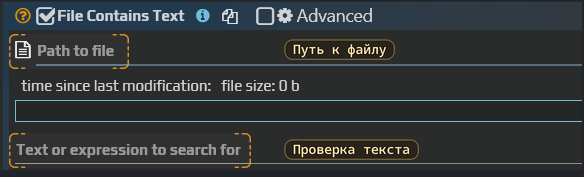

# Не упустить незаконченные пункты списка

Пока в вашем текстовом файле есть `TODO`, на экране висит памятка **Завершите список**. Сохраните файл без этой отметки — памятка исчезнет. Файл задаёт условие, а текст памятки вы вводите в Text отдельно.

Нужен небольшой локальный файл в UTF-8, который EyeAuras может прочитать. В папке, куда вы можете писать, сохраните `checklist.txt` с двумя строками: `TODO проверить заметки` и `DONE выбрать имя файла`. Запомните полный путь. EyeAuras не видит несохранённый текст в редакторе. Если файл переименовать, путь сам не обновится.

## Прочитать сохранённый список

1. Нажмите правой кнопкой на пустом месте дерева EyeAuras, выберите **New Aura**, назовите ауру **Незаконченный список**. В **Triggers** нажмите **+** и добавьте **File Contains Text**.
2. В **File path** введите полный путь к файлу или выберите его кнопкой **...**. В **File contents** должны появиться обе сохранённые строки, включая TODO.

   

3. В оценщике текста выберите **Regex**, введите `TODO` без кавычек и внешних косых черт, включите **Ignore Case**. Так слово ищется в любом месте файла. Режим **Text** сравнивал бы весь файл целиком. **Test mode** оставьте выключенным, чтобы результат зависел от настоящего файла.
4. В **Overlays** нажмите **+**, добавьте **Text**, в **Content** введите `Завершите список` и выставьте параметры из таблицы. Выключите **Locked**, разместите памятку размером 450 × 80 так, чтобы она читалась, и включите **Locked** обратно. Списки действий оставьте пустыми.

| Параметр | Значение |
| --- | --- |
| Text → Font | 24 |
| Text → Size to fit | Выключен |
| Window → Mode | Overlay |
| Position → Locked / Clickthrough | Включены после размещения |

5. Аура должна быть включена, EyeAuras — не на паузе. Выберите другую ауру и выйдите из редактора. Пока в сохранённом файле есть TODO, памятка должна быть видна.
6. В редакторе файла замените `TODO проверить заметки` на `DONE проверить заметки` и **сохраните**. Дождитесь нового текста в **File contents**. Триггер должен стать **Not Active**, а закреплённая памятка — исчезнуть. Верните TODO и сохраните — памятка появится снова.

Файл читается при подключении и при изменениях файловой системы. События, идущие подряд, объединяются в окне около 250 мс. Если памятка не меняется, сначала проверьте File contents и путь. `TODO` найдётся и внутри длинного слова. Чтобы искать отдельное слово, введите в Regex `\bTODO\b`.

Если пути или файла нет, триггер показывает **Unknown** — это не то же самое, что «в списке нет задач». При чтении учитывается метка кодировки, без неё берётся UTF-8. Выбрать произвольную старую кодовую страницу нельзя.

[File Contains Text](/ru/triggers/file-contains-text) читает сохранённый файл, [сопоставление текста](/ru/features/text-match-expressions) ищет отметку, [Text](/ru/overlays/text) с [общими параметрами](/ru/overlays/common-options) показывает памятку. Незакреплённый оверлей и предпросмотр выбранной ауры могут оставаться на экране, поэтому проверяйте условие после закрепления и когда выбрана другая аура.
