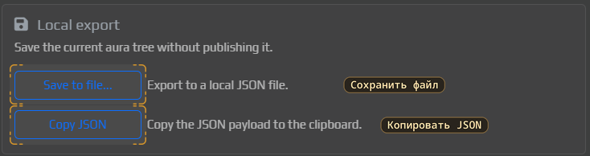

# Экспериментировать с копией своих подсказок

Вы сделаете локальную копию набора из двух аур и поменяете в ней памятку, а оригинал останется как был. Это перенос своих настроек, а не публикация и не импорт чужого кода. Нужна папка, в которую вы можете писать, и право экспортировать собственное содержимое.

## Подготовить небольшой связанный набор

1. На пустом месте дерева создайте **New folder** с именем **Проба переноса**. Внутри создайте **New Aura → Разрешить памятку** с **Triggers → Fixed Value → Is NOT Active**, без действий и оверлеев.
2. Создайте в папке вторую ауру **Памятка**. В Triggers добавьте **Aura Is Active**, через **Links** выберите только Разрешить памятку из этой папки, потребуйте **Active** и выберите **All must match (AND)**.
3. В Overlays Памятки добавьте **Text**: **Content** `Исходная памятка`, **Font 24**, **Size to fit** выключен, **Window → Mode → Overlay**. Разблокируйте оверлей, разместите его, затем включите **Locked** и **Clickthrough**. Действий не добавляйте ни в одну из аур. Обе ауры должны оставаться загруженными и включёнными, EyeAuras — не на паузе. Разрешить памятку оставьте неактивной: тогда ни оригинал, ни копия вне редактора пока не показываются.

## Сохранить JSON и выбрать Copy

1. Выберите папку **Проба переноса** и откройте **Share/Export** кнопкой экспорта или **Ctrl+S**. В **Content** проверьте, что там папка и обе ауры.
2. Если появилось **Missing linked objects detected**, разберитесь со связями. В нашем примере связь одна, и она ведёт внутрь выбранной папки. Если вы добавили источник снаружи, включите его через **Add linked objects** и снова проверьте Content — или сознательно оставьте внешнюю зависимость. Соседние элементы сами в экспорт не попадают.
3. Выберите **Destination → Local export → Save to file...**, сохраните `reminder-copy.json` в свою папку и закройте окно экспорта. Это локальное сохранение, а не **Publish**: ссылка на публикацию не нужна.

   

4. Нажмите **Import**, выберите **Source → Import from file → Open...** и свой JSON. В **Preview** проверьте папку, две ауры и сохранённые пути. Если перед открытием диалога выбрать папку в дереве, место импорта от этого само не изменится.
5. Оригиналы уже есть в дереве, поэтому откройте **Import Options** и при показанных конфликтах выберите **Copy**. Добавятся копии с отдельными идентификаторами, а конфликтующие пути будут изменены. Replace не выбирайте: он заменяет существующие элементы, а не объединяет настройки. Ignore Conflicts пропустит конфликтующие входящие объекты.

| Выбор | Результат в этом рецепте |
| --- | --- |
| Copy | Оригинал остаётся, добавляются копии |
| Replace | Конфликтующие оригиналы заменяются; здесь это не нужно |
| Ignore Conflicts | Конфликтующие входящие объекты пропускаются; полной независимой копии не получится |

## Проверить независимость копии

1. Найдите новую папку по изменённому пути. В **скопированной** Памятке откройте Aura Is Active → Links и кнопкой перехода по связи убедитесь, что она ведёт к **скопированной** Разрешить памятку, а не к оригиналу. Так же проверьте привязки свойств, если они есть в вашем наборе. До проверки оба переключателя оставьте неактивными.
2. Только у копии поменяйте Content в Text на `Копия памятки`, разместите её отдельно и закрепите. У оригинала должно остаться `Исходная памятка`.
3. Переведите скопированную Разрешить памятку в **Is Active**, выберите постороннюю ауру и выйдите из редактора. Должна появиться только Копия памятки. Исходный переключатель остаётся **Is NOT Active**. Верните скопированный переключатель в Is NOT Active, чтобы снова скрыть копию.

В [Экспорте и импорте](/ru/features/export-import) описаны JSON и выбор при конфликтах, в [Aura Is Active](/ru/triggers/aura-is-active) — связь между аурами, в [Bindings](/ru/features/bindings) — привязки свойств, которые переносятся вместе с набором.

Известные внутренние ссылки при копировании могут переназначаться. Произвольные строки кода, внешние пути и ссылки на объекты вне копируемого набора сами не исправляются. JSON не обещает переноса без потерь между любыми версиями. Перед тем как передать файл кому-то, проверьте настройки и встроенные ресурсы: экспорт не удаляет секреты сам.
