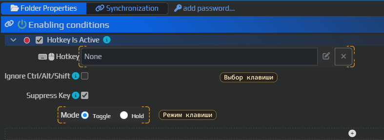

# Удерживать F8 для проверки цветной панели

Проверка цвета здесь работает, только пока вы держите клавишу. Аура показывает **Найдено зелёное состояние**, если панель в захвате совпадает с зелёным образцом. Отпустили клавишу — вся группа перестаёт работать.

Нужна видимая панель в вашем приложении с двумя известными состояниями: однотонный зелёный участок и заметно отличающийся серый, в том же месте и того же размера. Проще всего сделать два своих PNG 200 × 100, зелёный и серый, и показывать их в одном просмотрщике с одинаковым масштабом. Окно должно быть открыто и не свёрнуто, а выбранный захват — получать его текущую картинку. F8 берите, только если она свободна в вашем приложении. Иначе выберите другую свободную клавишу.

## Сначала настроить проверку цвета

1. Нажмите правой кнопкой на пустом месте дерева, создайте **New folder** и назовите папку **Проверка панели**. В контекстном меню папки выберите **New Aura** и назовите ауру **Зелёная панель**.
2. В **Triggers** этой ауры нажмите **+** и добавьте **Color Search**. В **Target Window** выберите просмотрщик указателем выбора окна и проверьте сведения о выбранном окне. Выставьте **Image Capture Rate 5 FPS** и откройте **Preview**. Покажите зелёное изображение и убедитесь, что в Preview видна текущая панель.
3. Через **Crop region** выделите небольшой участок строго внутри однотонной заливки, без границ, подписей и теней. Список эффектов оставьте пустым.
4. В **Color source - what to search for and how** выберите **Comparison Granularity → Aggregate Average Color of Entire Area** и **Comparison Method → Human Perception**. Пока участок зелёный, нажмите **Copy Captured Color to Target Color**.
5. В **Trigger activation conditions** включите **Min** и задайте диапазон из таблицы. Нажмите **Refresh Once** на зелёном изображении, затем покажите серое и обновите ещё раз. Зелёный должен совпасть, серый — нет. Если совпадают оба, сначала исправляйте источник и область, а не диапазон.

| Параметр Color Search | Значение |
| --- | --- |
| Image Capture Rate | 5 FPS |
| Match Threshold → Min | 95% |
| Match Threshold → Max | 100% |
| Effects | Пустой список |

6. В **Overlays** этой ауры добавьте **Text**. В **Content** введите `Найдено зелёное состояние`, задайте **Font 24**, выключите **Size to fit**, выберите **Window → Mode → Overlay**. Выключите **Locked**, разместите область 400 × 70 так, чтобы текст читался, затем включите **Locked** и **Clickthrough**.

## Разрешать работу группы клавишей

1. Выберите папку **Проверка панели**. В **Enabling Conditions** нажмите **+**, добавьте **Hotkey Is Active**, назначьте **F8**, выберите **Hold**, **Suppress Key** оставьте выключенным. В обычный список Triggers ауры эту клавишу не добавляйте.

   

2. Выберите ауру вне этой папки. Если такой нет, создайте в корне пустую ауру **Настройка**. Перейдите из редактора в просмотрщик. Папка и аура внутри неё должны оставаться загруженными, EyeAuras — не на паузе.
3. На зелёном изображении зажмите F8: должна появиться подпись. Отпустите F8 — подпись должна исчезнуть. На сером изображении при зажатой F8 подписи быть не должно. Между проверками отпускайте клавишу.

[Условия включения](/ru/features/enabling-conditions) разрешают или запрещают работу всей группы. Обычный триггер со значением «ложь» только участвует в общем условии ауры и не останавливает расчёт остальных триггеров. Выбранные в дереве элементы могут продолжать вычисляться или показываться для редактирования, поэтому и нужно выбрать ауру вне папки. [Color Search](/ru/triggers/images/color-search) сравнивает цвет, [Hotkey Is Active](/ru/triggers/hotkey-is-active) следит за клавишей, [Text](/ru/overlays/text) показывает ответ.

Если Preview пустой или показывает старую картинку, чините [источник захвата](/ru/triggers/images/imagecapturetriggers), а не снижайте порог.
