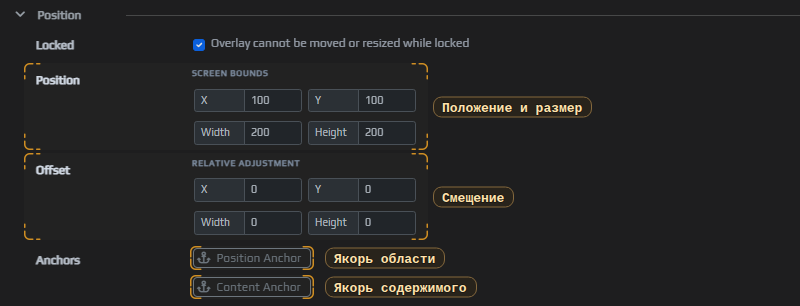

# Наблюдать один меняющийся участок окна

Replica показывает живую копию небольшого участка чужого окна там, где вам удобно. Для примера введите в своём документе Блокнота строку **Состояние: 10**, а потом поменяйте её на **Состояние: 20**. Replica повторяет картинку строки.

Откройте одно окно Блокнота, поставьте строку в самом верху документа и не сворачивайте окно. Рядом расположите второе окно, в котором работаете. Источник должен отдавать живую миниатюру. Закрытое, защищённое или свёрнутое окно может не давать обновляющейся картинки.

## Раздельно выбрать условие видимости и источник

1. Нажмите правой кнопкой на пустом месте дерева, выберите **New Aura**, назовите ауру **Живая область состояния**.
2. В **Triggers** нажмите **+** и добавьте **Window Exists**. В **Target Window** введите `notepad` и проверьте сведения о выбранном окне. Этот триггер держит ауру активной, пока окно существует. Картинку для Replica он не даёт.
3. В **Overlays** нажмите **+** и добавьте **Replica**. В её собственном разделе **Replica** тоже задайте **Target Window → `notepad`** и отдельно убедитесь, что здесь выбрано нужное окно.
4. **Linked auras** оставьте пустым — всё настраиваем вручную. Нажмите **Source region → Select region** и выделите прямоугольник вокруг строки. Это область клиентской части исходного окна в физических пикселях. **Source offset** оставьте нулевым, **Source anchors** — как есть.

| Параметр Replica | Значение |
| --- | --- |
| Target Window | `notepad` |
| Source region | Прямоугольник вокруг строки состояния |
| Source offset | Нулевой |
| Linked auras | Пустой список |
| Window → Mode | Overlay |

5. В общих параметрах **Position** выключите **Locked** и передвиньте копию ко второму окну. Включите **Visual style → Aspect Ratio** и подберите размер, при котором строка читается без растяжения. Затем включите **Locked** и **Clickthrough**.

   

6. Аура должна быть включена, EyeAuras — не на паузе. Выберите другую ауру и вернитесь в рабочее окно. В копии должно быть **Состояние: 10**. Поменяйте строку в Блокноте на **Состояние: 20** и вернитесь к работе: копия должна обновиться. Не прокручивайте строку за пределы выбранной области.
7. Закройте окно Блокнота. **Window Exists** должен стать **Not Active**, а закреплённая копия вне предпросмотра редактирования — исчезнуть. Когда откроете Блокнот снова или пересоздадите источник, проверьте выбор окна и область заново.

[Replica](/ru/overlays/replica) задаёт источник и область, [Window Exists](/ru/triggers/window-exists) — условие наличия окна, [общие параметры](/ru/overlays/common-options) — размещение копии. Через **Linked auras** окно и область можно взять из подходящей ауры, но здесь это не нужно.

Если видно всё окно целиком, выберите область заново, и не пустую: **Source region → Reset** возвращает показ целого окна. Если копия перестала обновляться, сначала проверьте, доступен ли источник, а не меняйте размер показа. Щелчок по копии не уходит в исходное окно. Clickthrough пропускает мышь в то окно, которое лежит под оверлеем. Если живое обновление не нужно, есть [рецепт статичной справочной карточки](/ru/recipes/basic/reference-card).
