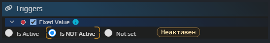

# Приостановить группу подсказок одним режимом

Переключатель **Обслуживание** отключает две обычные подсказки и показывает вместо них **Режим обслуживания**. Он лежит вне папки, которой управляет, поэтому остаётся доступным, когда папка отключена.

Ауры должны оставаться загруженными, EyeAuras — не на паузе.

## Создать переключатель и обычные подсказки

1. Нажмите правой кнопкой на пустом месте дерева, выберите **New Aura**, назовите ауру **Обслуживание**. Добавьте **Triggers → + → Fixed Value** и выберите **Is NOT Active** — режим обслуживания пока выключен. Действия и оверлеи этой ауре не нужны.

   

2. В корне создайте **New folder** с именем **Обычные подсказки**. Ауру Обслуживание внутрь не кладите.
3. В папке создайте ауру **Проверить заметки**. В Triggers добавьте **Fixed Value → Is Active**, в Overlays — **Text**. Задайте **Content** `Проверьте заметки`, **Font 24**, выключите **Size to fit**, выберите **Window → Mode → Overlay**. Разблокируйте оверлей, разместите область 450 × 80, затем включите **Locked** и **Clickthrough**.
4. В той же папке создайте вторую ауру **Сохранить черновик** с такими же параметрами, но **Content** `Сохраните черновик`. Разместите её ниже первой, не поверх. Списки действий обеих аур оставьте пустыми.
5. Выберите папку **Обычные подсказки**. В **Enabling Conditions** нажмите **+** и добавьте **Aura Is Active**. Через **Links** выберите только Обслуживание, задайте требуемое состояние связи **Not Active** и **Logical operator → All must match (AND)**. Теперь папка работает, только пока точно известно, что обслуживание выключено.

## Показать выбранный режим

1. Вне папки Обычные подсказки создайте в корне ещё одну ауру **Сообщение обслуживания**. В её обычные **Triggers** добавьте **Aura Is Active**, свяжите только с Обслуживанием, потребуйте **Active** и оставьте **All must match (AND)**.
2. Добавьте **Text** с **Content** `Режим обслуживания`, **Font 24**, выключенным **Size to fit** и **Window → Mode → Overlay**. Разместите его отдельно и включите **Locked** и **Clickthrough**. Действия не нужны.

| Где стоит условие | Требуемое состояние Обслуживание |
| --- | --- |
| Обычные подсказки → Enabling Conditions | Not Active |
| Сообщение обслуживания → Triggers | Active |

3. У ауры Обслуживание выберите **Is NOT Active**. Выберите постороннюю ауру вне папки и выйдите из редактора. Должны быть видны обе обычные подсказки, без сообщения об обслуживании.
4. Вернитесь к Обслуживанию, выберите **Is Active** и снова выйдите из редактора. Обычные подсказки должны исчезнуть, а Режим обслуживания — появиться. Верните **Is NOT Active**, и обычная группа вернётся.

[Fixed Value](/ru/triggers/fixed-value) задаёт общее ручное состояние, [Aura Is Active](/ru/triggers/aura-is-active) читает его и сравнивает с ожидаемым, а [Enabling Conditions](/ru/features/enabling-conditions) папки разрешают или запрещают работу аур внутри неё. Обычный триггер со значением «ложь» менял бы только результат одной ауры, а не отключал всю группу.

Не используйте **Not set** в значении «обслуживание выключено»: Unknown — это не то же самое, что известное Not Active. Пока вы настраиваете, выбранная аура может продолжать вычисляться, а разблокированный оверлей — оставаться на экране. Параметры показа текста описаны в [руководстве Text](/ru/overlays/text).
