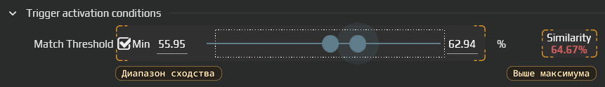

# Следить за отдельной панелью состояния

Вы работаете в одном приложении, а в другом вашем окне появляется предупреждающий цвет — и на экране всплывает **Проверьте панель состояния**. EyeAuras смотрит на захваченную картинку панели, а напоминание показывает отдельный Text.

Подготовьте источник с двумя известными цветами в одном и том же месте. Проще всего сделать два своих PNG 200 × 100, однотонный красный и однотонный серый, и открывать их в одном просмотрщике с постоянным масштабом. Рядом расположите второе, независимое окно, в котором работаете. Для начала источник должен быть не свёрнут и не перекрыт. Выбранный способ захвата должен получать свежие кадры и тогда, когда окно потеряло фокус.

## Найти предупреждающий цвет

1. Нажмите правой кнопкой на пустом месте дерева EyeAuras, выберите **New Aura** и назовите ауру **Предупреждение панели**. В **Triggers** нажмите **+** и добавьте **Color Search**.
2. Указателем **Target Window** выберите просмотрщик-источник, а не второе рабочее окно. Проверьте сведения о выбранном окне. Выставьте **Image Capture Rate 5 FPS** и откройте **Preview**.
3. Покажите красное изображение. Через **Crop region** выделите небольшой однотонный участок без краёв и текста. **Effects** оставьте пустым. Переключите красное и серое изображения и убедитесь, что обрезанный предпросмотр действительно меняется.
4. В **Color source - what to search for and how** задайте **Comparison Granularity → Aggregate Average Color of Entire Area** и **Comparison Method → Human Perception**. На красном изображении нажмите **Copy Captured Color to Target Color**.
5. В **Trigger activation conditions** включите **Min**, задайте **Min 95%**, **Max 100%** и нажмите **Refresh Once** в каждом состоянии. Красный должен давать **Active**, серый на правильном кадре — **Not Active**. Если состояния не различаются, сначала проверьте окно, область и сами цвета.

   

| Параметр | Значение |
| --- | --- |
| Target Window | Ваш просмотрщик-источник |
| Image Capture Rate | 5 FPS |
| Comparison Granularity | Aggregate Average Color of Entire Area |
| Диапазон Match Threshold | 95–100% |

## Разместить ответ рядом с рабочим окном

1. В **Overlays** нажмите **+** и добавьте **Text**. В **Content** введите `Проверьте панель состояния`. Выставьте **Font 24**, выключите **Size to fit**, задайте красный **Font Color** и **Window → Mode → Overlay**.
2. Выключите **Locked**, разместите оверлей 400 × 70 рядом со вторым рабочим окном, затем включите **Locked** и **Clickthrough**. Списки действий оставьте пустыми: здесь нужна только памятка.
3. Аура должна быть включена, EyeAuras — не на паузе. Выберите другую ауру и вернитесь в рабочее приложение. Пока источник красный, предупреждение должно быть видно. Покажите серое изображение и вернитесь в рабочее приложение — предупреждение должно исчезнуть. Верните красное, и оно появится снова.
4. В Preview проверьте, что источник без фокуса продолжает отдавать свежие кадры при смене состояния. После настройки закройте Preview. Если захват стал чёрным, замер или недоступен, выберите другой поддерживаемый способ захвата или держите источник в состоянии, в котором захват работает. Не путайте сбой захвата с обычным серым состоянием.

[Color Search](/ru/triggers/images/color-search) сравнивает выбранную область, [Text](/ru/overlays/text) показывает ответ рядом с работой, а от [параметров захвата](/ru/triggers/images/imagecapturetriggers) зависит, получится ли наблюдать окно в нужном состоянии. Предпросмотр редактирования и разблокированный оверлей могут оставаться на экране независимо от условия.
