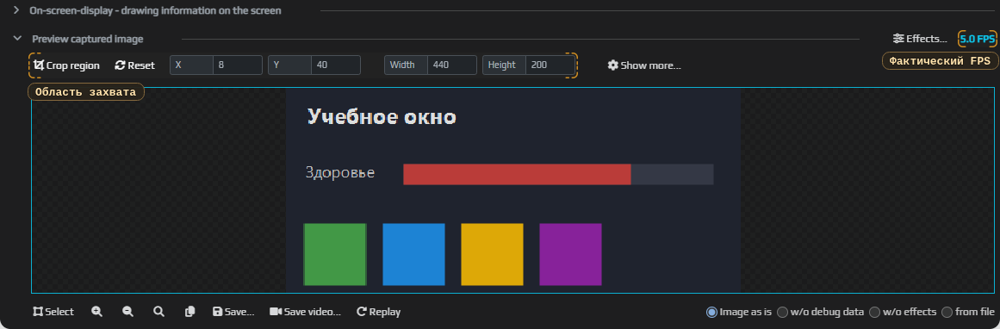

# Услышать один сигнал о значке готовности

В вашем приложении появляется заметный значок готовности — EyeAuras один раз подаёт звук. Проверка смотрит на картинку на экране.

Возьмите своё приложение или то, за которым вам разрешено наблюдать. У него должно быть два состояния, которые легко повторить: **значок есть** и **значка нет**. Окно не должно быть свёрнуто, масштаб интерфейса и тема — одинаковые в обоих состояниях. Нужны захват текущей картинки окна и рабочий звуковой выход.

## Получить кадр и подготовить образец

1. Нажмите правой кнопкой на пустом месте дерева, выберите **New Aura**, назовите ауру **Значок готовности**. В **Triggers** нажмите **+** и добавьте **Image Search**.
2. В **Target Window** выберите своё приложение, проверьте сведения о выбранном окне и задайте **Image Capture Rate 5 FPS**. Откройте **Preview** и выберите вид **w/o debug data**, чтобы диагностическая разметка не попала в образец. Убедитесь, что предпросмотр меняется вместе с настоящим приложением.
3. Пока значок виден, через **Crop region** ограничьте область, где он может появляться. Оставьте небольшой запас, но так, чтобы другие похожие значки в область не попали. Список эффектов для начала оставьте пустым.

   

4. В **Template source - what to search for** нажмите **Load from Preview Pane**, затем **Edit...**. В редакторе изображения выделите через **Crop** сам значок, нажмите **Apply crop**, затем **Save**. Не захватывайте то, что меняется: имена файлов, таймеры, числа прогресса. Образец должен помещаться в области поиска и быть того же размера в пикселях, что и значок на экране.
5. В **Trigger activation conditions** задайте **Match Threshold 95%**, **Include All Matches** оставьте выключенным и нажмите **Refresh Once**. Посмотрите на результат и найденную рамку: она должна охватывать нужный значок. Покажите состояние без значка и обновите ещё раз: на правильном текущем кадре совпадения быть не должно. Верните значок и убедитесь, что совпадение вернулось. Только после этого добавляйте звук.

| Параметр | Начальное значение |
| --- | --- |
| Image Capture Rate | 5 FPS |
| Match Threshold | 95% |
| Include All Matches | Выключен |
| Effects | Пустой список |

## Уведомлять о новом совпадении

1. В **On Enter** нажмите **+**, добавьте **Play Sound**, выберите **Audio notification → Ping** и задайте **Volume 50%**. Прослушайте звук кнопкой предпрослушивания. **While Active** и **On Exit** оставьте пустыми.
2. Аура должна быть включена, EyeAuras — не на паузе. Начните с подтверждённого **Not Active**, когда значка нет, затем покажите его в приложении. При переходе в **Active** должен прозвучать один Ping. Пока значок просто висит на экране, звук на каждом кадре повторяться не должен.
3. Уберите значок и дождитесь **Not Active**. При следующем появлении Ping может прозвучать снова.

[Захват изображения](/ru/triggers/images/imagecapturetriggers) задаёт источник, в [редакторе изображения](/ru/triggers/images/image-editor) вырезается образец, [Image Search](/ru/triggers/images/image-search) его находит, а [Play Sound](/ru/actions/play-sound) подаёт сигнал при переходе.

Если совпадение находится не там, сначала уточните область или образец и только потом меняйте порог. При другом DPI, масштабе или теме значок выглядит иначе: снимите образец заново в нужном масштабе. Чёрный, устаревший или недоступный кадр не значит, что значка нет.
