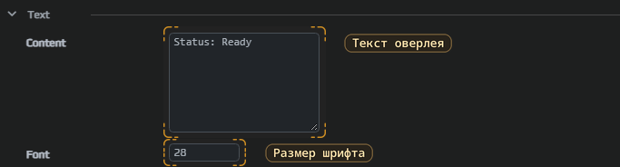

# Держать памятку записи рядом с заметками

Пока вы работаете в Блокноте, на экране видны три напоминания о подготовке. Перешли в другое приложение — они пропадают. Условие проверяет только окно на переднем плане.

Нужны открытый EyeAuras и одно окно Блокнота с вашими заметками. Оставьте именно одно окно Блокнота, чтобы выражение `notepad` находило его однозначно.

## Создать памятку

1. Нажмите правой кнопкой на пустом месте дерева EyeAuras и выберите **New Aura**. Назовите ауру **Памятка записи**.
2. В **Triggers** нажмите **+** и добавьте **Window Is Active**. В **Target Window** введите `notepad`. Проверьте по сведениям о выбранном окне, что это ваши заметки. Если подходит несколько окон, уточните выражение — см. [как выбрать нужное окно](/ru/features/window-matching-expressions).
3. В **Overlays** нажмите **+** и добавьте **Text**. В **Content** введите три строки с настоящими переносами: `Проверить микрофон`, `Выбрать файл записи`, `Просмотреть заметки`.

   

4. Выставьте параметры из таблицы. В **Position** временно выключите **Locked**, передвиньте памятку к заметкам и подберите размер, в который помещаются три строки. Начните с 500 × 120. Если текст обрезан, увеличьте область.

| Параметр | Значение |
| --- | --- |
| Text → Font | 24 |
| Text → Size to fit | Выключен |
| Text → Font Color | Белый |
| Window → Mode | Overlay |
| Position → Locked | Включён после размещения |
| Position → Clickthrough | Включён |

5. Аура должна быть включена, EyeAuras — не на паузе. Выберите другую ауру и вернитесь в Блокнот: памятка должна появиться. Перейдите в другое приложение: она должна исчезнуть. Вернитесь в Блокнот — памятка появится снова.

Разблокированный оверлей и аура, выбранная в открытом редакторе, могут оставаться на экране, чтобы их было удобно настраивать. Перед проверкой включите **Locked** и выберите другую ауру. Позиция задана у самого оверлея: если передвинуть окно Блокнота, памятка за ним не поедет.

[Window Is Active](/ru/triggers/window-is-active) задаёт условие по переднему окну, [Text](/ru/overlays/text) хранит памятку, а [общие параметры оверлеев](/ru/overlays/common-options) отвечают за размещение и поведение мыши.
