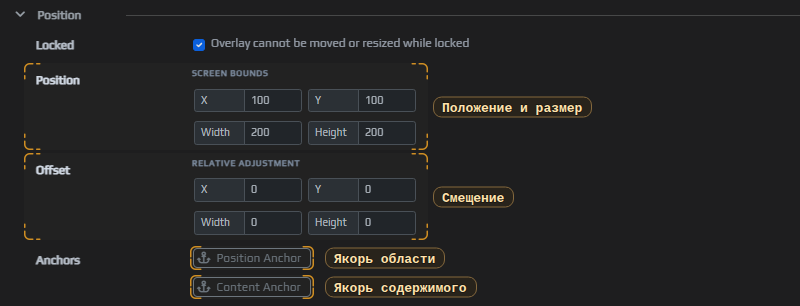

# Держать справочную карточку рядом с заметками

Пока Блокнот на переднем плане, рядом висит ваша справочная картинка: схема, памятка или раскладка клавиш. Не нужно каждый раз открывать просмотрщик.

Заранее сохраните локальный PNG — свой или тот, который вам разрешено использовать. Например, читаемую карточку 600 × 300 с вашими заметками. Откройте одно окно Блокнота, а остальные его окна закройте, чтобы нужное находилось однозначно.

## Импортировать, разместить и закрепить карточку

1. Нажмите правой кнопкой на пустом месте дерева, выберите **New Aura**, назовите ауру **Справочная карточка**.
2. В **Triggers** нажмите **+** и добавьте **Window Is Active**. В **Target Window** введите `notepad` и проверьте, что выбран ваш редактор заметок.
3. В **Overlays** нажмите **+** и добавьте **Image**. В его разделе **Image** нажмите **Load image from file...** и выберите свой PNG. Проверьте в **Preview**, что загрузилась нужная карточка. Картинка сохраняется внутри конфигурации.
4. Выставьте общие параметры из таблицы. Временно выключите **Locked** и перетащите карточку к заметкам. При включённом **Aspect Ratio** тяните за край, пока содержимое не станет читаемым, — пропорции при этом сохраняются. Для карточки 600 × 300 начните с области показа 600 × 300. Уменьшайте её, только если текст остаётся читаемым.

| Параметр | Значение |
| --- | --- |
| Window → Mode | Overlay |
| Visual style → Aspect Ratio | Включён |
| Position → Locked | Включён после размещения |
| Position → Clickthrough | Включён |

5. Аура должна быть включена, EyeAuras — не на паузе. Выберите другую ауру и вернитесь в Блокнот: карточка должна быть видна. Перейдите в другое приложение: она должна исчезнуть. Вернитесь в Блокнот и убедитесь, что появилась та же карточка.

[Window Is Active](/ru/triggers/window-is-active) решает, когда показывать карточку, [Image](/ru/overlays/image) хранит картинку, а [общие параметры оверлеев](/ru/overlays/common-options) задают размер, место и поведение мыши. Во время настройки разблокированная карточка и предпросмотр выбранной ауры могут оставаться на экране.

Если отредактировать исходный PNG на диске, встроенная копия сама не обновится. Когда карточка изменится, загрузите новый файл ещё раз. Если нужен постоянно меняющийся вид другого окна, берите [рецепт живой области состояния](/ru/recipes/basic/live-status-crop).
