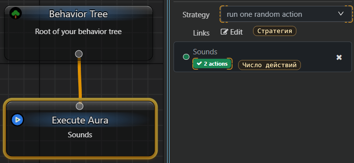

# Отметить начало и конец короткого сценария

Макрос играет Ping, ждёт 1500 мс после его окончания и играет Bell. Запускайте его вручную, когда нужно услышать начало и конец.

Нужны EyeAuras, в котором доступны редактор **New Macro** и шаблон **Run Aura**, и звуковой выход, который вы слышите. Соберите отдельный набор только со звуками.

## Подготовить две вызываемые звуковые ауры

1. В контекстном меню пустого места дерева выберите **New Aura**, назовите ауру **Начало сценария**. В Triggers добавьте **Fixed Value**, выберите **Is NOT Active** и так и оставьте. Тогда аура сама по себе сигнал не подаст.
2. В **On Enter** нажмите **+**, добавьте **Play Sound**, выберите **Audio notification → Ping**, задайте **Volume 50%** и выключите **Play in background**. Прослушайте звук. While Active, On Exit и Overlays оставьте пустыми: в ауре должно быть ровно одно действие.
3. Так же создайте загруженную ауру **Конец сценария**, только выберите **Bell** вместо Ping. Fixed Value тоже **Is NOT Active**, действие тоже одно, Play in background выключен. Обе ауры должны быть включены, хотя их триггеры неактивны.

## Разместить три шага в макросе

1. В меню создания дерева выберите **New Macro** и откройте его. В верхней строке настроек включите **Activation → Is Loaded** и выберите **Execution → When Activated → Do nothing**. Условий автоматического запуска не добавляйте.
2. В блок **Drag'n'drop instructions here** через **Add new Node** добавьте рядом друг с другом **Run Aura**, **Wait** и ещё один **Run Aura** — именно в таком порядке. Берите Wait макроса, а не ожидание BT из другого дерева.
3. У первого Run Aura откройте **General → Auras → Links** и выберите только Начало сценария. В строке должно быть **1 action**, а не NO ACTIONS. Задайте **Strategy → run 1-by-1 in order of addition**.

   

4. У Wait задайте **General → Delay 1500 ms**. Если показаны Min/Max, выключите случайный разброс кнопкой перемешивания.
5. Последний Run Aura свяжите только с Концом сценария, проверьте **1 action** и выберите ту же стратегию по порядку. Repeat и другие продолжения не добавляйте.

| Место в Block макроса | Настройка |
| --- | --- |
| Первое | Run Aura → Начало сценария, ordered |
| Второе | Wait макроса → Delay 1500 ms, случайный разброс выключен |
| Третье | Run Aura → Конец сценария, ordered |

6. Убедитесь, что EyeAuras не на паузе, и нажмите верхнюю **Run Macro Once**. Должны прозвучать Ping, примерно 1,5 секунды тишины после его окончания и Bell, а макрос — показать завершённый результат.
7. После завершения ничего не трогайте: вторая пара сигналов сама прозвучать не должна. Нажимайте Run Macro Once снова, только когда нужна следующая полная цепочка. Чтобы прервать текущий запуск, нажмите его **Stop**. Отмена кооперативная и уже прозвучавший звук не отменяет.

[Макрос](/ru/macros/getting-started) задаёт порядок шагов и ждёт каждый из них. [Run Aura](/ru/behavior-trees/nodes/execute-aura) выполняет действия аур, не меняя их активность. Он собирает действия из On Enter, While Active и On Exit, поэтому лишние списки здесь пустые. [Play Sound](/ru/actions/play-sound) ждёт конца звука, потому что Play in background выключен. В обычной ауре между действиями можно поставить [Delay](/ru/actions/delay), но здесь взят конечный макрос.

Если сигнала нет, проверьте предпрослушивание, связанную ауру и число действий. Обычный Failure у дочернего узла Macro Block не обязан останавливать следующие за ним узлы, как это было бы по правилам BT Sequence. Разобраться, что именно выполнилось, помогает [Event Viewer](/ru/features/event-viewer).
