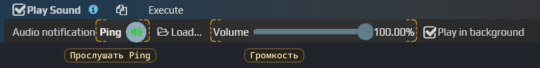

# Заметить открытие и закрытие просмотрщика

**Ping** звучит, когда появляется окно Блокнота, **Bell** — когда закрывается последнее подходящее окно. Так вы на слух отличаете одно от другого, пока заняты другим делом и не смотрите на дерево аур.

Подготовьте свой локальный текстовый файл, например `EA-Preview.txt`, и открывайте его в Блокноте. Остальные окна Блокнота закройте. Нужен рабочий звуковой выход. Оба сигнала есть в списке уведомлений, отдельный аудиофайл не нужен.

## Связать два перехода

1. Нажмите правой кнопкой на пустом месте дерева, выберите **New Aura** и назовите ауру **Сигналы просмотрщика**.
2. В **Triggers** нажмите **+**, выберите **Window Exists** и введите `notepad` в **Target Window**. Откройте свой файл в Блокноте и проверьте по сведениям о выбранном окне, что найден именно просмотрщик.
3. В **On Enter** нажмите **+** и добавьте **Play Sound**. В **Audio notification** выберите **Ping**, **Volume** поставьте **50%**. Кнопкой с динамиком рядом со списком можно прослушать сигнал и заодно проверить звуковой выход.

   

   На снимке громкость 100%, здесь хватит 50%.
4. В **On Exit** добавьте второй **Play Sound** с **Bell** и **Volume 50%**. Список **While Active** оставьте пустым: действие из него может повторяться, пока окно существует.

| Список действий | Реакция |
| --- | --- |
| On Enter | Play Sound → Ping, Volume 50% |
| While Active | Пустой |
| On Exit | Play Sound → Bell, Volume 50% |

5. Аура должна быть включена, EyeAuras — не на паузе. Закройте всё окно Блокнота, а не только вкладку документа, и дождитесь **Not Active** у **Window Exists**. Откройте файл снова: при переходе в **Active** должен прозвучать Ping. Закройте окно: при переходе обратно в **Not Active** должен прозвучать Bell.
6. Оставьте просмотрщик открытым и перейдите в другое приложение. Bell звучать не должен: окно потеряло фокус, но **Window Exists** по-прежнему его видит.

Если просмотрщик уже открыт, первый сигнал может прозвучать ещё во время настройки. Начинайте сравнение с подтверждённого **Not Active**. Если подходящих окон два, после закрытия первого состояние останется Active: выражение `notepad` широкое и за отдельным документом не следит.

[Window Exists](/ru/triggers/window-exists) сообщает, есть ли окно, а два [Play Sound](/ru/actions/play-sound) озвучивают переходы. Если сигнала нет, проверьте предпрослушивание, громкость и список действий. Чтобы увидеть записи о запуске действий, заранее откройте [Event Viewer](/ru/features/event-viewer), включите события аур и повторите переход. Запись события не подтверждает, что звук был слышен или что просмотрщик уже загрузил документ.
