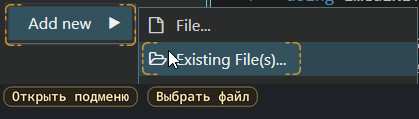

# Вложить справку и своё изображение в проект

Небольшую справочную карточку можно хранить прямо в проекте скрипта, без пути к файлу на диске разработчика. Скрипт читает вложенный текст, а Razor-компонент показывает его рядом с вашим PNG.

Нужен настольный EyeAuras с [сервисами Blazor-окна для скрипта и WebView2 Runtime](/ru/scripting/blazor-windows/getting-started). Берите **действие C# Script**: его Run продолжается, пока открыто окно. Короткий подготовительный скрипт C# Overlay здесь не подойдёт.

1. Создайте свою ауру `RecipeHelp` и добавьте **Actions → On Enter → C# Script** — запускать его будете вручную через Run. В проекте выберите **New file → Component**, имя `MainWindow`, и замените `MainWindow.razor` файлом ниже. Если шаблон создал ещё и `MainWindow.cs`, удалите его из нового проекта: здесь весь компонент лежит в одном Razor-файле.
2. Подготовьте файл `help.txt` в UTF-8 с текстом ниже и настоящий справочный PNG без секретов, которым вы вправе пользоваться. В дереве файлов скрипта выберите **Add → Existing File(s)...**, импортируйте оба файла как ресурсы и через **Rename** задайте им пути в проекте: `docs/help.txt` и `images/reference.png`.

   

3. Полностью замените **Script.csx**. Каждому логическому пути должен соответствовать ровно один ресурс. Сохраните написание и регистр папок. Namespace компонента — `RecipeHelp`. Он не обязан совпадать с namespace сгенерированного проекта.
4. Дождитесь компиляции и нажмите **Run**. В окне **Project reference** должны появиться все три строки справки и ваш PNG. При изменении размера окна изображение сохраняет пропорции и вписывается в доступную ширину.
5. Чтобы завершить Run, закройте окно или нажмите **Stop** у действия. Новый Run прочитает вложенный текст заново.

## Script.csx

```csharp
using System;
using System.Reactive.Linq;
using System.Reactive.Threading.Tasks;
using PoeShared.Blazor.Wpf;
using RecipeHelp;
using System.IO;
using EyeAuras.Repl;

{
    var files = GetService<IScriptFileProvider>();
    var helpFile = files.GetFileInfo("docs/help.txt");
    var imageFile = files.GetFileInfo("images/reference.png");
    if (!helpFile.Exists || !imageFile.Exists)
        throw new FileNotFoundException("Add docs/help.txt and images/reference.png to this project.");
    string help;
    using (var stream = helpFile.CreateReadStream())
    using (var reader = new StreamReader(stream))
        help = await reader.ReadToEndAsync(cancellationToken);
    using var window = GetService<IBlazorWindow>();
    window.ViewType = typeof(MainWindow);
    window.DataContext = help;
    window.Title = "Project reference";
    window.Width = 480;
    window.Height = 320;
    var closed = window.WhenClosed.Take(1).ToTask(cancellationToken);
    window.Show();
    try { await closed; }
    catch (OperationCanceledException) when (cancellationToken.IsCancellationRequested) { }
}
```

## MainWindow.razor

```razor
@namespace RecipeHelp
@using PoeShared.Blazor
@inherits BlazorReactiveComponent<string>

<h2>Project reference</h2>
<pre style="white-space: pre-wrap;">@DataContext</pre>

```

## docs/help.txt

```text
Project reference
This help text belongs to this script project.
Compare the image below with your own original PNG.
```


| Часть | За что отвечает |
| --- | --- |
| `IScriptFileProvider` | Сервис ресурсов проекта. Он не ваш, освобождать его не нужно. |
| `CreateReadStream()` и `StreamReader` | Ваши собственные поток и reader. Они закрываются до показа окна. |
| `DataContext = help` | Явно передаёт строку компоненту `BlazorReactiveComponent<string>`. |
| `images/reference.png` | Относительный URL ресурса. Оконный механизм проекта раздаёт его от базового URI страницы. Это не путь Windows. |
| `WhenClosed`, затем `Show()` | Подписка создаётся до показа окна, а ожидание закрытия остаётся внутри блока `using`, который владеет окном. |

Сейчас файловый сервис умеет находить ресурс по уникальному окончанию manifest-имени вместе с папкой, например `ProjectName.docs.help.txt`. Следите, чтобы окончание не подходило сразу к двум ресурсам. В полное имя входит namespace проекта, а не `@namespace` компонента. Если файл не найден, выведите `typeof(MainWindow).Assembly.GetManifestResourceNames()` в журнал скрипта и проверьте импорт. Про полные имена и упаковку при экспорте читайте во [встроенных ресурсах](/ru/scripting/embedded-resources). У прямого `Assembly.GetManifestResourceStream` своё требование: регистр должен совпадать точно.

Если изменить исходный файл на диске, вложенные байты останутся прежними. Замените ресурс или импортируйте его заново и перекомпилируйте проект. При экспорте и импорте всего проекта ресурсы переносятся вместе с ним. Если перенести один `.csx`, ресурсов в нём не будет. Чтение обычного файла с диска разобрано в [примере файлового сервиса](/ru/scripting/examples/basic/file-provider).
