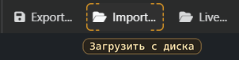

# Редактировать экспортированный проект с обычным классом

Здесь проект из двух файлов экспортируется на диск, правится в IDE и возвращается в EyeAuras. Обычный класс оформляет числа, а журнал получает через конструктор.

Нужны редактируемый **C# Script**, IDE для C# и отдельная пустая папка для экспорта. Не берите папку с чужими файлами: **Export... очищает её файлы и подпапки, сохраняя `.git`.**

1. Создайте ауру `RecipeIde` и добавьте **Actions → On Enter → C# Script** — запускать его будете вручную. Замените **Script.csx** кодом ниже. Через **New file → C# Class** добавьте `CounterFormatter.cs` и целиком замените сгенерированный класс. Namespace `RecipeIde` в классе и его импорт в скрипте оставьте.
2. Дождитесь компиляции и нажмите **Run** в EyeAuras. В **Event Log** действия появятся `Counter: 001`, `Counter: 002`, `Counter: 003` с паузами 500 мс. Если нажать Stop во время паузы, запуск завершится и оставшихся строк не будет.
3. Нажмите **Export...**, выберите отдельную пустую папку и откройте полученный `.sln` в IDE. Оставьте как есть **фактические имена проектов, файлы `.csproj`, записи SDK/ссылок и конфигурацию NuGet из экспорта**.
4. В файле `CounterFormatter.cs` на диске поменяйте только префикс `Counter:` на `Sample:` и сохраните. В EyeAuras выберите **Import...**, укажите экспортированный `.sln`, дождитесь синхронизации и диагностики. Импорт заменяет проект содержимым с диска, поэтому заранее сохраните правки, которые сделали только в EyeAuras.

   
5. Снова нажмите **Run** в EyeAuras. Строки `Sample: 001`…`Sample: 003` значат, что с диска вернулся уже изменённый класс. Сборка в IDE сама скрипт не запускает.

## Script.csx

```csharp
using System;
using System.Threading.Tasks;
using RecipeIde;

{
    var formatter = new CounterFormatter(Log);
    try
    {
        for (var value = 1; value <= 3; value++)
        {
            formatter.Report(value);
            await Task.Delay(500, cancellationToken);
        }
    }
    catch (OperationCanceledException) when (cancellationToken.IsCancellationRequested) { }
}
```

## CounterFormatter.cs

```csharp
using PoeShared.Logging;

namespace RecipeIde;

public sealed class CounterFormatter
{
    private readonly IFluentLog log;

    public CounterFormatter(IFluentLog log)
    {
        this.log = log;
    }

    public void Report(int value)
    {
        log.Info($"Counter: {value:D3}");
    }
}
```


| Часть | За что отвечает |
| --- | --- |
| `Script.csx` | Точка входа. Здесь цикл и токен отмены текущего запуска. |
| `new CounterFormatter(Log)` | Явно передаёт журнал обычному классу. |
| `CounterFormatter.cs` | Вспомогательный код проекта. Глобальных `Log`, `AuraTree` и `cancellationToken` в нём нет. |
| Экспортированный `.csproj` | Хранит сгенерированные настройки компиляции и ссылки. Имя будет таким, как в вашем экспорте. |

Если правите часто, выберите для своего решения **Live Import / Live...**. Сохраняйте файлы в IDE, ждите, пока проект обновится, и сами нажимайте Stop и Run в EyeAuras. В EyePad импортированные файлы могут быть помечены **Read-only** — редактируйте их снаружи. **CompileOnce** отключает импорт и слежение за файлами: нужна своя редактируемая копия с выключенным режимом.

Синхронизация только переносит файлы с диска в проект и не сливает два набора правок. Для сборки в IDE нужен совместимый SDK, но диагностику EyeAuras всё равно проверяйте. Об исключениях и о том, кто чем владеет, — в [Интеграции с IDE](/ru/scripting/ide-integration). Почему классу нужно явно передавать зависимости — в [контексте точки входа](/ru/scripting/getting-started).
