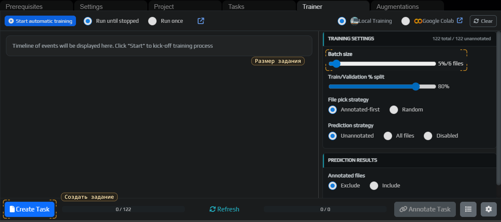

# Обучить свой проверенный детектор и увидеть рамки

Здесь вы обучите детектор одного класса на своих изображениях и посмотрите его рамки на новых изображениях в EyeAuras. Это путь от проверенных данных до рамок. Автоматической реакции и обещаний точности тут нет.

Нужен **YoloEase 2 на Windows x64** с управляемым окружением обучения и хранилищем, куда можно писать и где можно создавать символические ссылки. Шаги описаны по исходнику **946be263** и линии релиза **v2.0.90**. Более поздний исходник не значит, что все его изменения есть в выпущенной программе. EyeAuras использует модель отдельно: у него свои OpenCV/ONNX Runtime, parser и доступный provider. Обучение не входит в основной редактор EyeAuras.

## Подготовить независимые изображения и завершить задачу

1. Подготовьте **20 собственных PNG**. На одних должен быть хорошо различимый объект, например ваша оранжевая настольная метка, на других — настоящий пустой фон. Снимайте независимые сцены: меняйте положение, освещение и фон. Ещё **5 независимо снятых изображений** отложите вне проекта для итоговой проверки — и с объектом, и без него. Соседние видеокадры, копии и варианты одной сцены не должны делиться между обучением и validation.
2. В YoloEase нажмите **New...** и сохраните **OwnMarker.yeproj** в своей локальной папке. Рабочую папку **OwnMarker** держите рядом. В **Prerequisites** нажмите **Check all**, раскройте ошибки, поставьте управляемые зависимости через **Install missing** и снова нажмите **Check all**. Хватит CPU: информационные строки про GPU не значат, что для этого пути нужен GPU. Установка может скачивать Python, пакеты и веса, но графический драйвер не ставит. Подробнее — [Окружение](/ru/YoloEase/prerequisites).
3. В **Settings** выберите **Backend = Offline**. На **Project → Add label** задайте **Label name = marker**, выберите цвет и нажмите **Add**. Перетащите только 20 проектных PNG на **Drop folders, images, or videos here**. Отдельные изображения копируются в проект. Одно имя класса ещё не даёт примеров для обучения.
4. В **Trainer** нажмите **Refresh**, задайте **Batch size = 100%** и проверьте, что выбраны **20** ещё не назначенных файлов. Нажмите **Create Task**. В **Labels** выберите `marker`, нажмите **N** и двумя щелчками обведите каждый нужный объект. Рамки — без поворота, границы объекта везде по одному правилу. Просмотрите каждый кадр клавишами **D/F**, поправьте классы и размеры. На проверенных пустых кадрах рамок не рисуйте.

   

   На снимке 5% дают шесть файлов. У вас должно быть 100% и все 20 файлов рядом с Batch size — проверьте это до нажатия Create Task.
5. Проверив всю задачу, нажмите **Finish Job**. Если просто закрыть редактор, новая задача сохранится, но не завершится. Откройте её через **All tasks** и проверьте сохранённые рамки. В набор попадают завершённые аннотации, а не предложения модели, которые вы не приняли. Подробнее — [Редактор разметки](/ru/YoloEase/features/annotation-editor).

## Обучить один раз и проверить фактический split

6. В первом запуске оставьте все строки **Augmentations** выключенными, чтобы кадры были чистыми. В v2.0.90 и в исходнике красные исходные и голубые преобразованные контуры рисуются прямо в пикселях сохранённого PNG, а не только в preview. Варианты добавляются до split и могут оказаться по разные стороны train/validation. Подробнее — [Ограничения аугментаций](/ru/YoloEase/features/augmentations).
7. В **Settings → Training settings** задайте значения из таблицы. Элементы Trainer выберите отдельно.

| Настройка | Значение этого запуска |
| --- | --- |
| `Yolo8/10+ base model` | `yolo11s.pt` — совместимый detect checkpoint. Если весов нет, они могут скачаться. |
| `Epochs` / `Model Size` | `50` / `640`. Это параметры запуска, а не гарантия точности. |
| `Additional arguments` | `device=cpu` — явно обучать на CPU. |
| Trainer `Train/Validation % split` | `80%`. После преобразования проверьте реальные количества. |
| Запуск Trainer | **Local Training**, **Run once**, затем **Start automatic training**. |

8. Посмотрите этап сборки и папку **datasets/<run-id>/**. В ней должны быть **data.yaml**, **train/images + train/labels**, **valid/images + valid/labels**. Конвертер делит файлы подряд, в том порядке, в каком их получил. Он их не перемешивает и не выравнивает по классам, поэтому 80% не гарантирует баланс сцен и классов. Проверьте, что в обеих группах есть настоящие положительные примеры и проверенные отрицательные, а сцены независимы. Пять отложенных изображений не кладите ни в одну группу. Папки `test` создаются с нулевой долей — это не ваш отложенный набор. Если split не подходит, нажмите **Stop automatic training**, дождитесь остановки и перед следующим запуском поправьте выбор исходников или разметку.
9. Отдельно прочитайте **output** обучения, метрики validation и результат экспорта ONNX. **Cycle completed** появляется и после ошибки или отмены. Если обучение и экспорт прошли успешно, нажмите **open...** и найдите результат — обычно это **datasets/<run-id>/runs/train/weights/**. Сохраните **best.pt**, **last.pt** и экспортированный **.onnx**. Смотрите не только на loss/mAP, но и на пропуски и лишние рамки: двадцать кадров и пятьдесят эпох не доказывают, что модель справится с новыми сценами. Подробнее — [Trainer](/ru/YoloEase/features/trainer).

Локальный экспорт запрашивает `format=onnx` и **opset=17** из выбранного checkpoint. Файл `.pt` в EyeAuras не загружается, а смена расширения — это не экспорт. Обёртка задаёт явно не все параметры Ultralytics. Проверьте в модели три вещи:

- вход NCHW с именем **images** и фиксированными положительными размерами, обычно **1×3×640×640**;
- поддерживаемый detect-выход **1×(4 + число классов)×число кандидатов**;
- метаданные `names` с правильным индексом `marker`.

Другие формы, встроенный NMS, pose/OBB и произвольный ONNX нужно отдельно проверять на совместимость. Подробнее — [Контракт экспорта](/ru/YoloEase/features/yolo-onnx).

## Осмотреть рамки до добавления реакции

10. Откройте одно из пяти отложенных изображений в своём просмотрщике, чтобы его окно было видно. В EyeAuras создайте **RecipeMarker** через **Add new → New Aura** и добавьте в **Triggers** триггер **Machine Learning(AI) Search**. Действий ввода не добавляйте. Нажмите **Load from file...** и укажите свой ONNX. Дождитесь сведений о модели и проверьте задачу, вход и имена классов. Ошибка загрузки — это не то же самое, что «совпадений нет».
11. В **Capture settings → Target Window** выберите окно просмотрщика. Задайте **Image Capture Rate = 1**. Раскройте **Preview captured image** и через **Crop region** оставьте только изображение, без панелей. Эффекты должны давать такую же картинку, как при обучении, и не применяться дважды. В **Inference performance tuning → Provider** выберите **Cpu**, если он доступен. Пакет или название provider сами по себе не значат, что его нативная часть готова.
12. В **Trigger activation conditions → Search for** выберите свой `marker`. Задайте **Confidence Threshold = 30%** и **IoU Threshold = 40%**. Нажмите **Refresh Once** и включите в предпросмотре **Bounding Boxes** и **Labels**. Посмотрите, где стоит рамка и как она подписана. Переключитесь на отложенный кадр без объекта и обновите ещё раз: если подходящих результатов нет, триггер неактивен. Результат сохраняется, только если его оценка строго выше порога confidence. Score — это не измеренная вероятность того, что рамка верна.

Запишите пропуски, неверные рамки и ложные находки на всех пяти отложенных изображениях. Если есть ошибки, возвращайтесь к данным и разметке, а реакцию пока не добавляйте. Обучение закончилось, модель загрузилась, классы названы верно — всё это ещё не говорит о качестве. Parser сам растягивает вход до размера модели и возвращает рамки обратно, повторно их масштабировать не нужно. Где проходят границы между частями, объясняют [Использование модели](/ru/YoloEase/use-in-eyeauras), [AI Search](/ru/triggers/images/ai-search-trigger) и [захват](/ru/triggers/images/imagecapturetriggers).

Локальный путь не передаёт cloud ZIP. В исходнике `946be263` содержимое ZIP изменилось после v2.0.90. Если отдельно выберете Colab, не считайте, что это позднее исправление у вас уже установлено. Чтобы решить, полезны ли рамки, реакция ввода не нужна.
