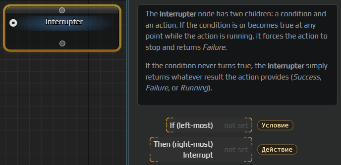

# Прекратить ожидающий участок при следующей проверке

В этом дереве двухсекундное ожидание можно прервать отдельным стоп-сигналом. Если на следующем тике Стоп активен, Interrupter не даст ожиданию продолжиться и сбросит его. Когда Стоп снят, ожидание начинается заново с полного срока, а не с остатка.

Нужны шаблоны Behavior Tree **Interrupter**, **Aura Is Active**, **Wait**, **Sequence**, **Fixed Status**. Тики вы выдаёте вручную, и Wait между ними остаётся в Running.

## Поставить стоп-проверку перед ожиданием

1. Создайте **New Aura → Прекратить ожидание** с **Triggers → Fixed Value → Is NOT Active**, без действий и оверлеев. Аура должна быть загружена и включена, EyeAuras — не на паузе.
2. Создайте **New Behavior Tree**, выберите **My Tree**, включите **Activation → Is Loaded** и задайте **Execution → When Activated → Do nothing**. Условия автоматической активации оставьте пустыми, повтор не включайте.
3. Через **Add new Node** соберите схему ниже. У Sequence сначала идёт Interrupter, затем итоговый Fixed Status. У Interrupter условие слева, Wait справа. Все узлы включены.

```text
My Tree
└─ Sequence
   ├─ Interrupter
   │  ├─ If: Aura Is Active — Прекратить ожидание must be Active
   │  └─ Action: Wait — 2000 ms
   └─ Fixed Status — Success
```

4. У Aura Is Active в **General → Links → Edit** выберите только ауру Прекратить ожидание, поставьте требование **must be Active** и задайте **All must match (AND)**. Ребёнка этой проверке не добавляйте. В **General** у Interrupter проверьте, что **If** указывает на эту проверку, а **Action** — на Wait.

   

   На снимке поле **Action** подписано Then Interrupt.
5. У Wait задайте **General → Delay = 2000 ms**. Случайный разброс должен быть выключен, ребёнка нет. У последнего Fixed Status выберите **General → Status → Success**, тоже без ребёнка.

## Прервать и начать полный новый срок

1. Убедитесь, что стоп-аура **Not Active**, и нажмите верхнюю **Tick BT Once**. Стоп-проверка не прошла, поэтому Wait запускается. Wait, Interrupter и Sequence возвращают **Running**. До последнего узла дело не доходит.
2. Выберите у стоп-ауры **Is Active**, дождитесь, пока она станет активной, и нажмите **ту же** кнопку тика. Interrupter увидит Success **до** продолжения Wait, сбросит своё ожидание и вернёт **Failure**. Sequence не дойдёт до последнего узла. Продолжение будет отклонено, даже если прежний срок успел истечь между тиками.
3. Верните стоп-ауре **Is NOT Active**, дождитесь состояния и сделайте тик. Wait начнёт новые полные 2000 мс и вернёт Running. Подождите больше двух секунд и сделайте ещё тик: Wait завершится, выполнится последний Fixed Status, Sequence вернёт **Success**.
4. После завершения больше не выдавайте тики: новый тик начнёт новый проход. Чтобы бросить сохранённый проход, выгрузите своё дерево через **Is Loaded**, дождитесь очистки и загрузите снова. Очистка цвета выполнение не сбрасывает.

[Interrupter](/ru/behavior-trees/nodes/Interrupter) сначала проверяет **If** и пускает **Action**, только если получил Failure. Если If сразу вернул Success, Action сбрасывается и не вызывается. Если If сразу вернул Running, работа откладывается без такого сброса. [Wait](/ru/behavior-trees/nodes/wait) быстро возвращает Running и помнит срок. Между этими вызовами условие никто не проверяет каждые 100 мс.

Другое дело, если сам вызов Action ещё ждёт асинхронную работу. Тогда Interrupter проверяет условие раз за разом с паузой **100 мс между завершёнными проверками**. Он запрашивает кооперативную отмену, ждёт, пока работа завершится и очистится, и только потом возвращает Failure. В этом опыте пользуйтесь одним ручным входом. Чем он отличается от автоматического Main — в [Root](/ru/behavior-trees/nodes/root).
