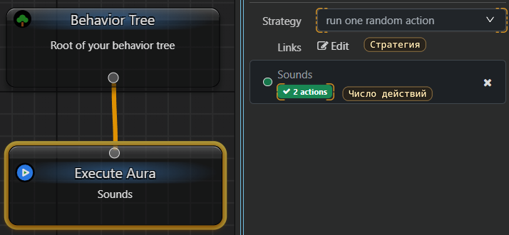

# Проверить готовность перед вызовом звука

Дерево подаёт один звук, только если ваша аура готовности активна. Её состояние вы переключаете вручную. Если проверка не прошла, Sequence завершается без уведомления. Это не то же самое, что звуковая аура, которая сама реагирует на переход своего триггера.

Нужны редактор **Behavior Tree**, шаблоны **Sequence**, **Aura Is Active**, **Run Aura** и аудиовыход, который вы слышите. Возьмите отдельную конфигурацию, где есть только звук. EyeAuras не должен быть на паузе. Скрипт, ввод в приложение и игровые данные не нужны.

## Подготовить условие и вызываемое действие

1. Создайте **New Aura → Готовность**. Добавьте **Triggers → Fixed Value → Is NOT Active**, без действий и оверлеев. Дерево будет проверять только её состояние.
2. Создайте **New Aura → Сигнал готовности**. Добавьте ей собственный **Fixed Value → Is NOT Active**, чтобы звук не играл при обычной активации. Обе ауры должны оставаться загруженными и включёнными.
3. В **On Enter** ауры Сигнал готовности добавьте один **Play Sound**: **Audio notification → Ping**, **Volume 50%**, **Play in background** выключен. Проверьте предпрослушивание. While Active и On Exit оставьте пустыми: у ауры должно быть ровно одно действие. То, что она неактивна, не мешает отдельно вызвать её через Run Aura.

## Собрать маршрут с проверкой

1. В меню создания дерева выберите **New Behavior Tree** и откройте его. Выберите **My Tree**, включите **Activation → Is Loaded** и задайте **Execution → When Activated → Do nothing**. Связей автоматической активации не добавляйте.
2. Через **Add new Node** добавьте **Sequence**, **Aura Is Active** и **Run Aura**. Соедините My Tree с Sequence, а Sequence — с двумя детьми: Aura Is Active слева, Run Aura справа. Этим двум узлам своих детей не добавляйте.
3. Выберите Aura Is Active. В **General → Links → Edit** укажите только ауру Готовность, оставьте **must be Active** и выберите **Operator → All must match (AND)**. Убедитесь, что связь действительно есть: пустой список вашу готовность не проверяет.
4. Выберите Run Aura. В **General → Auras → Links** укажите только Сигнал готовности. Проверьте, что написано **1 action**, и выберите **Strategy → run 1-by-1 in order of addition**.

   

   На снимке прежний редактор: у Sounds два действия и выбран случайный запуск. У вас должно быть одно действие у звуковой ауры и последовательный запуск в Strategy.

```text
My Tree
└─ Sequence
   ├─ Aura Is Active: Готовность must be Active
   └─ Run Aura: Сигнал готовности, ordered, 1 action
```

5. Пока Готовность остаётся **Is NOT Active**, нажмите верхнюю **Tick BT Once** — не Run в панели отдельного узла. Проверка должна вернуть **Failure**, звука не будет: Sequence не вызывает второго ребёнка.
6. У Готовности выберите в Fixed Value **Is Active** и дождитесь, пока аура станет Active. Вернитесь к тому же дереву и снова нажмите **Tick BT Once**. Проверка пройдёт, один раз прозвучит Ping, дерево завершится с **Success**. Сигнал готовности при этом может всё время оставаться неактивным.
7. Верните Готовность в **Is NOT Active**, дождитесь состояния и повторите тик: проверка завершится без сигнала. Ещё один тик при Active начал бы новую попытку и мог бы снова подать звук. Защёлки «один раз навсегда» здесь нет.

[Sequence](/ru/behavior-trees/nodes/sequence) останавливает маршрут после неуспешной проверки, [Aura Is Active](/ru/behavior-trees/nodes/aura-is-active) читает состояние вашей ауры, [Run Aura](/ru/behavior-trees/nodes/execute-aura) вызывает списки действий своей цели. Success/Failure/Running — это результаты узлов, а не состояния ауры Active/Not Active/Unknown. Если проверка показывает Unknown, разбирайтесь с ошибкой: это не подтверждённая неготовность.

Незавершённый маршрут продолжайте через тот же вход и дожидайтесь, пока вызов закончится. У проверки здесь нет ребёнка в Running. Если добавите долгую работу, Sequence не станет непрерывно перепроверять условия, которые уже прошли. Про ручной запуск и автоматический Main — в [Root](/ru/behavior-trees/nodes/root), про соединения — в [первом руководстве](/ru/behavior-trees/gettings-started). Успешный вызов звука сам по себе не подтверждает, что внешнее приложение что-то обработало.
