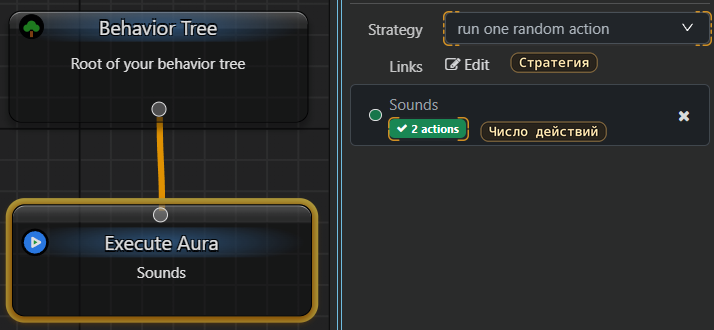

# Услышать, какой вариант выбран

Дерево играет Ping, если прошла основная проверка, а иначе Bell, если прошла запасная. Если не прошла ни одна, звука не будет. Результаты проверок вы здесь задаёте сами — так выбор понятен ещё до подключения настоящего датчика.

Нужны шаблоны Behavior Tree **Selector**, **Sequence**, **Fixed Status**, **Run Aura** и аудиовыход, который вы слышите. Создайте отдельный набор, где есть только звук. EyeAuras не должен быть на паузе.

## Подготовить два разных сигнала

1. Создайте **New Aura → Основной сигнал**. Добавьте **Triggers → Fixed Value → Is NOT Active**. В **On Enter** добавьте ровно один **Play Sound**: **Audio notification → Ping**, **Volume 50%**, **Play in background** выключен. Проверьте предпрослушивание. While Active, On Exit и Overlays оставьте пустыми.
2. Так же создайте **Запасной сигнал**, но выберите **Bell**. Обе ауры оставьте загруженными, включёнными и неактивными: их действия дерево вызывает отдельно.
3. Создайте **New Behavior Tree**, выберите **My Tree**, включите **Activation → Is Loaded** и задайте **Execution → When Activated → Do nothing**. Автоматическую активацию не добавляйте, повтор не запускайте.
4. Через **Add new Node** соберите схему ниже. У Selector две Sequence, основная слева. В каждой сначала проверка, затем Run Aura. Все узлы включены, у листьев детей нет.

```text
My Tree
└─ Selector
   ├─ Основная: Sequence
   │  ├─ Fixed Status: Failure
   │  └─ Run Aura: Основной сигнал, ordered, 1 action
   └─ Запасная: Sequence
      ├─ Fixed Status: Success
      └─ Run Aura: Запасной сигнал, ordered, 1 action
```

5. У каждого Fixed Status задайте показанное на схеме значение через **General → Status**. В каждом Run Aura откройте **General → Auras → Links**, укажите только его звуковую ауру, проверьте, что написано **1 action**, и выберите **Strategy → run 1-by-1 in order of addition**.

   

   На снимке у Sounds два действия. У вас каждый Run Aura должен показывать одно действие своей звуковой ауры — проверьте обе ветки отдельно.

## Менять доступную ветку

1. Нажмите верхнюю **Tick BT Once**. Основная проверка не проходит, её Ping пропускается. Запасная проходит, звучит Bell, Selector возвращает **Success**.
2. У основного Fixed Status выберите **Success** и повторите тик. Прозвучит Ping. Selector закончит выбор на этой успешной Sequence и Bell не вызовет.
3. Задайте обеим проверкам **Failure** и повторите тик: Selector вернёт **Failure**, звуков не будет. Чтобы снова получить первый результат, верните основной Failure, а запасной Success. Триггеры звуковых аур не переключайте — они должны оставаться неактивными.

| Выбор | Зачем нужен |
| --- | --- |
| Sequence вокруг проверки и сигнала | Если поставить проверку прямо под Selector, её успех закончил бы выбор раньше отдельного сигнала |
| Порядок слева направо | От него зависит, какой подходящий вариант окажется первым |
| Ручной тик после терминального результата | Начинает ещё один проход, поэтому звук может повториться |

[Selector](/ru/behavior-trees/nodes/selector) после Failure пробует следующего ребёнка. [Sequence](/ru/behavior-trees/nodes/sequence) при Failure останавливается, не дойдя до сигнала. [Fixed Status](/ru/behavior-trees/nodes/fixed-status) возвращает результат, который вы задали. [Run Aura](/ru/behavior-trees/nodes/execute-aura) вызывает готовые списки действий и не меняет активность их аур.

Если ветка вернула Running, на следующем тике Selector продолжит её же. Он не переключится сам, даже если более ранний вариант изменился. Уже выполненное не откатывается. Позже проверку можно заменить на [Aura Is Active](/ru/behavior-trees/nodes/aura-is-active) без ребёнка: явно выберите свою проверенную ауру и ожидаемое состояние. Unknown и ошибки — это не обычный отказ основного варианта. В этом ручном опыте нет источника игровых данных и нет защёлки, которая пускает сигнал только один раз.
