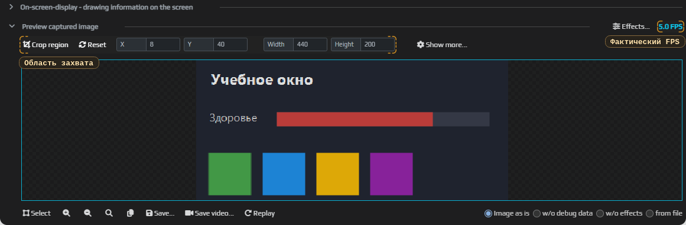

# Сохранить смысл половины заполнения при другом размере

Есть две полоски разного размера, и для каждой нужна памятка, когда она заполнена примерно наполовину. Для этого полоску превращают в чёрно-белую маску и смотрят на её средний цвет.

Что подготовить:

- Шесть PNG в своём графическом редакторе: полоски **200 × 20** и **400 × 40** пикселей, каждая в трёх вариантах — пустая, половинная и полная.
- Пустые пиксели — чистый чёрный **RGB(0,0,0)**, заполненные — однородный зелёный **RGB(0,204,0)**. В половинных картинках зелёная ровно левая половина.
- Без текста, рамок, скруглений, градиента и сглаживания.
- Два своих окна просмотрщика, которые легко различить: в одном маленькая полоска, в другом большая, масштаб 100%. В каждом окне три картинки должны переключаться так, чтобы полоска не сдвигалась.
- Работающий захват и Color Search с **Color Replacement - HSV Range**.

## Захватить всю полоску и получить бинарную маску

1. Создайте **New Aura → Малая полоска** только с **Color Search**. В **Capture settings → Target Window** выберите просмотрщик малой полоски и задайте **Image Capture Rate = 5**. В **Preview captured image** убедитесь, что видна нужная текущая картинка. Если кадр чёрный, старый или от чужого окна, сначала выберите правильный источник.
2. В **Crop region → X/Y/Width/Height** оставьте ровно всю внутреннюю область малой полоски: и заполненную, и пустую часть, без просмотрщика и рамок. Кадр должен получиться 200 × 20. Для всех трёх состояний область одна и та же. Координаты считаются от исходного изображения, а не от рабочего стола.

   
3. Откройте **Effects... → Add → Color Replacement - HSV Range**. Это должен быть единственный эффект, на всей обрезанной области: без изменения размера, размытия и других преобразований. Задайте диапазоны, границы включены: **H 55–65**, **S 200–255**, **V 150–255**. Включите **оба** флажка замены: совпавший цвет — белый **RGB(255,255,255)**, несовпавший — чёрный **RGB(0,0,0)**. **Invert**, если он показан, выключите. Шкала H в редакторе — 0–180, S и V — 0–255.
4. В **Image as is** проверьте результат: зелёная часть стала точно белой, пустая чёрная осталась чёрной. Сравните с **w/o effects** и вернитесь на Image as is. Если в маске есть серый, другой цвет или лишнее содержимое, исправьте источник, диапазон или область, а потом уже измеряйте долю.
5. Настройте Color Search по таблице. В Target Color задайте белый вручную. **Не** копируйте в образец средний цвет наполовину заполненного кадра.

| Настройка | Значение |
| --- | --- |
| Comparison Granularity | Aggregate Average Color of Entire Area |
| Comparison Method | Mathematical |
| Target Color | Белый, #FFFFFF |
| Match Threshold → включён Min | Min 45%, Max 55%, включая границы |

6. Создайте отдельную ауру **Большая полоска** с Color Search и настройте её так же для второго просмотрщика. Область — вся полоска 400 × 40, замена и сравнение те же. Проверьте, что две ауры не смотрят случайно в одно окно.

## Сравнить известные состояния до показа ответа

1. В обоих просмотрщиках откройте пустые картинки: маска должна быть чёрной, Similarity около 0%. Откройте половинные — примерно 50%. Откройте полные — около 100%. При равной доле сходство у малой и большой полоски должно быть близким, хотя белых пикселей у них разное количество. Средний цвет округляется до байта, поэтому половинный результат может немного сдвинуться.
2. Только после этой проверки добавьте каждой ауре **Text**: **Content** `Малая полоска около половины` или `Большая полоска около половины`, **Font 24**, **Size to fit** выключен. Оставьте Overlay, разместите тексты в разных прямоугольниках и включите **Locked**. Действия оставьте пустыми. Чтобы увидеть обычную видимость, выберите другой объект и выйдите из редактора.
3. На половинных полосках, в диапазоне 45–55%, должны быть видны обе памятки. На пустых и полных они скрыты. Верните обе половинные картинки — памятки должны появиться снова. Если при смене картинки полоска сдвинулась, исправьте область и заново проверьте все три состояния.

[Effects](/ru/triggers/images/effects) делает точную двухцветную маску, [Color Search](/ru/triggers/images/color-search) сравнивает её средний цвет с белым, а [Text](/ru/overlays/text) показывает сообщение, которое вы ввели сами.

У такой идеальной маски средний цвет приближается к белому пропорционально доле белых пикселей. Это перестаёт работать, если картинка другая, цвета смешаны, есть поля или свечение, изображение пересчитано по размеру или область захватывает то больше, то меньше. Не расширяйте порог только для того, чтобы скрыть неудачную проверку.

Если захват недоступен, вместо подтверждённо пустой полоски может получиться Unknown. Проверьте захват по [руководству](/ru/triggers/images/imagecapturetriggers).
