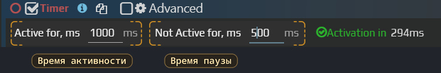

# Сопоставить импульс с сообщениями о состоянии

Аура примерно секунду показывает текст **Импульс активен**, потом примерно на секунду его скрывает. Вы сравните это с записями о состоянии той же ауры в журнале. А если ауру отключить и включить снова, будет видно, что начинается новый цикл, а не продолжается старая фаза.

Создайте отдельную ауру только для показа. EyeAuras не должен стоять на паузе. Внешнее окно, скрипт и действия не нужны. **Оба** срока Timer оставьте одинаковыми.

## Подготовить показ и сбор событий

1. Создайте **New Aura → Проверка импульса**. Добавьте только **Triggers → Timer**. Задайте **Active for = 1000**, **Not Active for = 1000**, единицы **ms**. Инверсию и дополнительные задержки активации и деактивации выключите. Списки действий оставьте пустыми.

   
2. В **Overlays** добавьте **Text**: **Content** `Импульс активен`, **Font 24**, **Size to fit** выключен. Оставьте **Window → Mode → Overlay**. Разблокируйте оверлей, разместите прямоугольник так, чтобы текст читался, и включите **Locked**. На время наблюдения выберите другую ауру, иначе предпросмотр редактора будет удерживать текст на экране.
3. Кнопкой **Show event log** откройте **Event Viewer** до того, как запустите новый цикл. Покажите фильтры, включите **Auras**, задайте **Level → Info**, очистите текстовый фильтр и снимите панель с паузы. Не сворачивайте её.
4. Отключите Проверку импульса переключателем ауры и включите снова. Новый цикл начинается с Inactive: сначала текст скрыт, примерно через секунду появляется, ещё примерно через секунду скрывается, и так по кругу.
5. В текстовый фильтр Event Viewer введите `Aura state changed to`. Найдите записи с **контекстом** Проверки импульса и сравните их время с тем, что видели на экране. Сообщение говорит об итоговом состоянии ауры, а не об отдельном действии Timer. Тот же текст могут писать и другие ауры, поэтому без контекста одного сообщения мало.

| Наблюдение | Что означает |
| --- | --- |
| Сначала неактивная пауза, затем Text то виден, то скрыт | Timer с равными сроками управляет обычной видимостью |
| Записи переходов Проверки импульса | Модель ауры сообщила о своих переходах |
| Триггер отключён или состояние недоступно/null | Работа остановлена или недоступна. Это не ещё одна обычная фаза Inactive |
| Повторное включение | Новая неактивная пауза, а не остаток старой фазы |

Снова отключите ауру: текст должен перестать появляться. Если остался предпросмотр, выберите другой объект и выйдите из редактора. Чтобы начать новый цикл, включите ауру.

Полный повтор занимает около двух секунд плюс затраты планировщика. Изменение длительности тоже перезапускает цикл. Значения меньше 100 мс поднимаются до этого минимума, а ноль фазу не выключает.

[Timer](/ru/triggers/timer) даёт условие, [Text](/ru/overlays/text) и [общие параметры](/ru/overlays/common-options) делают его видимым, а в [Event Viewer](/ru/features/event-viewer) видны переходы, о которых сообщила аура.

Текстовый фильтр ищет по сообщению, а не по имени контекста. Панель хранит только 250 принятых записей и пропускает события, пока она на паузе, свёрнута или категория выключена. Если истории нет, очистите фильтры и повторите с открытой панелью.

[Wait](/ru/behavior-trees/nodes/wait) для этого не подходит: он задержал бы один маршрут дерева, а не создал периодический импульс ауры.
